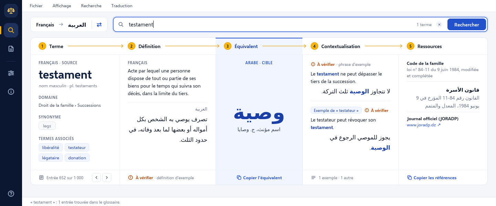
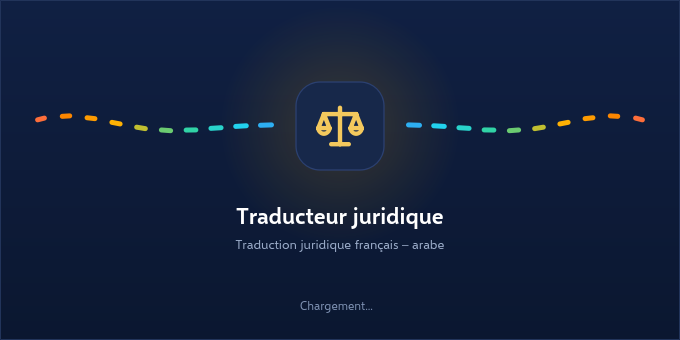
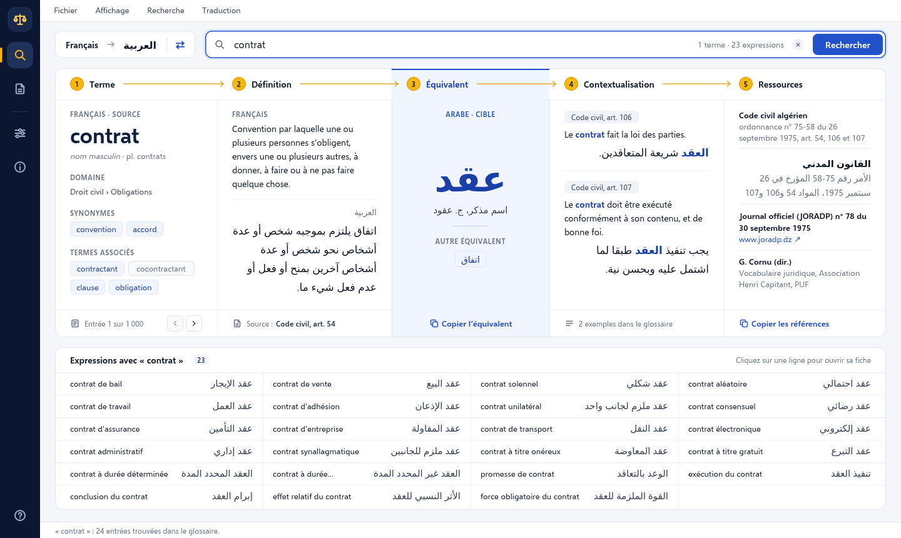
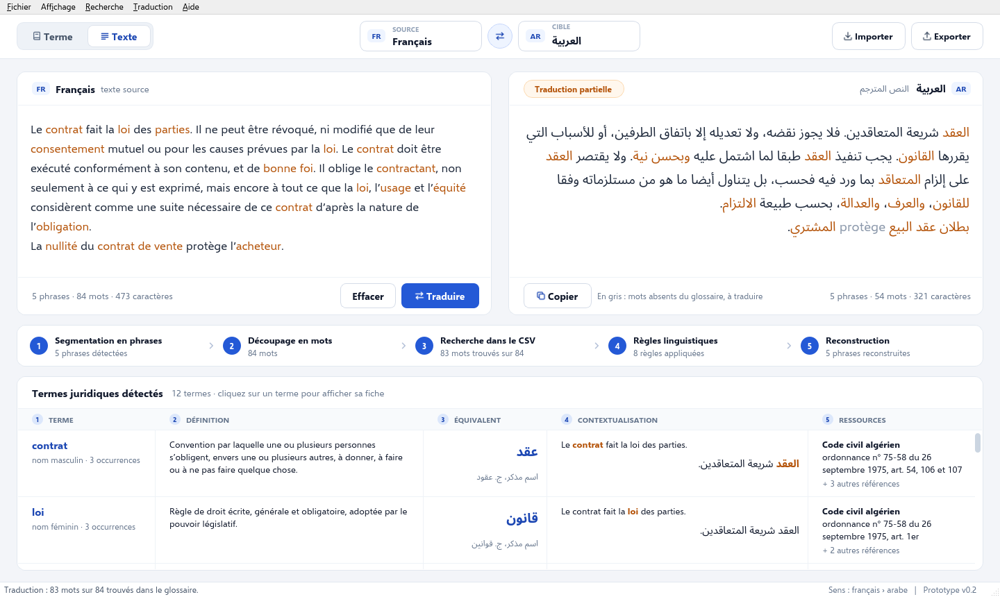
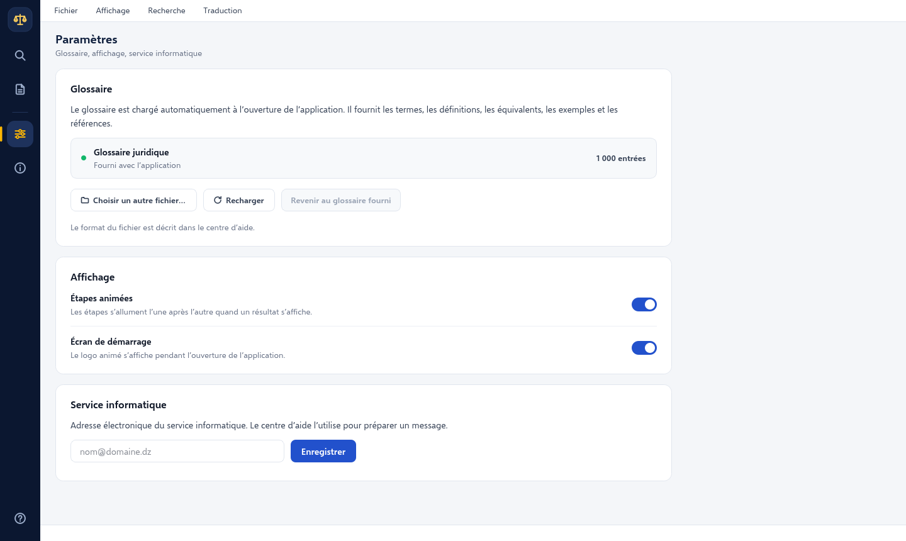
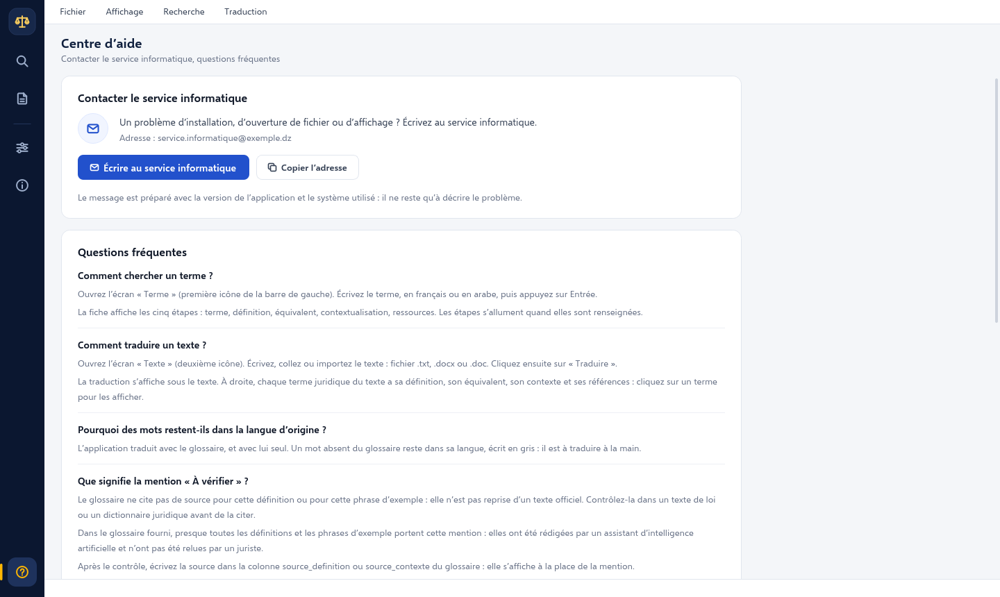
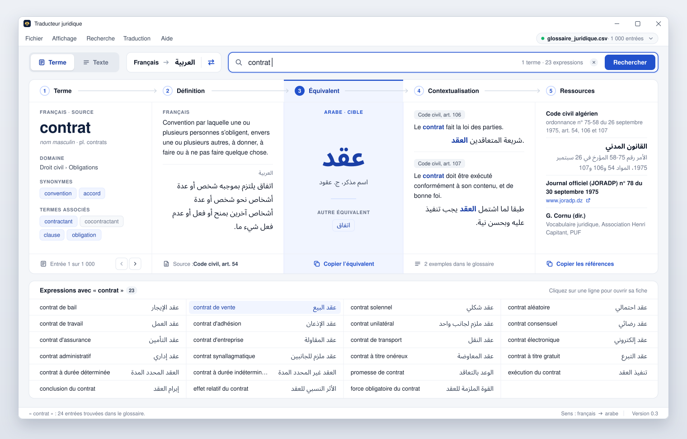
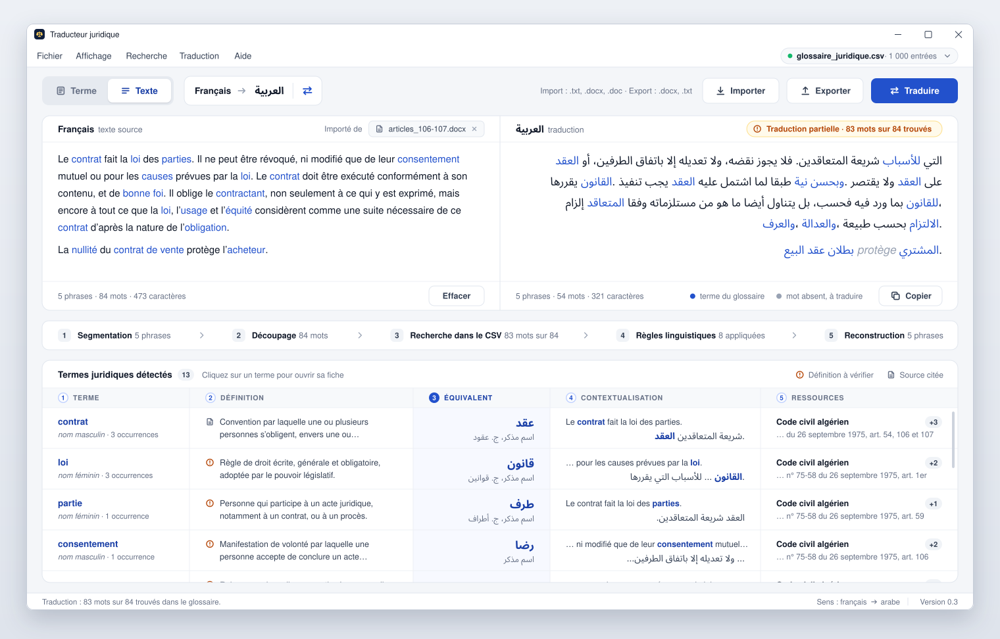
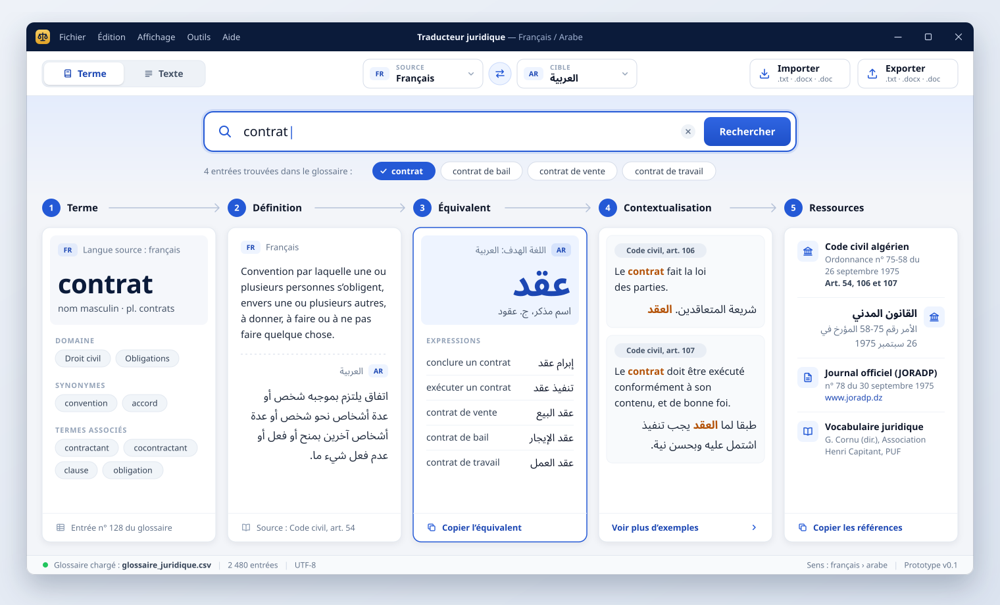
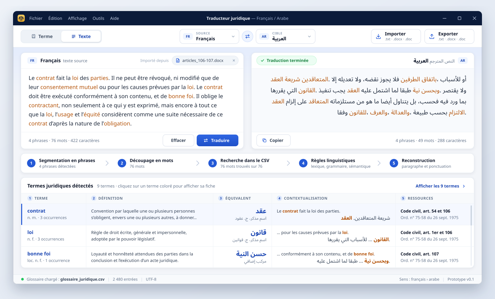

# La-traduction-juridique-assiste-par-l-ia-entre-gain-de-producutivite-et-risques-d-inexactitude

Prototype d'une application de bureau de traduction juridique **français ⇄ arabe**, « à la
Reverso ». Pour chaque terme, elle suit l'enchaînement :

**① Terme → ② Définition → ③ Équivalent → ④ Contextualisation → ⑤ Ressources**

Le dépôt contient l'application (Python et PySide6) et les dessins qui l'ont préparée : la
[proposition d'interface](#la-proposition-dinterface) et la
[première maquette](#maquette-de-lapplication-de-bureau).

## L'application (version 0.5)

La version 0.5 remplit le champ ④ **Contextualisation** pour tout le glossaire fourni :

- **chacune des 1 000 entrées a sa phrase d'exemple**, en français et en arabe. Dans la
  version 0.4, 31 entrées seulement en avaient une ;
- 969 de ces phrases ont été **rédigées par un assistant d'intelligence artificielle**. Ce ne
  sont pas des citations de textes officiels, et aucun juriste ne les a relues. L'application
  les signale par la mention **À vérifier**. Les 31 autres entrées citent le Code civil, avec
  le numéro de l'article ;
- quand le champ ④ est complété par une phrase d'une autre entrée, une phrase qui cite sa
  source passe avant une phrase à vérifier.



Le détail est dans [Le glossaire d'exemple](#le-glossaire-dexemple).

La version 0.5.1 simplifie l'**écran de démarrage** : il ne montre plus que le logo et les
tirets, sur un fond d'une seule couleur. Le nom de l'application, la mention « Chargement… »,
le dégradé, la lueur et la bordure sont retirés.

Le reste de la présentation est celui de la version 0.4. Cette version comprenait la
version 0.3, qui n'a pas été publiée à part. Elle avait apporté ceci :

- la **fiche d'un terme** suit la [proposition d'interface](#la-proposition-dinterface) : les
  cinq champs côte à côte dans une seule fiche, l'équivalent au centre, les autres résultats
  listés sous la fiche ;
- un **écran de démarrage** animé s'affiche pendant l'ouverture ;
- une **barre latérale** sombre, à gauche, donne accès aux cinq écrans : « Terme », « Texte »,
  « Paramètres », « Description de la plateforme » et « Centre d'aide » ;
- les **étapes** de l'enchaînement s'allument en doré, l'une après l'autre, quand un résultat
  s'affiche ;
- le **glossaire est chargé automatiquement** à l'ouverture : il n'y a plus de bouton pour
  l'ouvrir. Le nom du fichier, son encodage et le numéro de version ne sont plus écrits dans la
  fenêtre. Seul un fichier choisi par l'utilisateur est nommé, dans « Paramètres » ;
- sur l'écran « Texte », le texte et sa traduction sont **à gauche**, les informations sur les
  termes **à droite**, avec toutes les références écrites en entier ;
- le champ ④ cherche des phrases dans tout le glossaire, et plus seulement dans la ligne du
  terme ;
- le menu « Aide » est remplacé par le **Centre d'aide**, qui prépare un message pour le
  service informatique.

La lecture du glossaire, la recherche d'un terme et la traduction d'un texte sont celles de la
version 0.2.

**Écran de démarrage** — le logo, entre deux rangées de tirets qui ondulent et changent de
couleur, sur un fond uni :



**Écran « Terme »** — recherche d'un terme dans le glossaire :



**Écran « Texte »** — traduction d'un texte à l'aide du glossaire :



**Écran « Paramètres »** :



**Centre d'aide** :



*Captures produites sous Linux, sans écran. L'aspect des caractères peut changer d'un système à
l'autre. L'adresse affichée dans le centre d'aide est un exemple. Les captures des écrans
« Terme », « Texte » et « Paramètres » datent de la version 0.4 : ces écrans s'affichent de la
même façon depuis.*

### Ce qui est fait, ce qui reste à faire

| Fonctionnalité | État |
| --- | --- |
| Lecture du glossaire CSV, chargé à l'ouverture de l'application | Fait |
| Écran « Terme » : barre de recherche et fiche à cinq champs côte à côte | Fait, dans les deux sens (français → arabe et arabe → français) |
| Écran « Texte » : zones de texte, segmentation en phrases, découpage en mots, recherche de chaque mot dans le CSV, règles lexicales, grammaticales et sémantiques, reconstruction du paragraphe | Fait, dans les deux sens. La traduction se limite au contenu du glossaire : voir [Comment le texte est traduit](#comment-le-texte-est-traduit). |
| Import de fichiers `.txt`, `.docx`, `.doc` | Fait |
| Export de la traduction en `.docx` ou `.txt` | Fait. L'export au format `.doc` n'est pas proposé ; Word ouvre les fichiers `.docx`. |
| Écran de démarrage, barre latérale, étapes qui s'allument, écrans « Paramètres », « Description de la plateforme » et « Centre d'aide » | Fait (version 0.4). Rien de cela n'a été essayé sous Windows : voir les [limites connues](#limites-connues). |
| Contextes cherchés dans tout le glossaire | Fait. |
| Une phrase d'exemple pour chaque entrée du glossaire fourni | Fait (version 0.5) : 1 000 entrées sur 1 000. 969 phrases sont rédigées par un assistant d'intelligence artificielle et **restent à vérifier par un juriste** : voir [Le glossaire d'exemple](#le-glossaire-dexemple). |
| Message au service informatique | Fait : l'application prépare le message, le logiciel de messagerie de l'ordinateur l'envoie. L'adresse du service est à saisir dans « Paramètres ». |
| Fichier `.exe` pour Windows | À faire |

### Installation

Il faut **Python 3.10 ou plus récent**.

Sous Windows, si la commande `python` répond « Python was not found », Python n'est pas encore
installé sur l'ordinateur :

1. Installer le **Python Install Manager** depuis le
   [Microsoft Store](https://apps.microsoft.com/detail/9NQ7512CXL7T) (bouton « Installer »). Il
   est aussi proposé sur [python.org](https://www.python.org/downloads/).
2. Ouvrir un nouveau terminal. À la première utilisation de la commande `python`, la dernière
   version de Python est téléchargée et installée automatiquement.

Dans VS Code, ouvrir le dossier du projet, puis un terminal (menu *Terminal → Nouveau terminal*) :

```
python -m pip install -r requirements.txt
```

Cette commande télécharge PySide6, soit environ 85 Mo sous Windows. Si la commande `python`
n'est toujours pas reconnue, écrire `py` à la place.

### Lancement

```
python main.py
```

Ou, dans VS Code : ouvrir `main.py`, puis cliquer sur ▶ (« Exécuter le fichier Python »).

L'écran de démarrage s'affiche environ deux secondes, puis la fenêtre s'ouvre. Un clic sur
l'écran de démarrage le ferme dès que la fenêtre est prête. Il se désactive dans « Paramètres ».

Le glossaire fourni est chargé automatiquement. Si un autre glossaire a été choisi dans
« Paramètres », c'est lui qui est repris. Pour ouvrir l'application avec un glossaire précis :
`python main.py chemin/vers/mon_glossaire.csv`.

### Mise à jour

Pour récupérer la dernière version du dépôt, dans le terminal de VS Code :

```
git pull origin main
python -m pip install -r requirements.txt
python main.py
```

### La barre latérale

La barre sombre, à gauche de la fenêtre, contient une icône par écran. L'icône de l'écran
affiché est dorée. Laisser le pointeur sur une icône affiche le nom de l'écran.

| Icône | Écran | Raccourci |
| --- | --- | --- |
| Loupe | **Terme** : chercher un terme dans le glossaire | Ctrl+1 |
| Feuille | **Texte** : traduire un texte | Ctrl+2 |
| Curseurs | **Paramètres** : glossaire, affichage, adresse du service informatique | Ctrl+3 |
| « i » | **Description de la plateforme** : ce que fait l'application, et comment | Ctrl+4 |
| « ? », en bas | **Centre d'aide** : contact du service informatique, questions fréquentes | F1 |

Les mêmes écrans sont dans le menu *Affichage*.

### Utiliser l'écran « Terme »

- Saisir un terme, en français ou en arabe, puis appuyer sur Entrée ou cliquer sur
  **Rechercher**. Pendant la saisie, une liste propose les termes du glossaire qui contiennent
  les lettres tapées. Si le terme est écrit dans l'autre langue, le sens de traduction
  s'inverse tout seul. Le bouton ⇄ l'inverse à la main.
- La **fiche** du terme réunit les cinq champs, côte à côte. L'équivalent est au centre, sur
  fond bleu.
- En haut de la fiche, les **cinq étapes s'allument en doré**, l'une après l'autre. Une étape
  reste grise quand le glossaire n'a rien pour ce champ.
- La barre de recherche indique ce qui a été trouvé (« 1 terme · 23 expressions »). Les autres
  entrées trouvées sont listées **sous la fiche**. Un clic sur une ligne ouvre sa fiche.
- Un terme qui a plusieurs sens (« action » : « دعوى » ou « سهم ») a un onglet par sens, en
  haut de la fiche.
- Dans la fiche, une puce écrite en bleu (synonyme, terme associé, autre équivalent) est une
  autre entrée du glossaire : un clic l'ouvre. Les deux flèches placées en bas du champ ①
  ouvrent l'entrée précédente et l'entrée suivante du glossaire.
- **Copier l'équivalent** et **Copier les références** placent le texte dans le
  presse-papiers. Dans le champ ⑤, un clic sur l'adresse d'un site l'ouvre dans le navigateur.
- Si rien n'est trouvé, l'application propose les termes dont l'écriture est proche.

**Le champ ④ Contextualisation.** Il affiche d'abord les exemples écrits dans la ligne du terme
(colonnes `contexte_fr` et `contexte_ar`). S'il y en a moins de deux, l'application cherche dans
tout le glossaire d'autres phrases qui emploient le terme : les exemples et les définitions des
autres entrées. Une phrase n'est retenue que si elle contient le terme en français **et** son
équivalent en arabe. Parmi les exemples des autres entrées, ceux qui ne sont pas « à vérifier »
passent d'abord. Une étiquette dit d'où vient la phrase, par exemple *Exemple de « testateur »*
ou *Définition de « acheteur »* ; un clic sur cette étiquette ouvre l'entrée en question.

Au-dessus de chaque phrase, le champ ④ écrit sa source (« Code civil, art. 106 »), ou la
mention **À vérifier** quand le glossaire ne la reprend d'aucun texte.

**Les cinq champs sont remplis avec le contenu du glossaire, et rien d'autre.** Un terme qui
n'est pas dans le glossaire n'a pas de fiche. Quand le glossaire n'a ni définition, ni phrase, ni
ressource pour un terme, le champ correspondant le dit et son étape reste grise. Pour compléter
le glossaire : voir [Corriger le glossaire](#corriger-le-glossaire).

**La mention « À vérifier ».** Elle est écrite en orange, à côté d'un point d'exclamation.

- Dans le champ ②, elle signale une définition sans source : la colonne `source_definition`
  est vide, ou commence par « à vérifier ». C'est le cas de 993 des 1 000 définitions du
  glossaire fourni.
- Dans le champ ④, elle signale une phrase d'exemple dont la colonne `source_contexte`
  commence par « à vérifier » : c'est le cas de 969 des 1 002 phrases d'exemple du glossaire
  fourni. Elle signale aussi une définition sans source, quand cette définition sert de
  contexte à un autre terme. Une phrase d'exemple dont la colonne `source_contexte` est vide
  s'affiche sans source et sans mention.
- Après le contrôle d'une définition ou d'une phrase, écrire sa source dans le glossaire
  (« Code de la famille, art. 4 ») : la source s'affiche à la place de la mention.

La recherche ne tient pas compte des majuscules, des accents, d'un article placé devant le terme
(« le contrat », « العقد »), des signes diacritiques arabes ni des variantes d'écriture de la
hamza, du ta marbuta et de l'alif maqsura. Le pluriel est reconnu s'il figure dans le glossaire.

### Utiliser l'écran « Texte »

À gauche, de haut en bas : le texte, les cinq étapes du traitement, la traduction. À droite :
les informations sur les termes juridiques du texte.

1. Cliquer sur l'icône **Texte** de la barre latérale (ou Ctrl+2). Les boutons **Importer**,
   **Exporter** et **Traduire** s'affichent en haut à droite.
2. Écrire ou coller le texte dans la zone du haut. **Importer** ouvre un fichier `.txt`,
   `.docx` ou `.doc`. Le lien *Insérer un exemple* place un texte d'essai.
3. Cliquer sur **Traduire** (ou Ctrl+Entrée). Un fichier importé est traduit tout de suite. Si
   le texte est écrit dans l'autre langue, le sens de traduction s'inverse tout seul.
4. La traduction s'affiche dans la zone du bas, sous le texte :
   - en bleu, les termes du glossaire (dans les deux zones) ;
   - en gris italique, les mots absents du glossaire : ils restent dans la langue source et
     sont à traduire à la main.
5. L'étiquette placée au-dessus de la traduction indique le résultat :
   - « Traduction terminée » (tous les mots ont été trouvés) ou « Traduction partielle », avec
     le nombre de mots trouvés (« 83 mots sur 84 trouvés ») ;
   - « Aucun mot trouvé dans le glossaire » ;
   - « Texte modifié » quand le texte source a changé depuis la dernière traduction.
6. Entre les deux zones, les cinq étapes du traitement s'allument en doré et donnent chacune
   leur résultat (« 83 / 84 » pour la recherche). Laisser le pointeur sur une étape affiche le
   détail : règles appliquées, mots non trouvés, phrases reprises d'un exemple du glossaire.
7. À droite, le panneau « Termes juridiques détectés » contient **une carte par terme** du
   glossaire relevé dans le texte. La première carte est ouverte.
   - Un clic sur l'en-tête d'une carte l'ouvre ou la referme. **Tout développer** ouvre toutes
     les cartes.
   - Un clic sur un terme écrit en bleu, dans le texte ou dans la traduction, ouvre sa carte.
   - Une carte ouverte suit l'enchaînement : ① le terme, sa catégorie et son nombre
     d'occurrences ; ② sa définition dans les deux langues, avec sa source ou la mention
     « À vérifier » ; ③ son équivalent ; ④ la phrase du texte où il figure et sa traduction,
     puis jusqu'à deux phrases du glossaire, avec leur source ou la mention « À vérifier » ;
     ⑤ **toutes** ses références, écrites en entier.
   - Quand le contexte n'a pas permis de choisir entre deux sens d'un terme, sa carte le
     signale en orange.
   - Le lien *Ouvrir la fiche du terme* affiche le terme sur l'écran « Terme ».
8. **Copier** place la traduction dans le presse-papiers. **Exporter** l'enregistre dans un
   fichier `.docx` ou `.txt`. **Effacer** vide les deux zones.

Chaque écran garde son propre sens de traduction.

### Paramètres, description de la plateforme, centre d'aide

**Paramètres**

- *Glossaire* : le glossaire chargé (« Glossaire juridique » pour le glossaire fourni, le nom
  du fichier pour un autre) et son nombre d'entrées.
  - **Choisir un autre fichier…** charge un autre fichier CSV. L'application le rouvrira au
    prochain lancement.
  - **Recharger** relit le fichier après une modification.
  - **Revenir au glossaire fourni** reprend `donnees/glossaire_juridique.csv`.
- *Affichage* : deux interrupteurs, l'un pour les étapes animées, l'autre pour l'écran de
  démarrage.
- *Service informatique* : l'adresse électronique du service informatique. **Elle est vide à
  l'installation.** Il faut la saisir une fois, puis cliquer sur **Enregistrer**.

**Description de la plateforme** — ce que fait l'application, les cinq étapes de
l'enchaînement, les deux écrans de travail, la façon dont un texte est traduit, et ce qu'il faut
savoir avant de se fier à une traduction.

**Centre d'aide**

- **Écrire au service informatique** ouvre le logiciel de messagerie de l'ordinateur sur un
  message déjà adressé. Le message indique la version de l'application, le système et le
  glossaire utilisés : il reste à décrire le problème. L'application n'envoie rien elle-même.
- Si aucun logiciel de messagerie ne répond, l'adresse est copiée dans le presse-papiers, pour
  écrire depuis une autre messagerie. **Copier l'adresse** la copie directement.
- Tant que l'adresse n'est pas saisie, le bouton renvoie à « Paramètres ».
- Six questions fréquentes, puis la liste des raccourcis du clavier.

### Comment le texte est traduit

La traduction utilise **le glossaire CSV et lui seul** : ni dictionnaire général, ni service en
ligne, ni modèle d'intelligence artificielle. Elle suit cinq étapes :

1. **Segmentation** : le texte est découpé en phrases.
2. **Découpage** : chaque phrase est découpée en mots.
3. **Recherche dans le glossaire** : la phrase entière est cherchée parmi les exemples du glossaire,
   puis les expressions les plus longues (« contrat de vente »), puis les mots un par un.
4. **Règles linguistiques** :
   - lexique : expression de plusieurs mots, synonyme ramené au terme du glossaire ;
   - grammaire : pluriel, article défini ou indéfini, complément du nom (« la nullité du
     contrat » ↔ « بطلان العقد »), possessif et particules collées au mot arabe (و، ب، ل…) ;
     après « le », « la », « au », « du », « un », « son »…, un mot n'est pas lu comme un
     pluriel (« cours », dans « au cours de », n'est pas le pluriel de « cour ») ;
   - sémantique : quand une forme correspond à plusieurs entrées (« droit » : « حق » ou
     « قانون »), le choix se fait d'après les autres termes de la phrase et du texte.
5. **Reconstruction** : chaque phrase est récrite dans la langue cible, avec sa ponctuation.

Ce que cela donne :

- Une phrase identique à un exemple du glossaire (colonnes `contexte_fr` et `contexte_ar`) reçoit
  la traduction de cet exemple. Quand cet exemple porte la mention « à vérifier », la
  traduction n'est pas plus sûre que lui : l'étape 5 et l'étiquette de résultat l'indiquent
  quand on y laisse le pointeur (« dont 1 d'un exemple à vérifier »).
- Les autres phrases sont traduites mot à mot. Les termes du glossaire sont traduits ; les
  autres mots (verbes, mots grammaticaux, mots absents du CSV) restent dans la langue source, en
  gris italique. Exemple avec le glossaire fourni : « La nullité du contrat de vente protège
  l'acheteur. » donne « بطلان عقد البيع protège المشتري. ».
- L'ordre des mots n'est pas modifié. Les verbes ne sont pas conjugués et les adjectifs ne sont
  pas accordés.
- Dans un texte français écrit avec ses accents, les accents comptent : « cause » n'est pas
  « causé », ni « condamne » « condamné ». Une majuscule peut ne pas porter le sien (« Etat »).
  Un texte sans aucun accent est comparé sans les accents.
- Un mot courant qui s'écrit comme un terme du glossaire est traduit comme ce terme, même
  quand il a un autre sens : voir les [limites connues](#limites-connues).
- Une phrase où aucun terme n'est trouvé est recopiée telle quelle.
- Pour traduire davantage, il faut enrichir le CSV : termes, pluriels, synonymes, exemples.

Le résultat est une aide à la traduction. Il doit être complété et vérifié par le traducteur.

### Import et export

| Format | Import | Export |
| --- | --- | --- |
| `.txt` | Oui. L'encodage est reconnu (UTF-8, UTF-16, Windows-1256, Windows-1252). | Oui, en UTF-8. |
| `.docx` (Word) | Oui | Oui. Les paragraphes arabes sont écrits de droite à gauche. |
| `.doc` (Word 97 à 2003) | Oui | Non |

- Seul le texte du corps du document est lu : un paragraphe par ligne, les cellules d'un
  tableau séparées par des tabulations. La mise en forme, les images, les en-têtes, les pieds de
  page et les notes ne sont pas repris. Dans un fichier `.doc`, le texte des zones de texte
  (cadres flottants) est placé à la fin.
- Le format est reconnu d'après le contenu du fichier, pas d'après son nom. Certains sites et
  logiciels produisent des fichiers nommés `.doc` qui sont en réalité une page web (HTML) ou un
  fichier XML de Word 2003 : leur texte est lu, sans les balises. Un fichier `.txt` est
  toujours lu tel quel.
- Un fichier Word protégé par un mot de passe, créé avant Word 97 ou endommagé est refusé, avec
  un message qui en donne la raison.
- Les fichiers PDF et RTF ne sont pas lus : le message d'erreur indique comment les convertir.
- Le nom proposé pour l'export est celui du fichier importé suivi de `_traduction`. Le fichier
  exporté contient le texte de la traduction, y compris les mots non traduits.

### Raccourcis

| Raccourci | Action |
| --- | --- |
| Ctrl+1, Ctrl+2 | Afficher l'écran « Terme », l'écran « Texte » |
| Ctrl+3, Ctrl+4 | Afficher « Paramètres », « Description de la plateforme » |
| F1 | Afficher le centre d'aide |
| Ctrl+I | Inverser le sens de traduction |
| Ctrl+F | Aller à la barre de recherche |
| Ctrl+Entrée | Traduire le texte |
| Ctrl+Maj+C | Copier la traduction |
| Ctrl+Maj+O | Importer un texte |
| Ctrl+E | Exporter la traduction |
| Ctrl+O | Choisir un autre glossaire |
| F5 | Recharger le glossaire |
| Ctrl+Q | Quitter |
| Alt+F, Alt+I, Alt+R, Alt+T | Ouvrir le menu Fichier, Affichage, Recherche, Traduction |

### Le glossaire CSV

Une ligne par terme ; la première ligne donne le nom des colonnes. Seules les deux premières
colonnes du tableau sont obligatoires.

| Colonne | Écran « Terme » | Écran « Texte » |
| --- | --- | --- |
| `terme_fr`, `terme_ar` | ① Terme et ③ Équivalent, selon le sens de traduction | Mots et expressions cherchés dans le texte, et leur traduction |
| `categorie_fr`, `categorie_ar` | Catégorie grammaticale, sous le terme et sous l'équivalent | Si `categorie_fr` contient « masculin » ou « féminin », l'article français est écrit (« le », « la », « un », « une »). Si elle contient « pluriel » (« biens », « droits de l'homme »), le terme est traité comme un pluriel (« les », « des », « ses »). |
| `pluriel_fr`, `pluriel_ar` | Pluriel, sous le terme et sous l'équivalent ; il sert aussi à la recherche | Reconnaissance et écriture du pluriel |
| `domaine` | ① Terme, rubrique « Domaine » | — |
| `synonymes_fr`, `synonymes_ar` | Ceux de la langue source : ① Terme, rubrique « Synonymes ». Ceux de la langue cible : ③ Équivalent, rubrique « Autres équivalents ». Ils servent aussi à la recherche. | Un synonyme trouvé dans le texte est traduit comme le terme |
| `termes_associes` | ① Terme, rubrique « Termes associés » | Choix entre deux entrées de même forme |
| `definition_fr`, `definition_ar`, `source_definition` | ② Définition. Si `source_definition` est vide ou commence par « à vérifier », la définition porte la mention « À vérifier ». | ② dans la carte du terme, avec le même avertissement |
| `contexte_fr`, `contexte_ar`, `source_contexte` | ④ Contextualisation. Ces phrases servent aussi de contexte aux autres termes qu'elles emploient. Si `source_contexte` commence par « à vérifier », la phrase porte la mention « À vérifier ». | Une phrase du texte identique à un exemple reçoit la traduction de cet exemple. Dans la carte du terme : ④, après la phrase du texte, avec la même mention. |
| `ressources` | ⑤ Ressources | ⑤ dans la carte du terme : toutes les références, en entier |

- Dans une cellule, plusieurs valeurs se séparent par une barre verticale : `convention | accord`.
  Pour les exemples, le premier exemple français va avec le premier exemple arabe et la première
  source, et ainsi de suite.
- Depuis Excel : *Enregistrer sous → CSV UTF-8 (délimité par des virgules)*. Un classeur
  `.xlsx` n'est pas lu directement.
- Le séparateur (point-virgule, virgule ou tabulation) et l'encodage (UTF-8, UTF-16,
  Windows-1256, Windows-1252) sont reconnus automatiquement.
- D'autres noms de colonnes sont acceptés (« Français », « Arabe », « Définition »…). Un fichier
  sans ligne d'en-tête fonctionne aussi : la colonne arabe et la colonne française sont
  repérées d'après leur écriture.
- Les lignes sans terme français ou sans terme arabe sont ignorées. Leur nombre est indiqué
  quand on choisit le fichier dans « Paramètres ».
- La liste « Expressions avec… », sous la fiche, ne vient pas d'une colonne : ce sont les
  autres entrées du glossaire qui contiennent le terme (« contrat de vente » pour « contrat »).

Le rappel du format se trouve aussi dans l'application : centre d'aide, question « Comment
utiliser un autre glossaire ? ».

### Le glossaire d'exemple

`donnees/glossaire_juridique.csv` contient **1 000 entrées**, dans le vocabulaire du droit
algérien. Il sert à essayer l'application. **Son contenu n'a été relu ni par un juriste ni par
un traducteur** : il doit être vérifié avant tout usage, ou remplacé par le glossaire du projet.

Nombre d'entrées par domaine (premier domaine indiqué dans la colonne `domaine`) :

| Domaine | Entrées |
| --- | --- |
| Droit civil (personnes, obligations, responsabilité, preuve, contrats, biens, sûretés) | 257 |
| Procédure civile et voies d'exécution | 99 |
| Sources du droit et notions générales | 74 |
| Droit pénal | 71 |
| Droit administratif | 59 |
| Droit constitutionnel | 54 |
| Droit de la famille et successions | 54 |
| Organisation judiciaire | 49 |
| Droit commercial (sociétés, effets de commerce, entreprises en difficulté) | 49 |
| Procédure pénale | 47 |
| Droit international public et privé, droits de l'homme, arbitrage et médiation | 40 |
| Droit du travail et sécurité sociale | 37 |
| Autres : fiscal, finances publiques, douanes, foncier, banque, assurances, propriété intellectuelle, consommation, concurrence, numérique, environnement, urbanisme, nationalité, maritime | 110 |

#### Les 40 premières entrées

Ce sont les entrées de droit civil des premières versions. La version 0.5 a ajouté une phrase
d'exemple à neuf d'entre elles ; le reste n'a pas été modifié.

- **Extraits du Code civil algérien** (ordonnance n° 75-58 du 26 septembre 1975), en français
  et en arabe :
  - les définitions de « contrat » (art. 54), « vente » et « contrat de vente » (art. 351),
    « bail » et « contrat de bail » (art. 467) et « propriété » (art. 674) ;
  - les exemples de 31 entrées : articles 1er, 40, 55, 59, 102, 106, 107, 124, 188, 351 et
    467, et l'intitulé de l'ordonnance.

  Ces textes ont été relevés sur des sites web juridiques et n'ont pas été comparés au Journal
  officiel : ils sont à vérifier avant d'être cités. Les articles longs sont découpés en
  phrases, et le début des définitions est retiré (« Le contrat est une… »). Le texte arabe a
  reçu trois retouches : une hamza ajoutée à l'article 59 (« الإخلال »), le choix d'une des
  deux versions trouvées pour le début de l'article 124, et une virgule ajoutée dans
  l'intitulé de l'ordonnance.
- **Définitions d'exemple.** Les 34 autres définitions, en français et en arabe, ont été
  rédigées pour la démonstration. Elles ne viennent d'aucun dictionnaire juridique. La source
  affichée pour 33 d'entre elles est « à vérifier (définition d'exemple) » ; celle de
  « conclusion du contrat » est « D'après le Code civil, art. 59 ».
- **Autre contenu d'illustration.** Les couples de termes, les catégories grammaticales, les
  pluriels, les domaines, les synonymes, les termes associés et les ressources ont été rédigés
  pour la démonstration.
- Neuf de ces entrées n'avaient pas d'exemple à elles : « contrat de vente », « contrat de
  bail », « contrat de travail », « conclusion du contrat », « droit », « mauvaise foi »,
  « responsabilité », « article » et « Journal officiel ». Elles ont reçu une phrase rédigée
  par l'assistant, comme les 960 entrées suivantes. Ces neuf phrases sont écrites directement
  dans le fichier CSV.

#### Les 960 entrées suivantes

Les entrées n° 41 à 1 000 ont été **rédigées de mémoire par un assistant d'intelligence
artificielle**, sans dictionnaire juridique et sans relecture par un spécialiste. Tout leur
contenu est à vérifier.

- **Termes et équivalents.** Ce sont des noms et des groupes nominaux. Les équivalents suivent
  autant que possible le vocabulaire des textes algériens (« cour » : « مجلس قضائي »,
  « lettre de change » : « سفتجة », « wilaya » : « ولاية »). Un autre équivalent en usage est
  parfois donné comme synonyme (« كمبيالة »).
- **Définitions.** Elles sont courtes, dans les deux langues, et toutes portent la source
  « à vérifier (définition d'exemple) ». Quelques-unes suivent de près la formulation d'un
  code, écrite de mémoire (« droit de propriété », « mariage », « garde », « commerçant »…) :
  elles n'ont pas été comparées au texte officiel et ne doivent pas être citées comme telles.
- **Phrases d'exemple (version 0.5).** Chaque entrée a une phrase, en français et en arabe.
  Voir [Les phrases d'exemple](#les-phrases-dexemple).
- **Ressources.** Chaque entrée renvoie au texte principal de son domaine (code, loi,
  ordonnance ou convention internationale), sans numéro d'article, et le plus souvent au
  Journal officiel ([www.joradp.dz](https://www.joradp.dz)). Les références de six codes
  (civil, pénal, de commerce, de la famille, de procédure civile et administrative, de
  procédure pénale) correspondent à celles que donne le site du ministère de la Justice
  (droit.mjustice.gov.dz), d'après les extraits affichés par un moteur de recherche. Les
  autres références (numéros et dates des lois, des ordonnances et des numéros du Journal
  officiel) ont été écrites de mémoire. Aucune n'a été comparée au Journal officiel, et un
  texte a pu être modifié ou remplacé depuis.
- **Catégories, pluriels, synonymes, termes associés.** Rédigés de la même façon. Les termes
  associés d'une entrée sont ses voisins dans le glossaire.

#### Les phrases d'exemple

Le glossaire contient 1 002 phrases d'exemple : une par entrée, deux pour « contrat » et
« équité ».

- **33 phrases citent le Code civil**, dans 31 des 40 premières entrées. Leur source est le
  numéro de l'article, ou l'intitulé du code. Elles sont décrites plus haut.
- **969 phrases ont été rédigées par un assistant d'intelligence artificielle**, de mémoire,
  pour montrer l'emploi du terme. Leur source dans le glossaire est « à vérifier (phrase
  d'exemple) », et l'application affiche la mention **À vérifier**.
  - Chaque phrase est courte (122 caractères au plus en français), au présent, et emploie le
    terme en français et son équivalent en arabe. La phrase arabe traduit la phrase française
    avec les équivalents du glossaire.
  - Beaucoup de phrases énoncent une règle du droit algérien, parfois avec un chiffre : un
    délai, un âge, un montant, une durée (« La garde à vue ne peut dépasser quarante-huit
    heures. »). **Ces règles et ces chiffres ont été écrits de mémoire. Ils n'ont été comparés
    à aucun texte officiel**, et un texte a pu être modifié depuis. Une phrase peut aussi
    simplifier une règle qui a des exceptions.
  - Ce qui a été contrôlé par programme (script `construire.py`, tests) : le terme figure dans la phrase
    française et son équivalent dans la phrase arabe ; aucune phrase ne sert deux fois ; quand
    la phrase française emploie un autre terme du glossaire, la phrase arabe emploie son
    équivalent ou un de ses synonymes.
  - Ce qui n'a pas été fait : **aucun juriste et aucun traducteur n'a relu ces phrases.**
    L'assistant les a relues lui-même une fois. Cette relecture ne remplace pas celle d'un
    spécialiste.
- **Ce qu'affiche le champ ④.** 549 entrées affichent une phrase et 451 en affichent deux.
  Pour 449 entrées, la seconde phrase vient d'une autre entrée qui emploie le terme : 354 fois
  son exemple (16 citent le Code civil, 338 sont à vérifier) et 95 fois sa définition (toutes
  à vérifier).
- **Traduction d'un texte.** Une phrase du texte identique à un exemple reçoit la traduction de
  cet exemple. Les 969 phrases rédigées servent donc aussi de traductions toutes faites :
  l'application le signale (étape 5 et étiquette de résultat, au survol).
- Dans quatre citations du Code civil, le terme de l'entrée n'est pas mis en évidence dans une
  des deux langues, parce que l'article emploie un autre mot ou une autre forme : « exécution
  du contrat », « réparation » et « capacité » en français, « consentement » en arabe.

#### Dans tout le glossaire

- Le *Vocabulaire juridique* de G. Cornu est cité comme ouvrage à consulter (65 entrées) :
  aucune définition n'en est tirée.
- Quatre termes français et dix termes arabes désignent chacun deux entrées, par exemple
  « action » (« دعوى » ou « سهم »), « auteur » (« فاعل » ou « مؤلف »), « قرار » (« décision » ou
  « arrêt ») et « ولاية » (« wilaya » ou « tutelle »). L'écran « Terme » affiche un onglet pour
  chaque entrée. L'écran « Texte » choisit d'après le contexte et signale le terme quand il
  hésite.

#### Corriger le glossaire

Le plus simple est de modifier `donnees/glossaire_juridique.csv` dans un tableur ou un éditeur
de texte, puis de le recharger dans l'application : « Paramètres », bouton **Recharger** (ou
F5).

Pour corriger la phrase d'un terme, modifier les colonnes `contexte_fr` et `contexte_ar` de sa
ligne. La phrase française doit contenir le terme, et la phrase arabe son équivalent. Une fois
la phrase vérifiée, remplacer « à vérifier (phrase d'exemple) » par sa source dans la colonne
`source_contexte` (par exemple « Code de la famille, art. 4 ») : la mention « À vérifier »
disparaît de l'application.

Le dossier `outils/glossaire/` garde ce qui a servi à écrire les entrées n° 41 à 1 000 :

- `lots/` : les entrées, une par ligne (19 fichiers texte, un par domaine) ;
- `exemples/` : les phrases d'exemple, une par ligne, dans un fichier du même nom que le lot :
  `terme français | phrase française | phrase arabe` ;
- `construire.py` : le script qui vérifie ces fichiers et les assemble.

```
python outils/glossaire/construire.py               vérifie les lots et les exemples, sans rien écrire ;
                                                    dit si le fichier CSV leur correspond
python outils/glossaire/construire.py --ecrire      récrit le fichier CSV
python outils/glossaire/construire.py --manquants   liste les entrées qui n'ont pas de phrase d'exemple
python outils/glossaire/construire.py --coherence   liste les phrases à relire (voir ci-dessous)
```

Le script refuse une phrase d'exemple qui ne contient pas le terme dans les deux langues, qui
sert déjà à une autre entrée, qui dépasse 170 caractères ou qui ne finit pas par un point.
L'option `--coherence` liste les phrases où un autre terme du glossaire figure en français
sans que son équivalent figure en arabe : ce n'est pas toujours une erreur, chaque phrase
listée est à relire.

**Attention :** ce script garde les 40 premières entrées du CSV et récrit toutes les
suivantes à partir des lots et des exemples. Une correction faite à la main dans le CSV après
la 40e entrée est donc perdue si on le relance. Il faut choisir : corriger le CSV et ne plus
utiliser le script, ou corriger les lots et les exemples et relancer le script. Le format des
fichiers est décrit au début de `construire.py`.

### Organisation du code

```
main.py                      lance l'application
requirements.txt             bibliothèques nécessaires
donnees/
  glossaire_juridique.csv    glossaire d'exemple (1 000 entrées)
traducteur/
  langues.py                 comparaison des mots : accents, variantes d'écriture de l'arabe
  glossaire.py               lecture du CSV et recherche des termes
  contextes.py               phrases du glossaire qui emploient un terme (champ ④)
  surlignage.py              repérage du terme dans une phrase
  segmentation.py            découpage d'un texte en phrases, puis en mots
  traduction.py              traduction d'un texte : recherche, règles, reconstruction
  documents.py               import et export des fichiers .txt, .docx et .doc
  application.py             démarrage de l'application
  interface/
    demarrage.py             écran de démarrage animé
    fenetre.py               fenêtre : barre latérale, menus, barre d'outils, chargement du glossaire
    navigation.py            barre latérale
    recherche.py             écran « Terme » : barre de recherche, accueil, terme introuvable
    fiche.py                 fiche d'un terme (les cinq champs) et liste placée sous la fiche
    texte.py                 écran « Texte » : zones de texte, bande des étapes
    termes.py                écran « Texte » : cartes des termes détectés
    pages.py                 écrans « Paramètres », « Description de la plateforme », « Centre d'aide »
    animation.py             allumage progressif des étapes
    boites.py                fenêtres de message (glossaire chargé, erreurs)
    composants.py            éléments communs : étiquettes, puces, panneaux, dispositions
    dessin.py                écriture des textes dessinés (listes, en-têtes) : abréger, couper
    theme.py                 couleurs et feuille de style
    icones.py                icônes
outils/
  glossaire/                 construction du glossaire d'exemple : script, lots de termes, phrases d'exemple
  maquette/                  script qui dessine la proposition d'interface
tests/                       tests automatiques
  donnees/                   petit glossaire de 40 entrées réservé aux tests
docs/                        captures d'écran
maquette/                    première maquette SVG des deux écrans (version 0.1)
  proposition/               proposition d'interface (version 0.3)
```

Les modules placés directement dans `traducteur/` n'utilisent pas l'interface graphique, sauf
`application.py`. La lecture et l'écriture des fichiers Word n'utilisent aucune bibliothèque
supplémentaire.

### Tests

```
python -m pip install -r requirements-dev.txt
python -m pytest
```

Les 439 tests s'exécutent sans ouvrir de fenêtre. La plupart utilisent un petit glossaire de
40 entrées (`tests/donnees/glossaire_essai.csv`), pour que leurs résultats ne dépendent pas du
contenu du glossaire fourni. Les tests de `tests/test_glossaire_fourni.py` portent sur ce
dernier : ils contiennent des nombres (1 000 entrées, 24 résultats pour « contrat ») à mettre
à jour quand il est enrichi.

Ces tests demandent que chaque entrée du glossaire fourni ait une phrase d'exemple, et que
chaque phrase ait une source ou la mention « à vérifier ». Ils ne comptent pas les phrases « à
vérifier » : écrire la source d'une phrase dans le fichier CSV ne les fait pas échouer. Une
phrase qui garde la mention doit contenir le terme en français et son équivalent en arabe.

Les tests de `tests/test_outil_glossaire.py` lancent le script
`outils/glossaire/construire.py` sur des copies des fichiers : il doit accepter les lots et
les phrases d'exemple fournis, et refuser une phrase d'exemple mal écrite.

Les tests de l'interface vérifient ce que chaque écran affiche et ce que fait chaque commande.
Ils ne vérifient pas l'aspect : celui-ci a été contrôlé à l'œil, sur des captures (voir les
[limites connues](#limites-connues)).

### Limites connues

- **Systèmes essayés.** Les tests ont été exécutés sous Linux, sans écran, avec Python 3.11
  (PySide6 6.7 et 6.11) et Python 3.15 (PySide6 6.12). Aucun test n'a été exécuté sous Windows ni
  sous macOS. Depuis la version 0.5, ils n'ont été exécutés qu'avec Python 3.11 et PySide6 6.11.
  Les captures de cette page ont été produites sans écran. **Les versions 0.4 et 0.5 n'ont pas
  été essayées sur un écran réel** : l'écran de démarrage (fenêtre sans bordure et sans ombre,
  animation), la barre latérale et l'allumage des étapes sont à contrôler sous Windows.
- **PySide6 6.12 avec Python 3.11.** Avec ces deux versions, l'application se ferme brutalement
  après quelques milliers d'opérations (« Fatal Python error: none_dealloc »). `requirements.txt`
  installe donc une version antérieure de PySide6 avec Python 3.10 et 3.11 (Python 3.10 n'a pas
  été essayé : c'est une précaution). Si l'application détecte ce défaut au lancement, elle
  affiche un avertissement. Le défaut ne s'est pas produit avec Python 3.15.
- **Traduction d'un texte.** Elle se limite au glossaire : voir
  [Comment le texte est traduit](#comment-le-texte-est-traduit). En particulier :
  - un mot conjugué ou décliné n'est reconnu que si cette forme figure dans le glossaire, ou si
    elle s'en déduit par une règle simple (pluriel français en « s », « x » ou « aux » ;
    article, particule et terminaisons courantes en arabe) ;
  - quand le pluriel arabe d'un terme n'est pas connu, le terme reste au singulier ;
  - sans genre dans la colonne `categorie_fr`, l'article français n'est pas écrit devant une
    consonne ;
  - quand le contexte ne permet pas de choisir entre deux entrées de même forme, la première
    entrée du glossaire est retenue et la carte du terme le signale comme ambigu. Un choix fait
    d'après le contexte peut aussi être faux : la carte indique alors l'autre sens.
- **Un mot courant peut être pris pour un terme.** L'application ne connaît que l'écriture des
  mots. Elle ne distingue pas un terme juridique d'un verbe ou d'un mot ordinaire qui s'écrit
  de la même façon. Exemples avec le glossaire fourni :
  - « celui qui cause un dommage » : le verbe « cause » est traduit par « سبب » ;
  - « en tout état de cause » : « état » est traduit par « دولة » et « cause » par « سبب » ;
  - « la mise en œuvre » : « œuvre » est traduit par « مصنف » ;
  - « en cours d'examen » : « cours » est lu comme le pluriel de « cour » ;
  - « من أجل » (pour) : « أجل » est traduit par « délai » ; « عدة أشخاص » (plusieurs
    personnes) : « عدة » est traduit par « retraite légale » ;
  - « دفع المشتري الثمن » (l'acheteur a payé le prix) : le verbe « دفع » est lu comme le nom
    « paiement ».

  Plus le glossaire est riche, plus ces confusions sont fréquentes. L'étiquette « Traduction
  terminée » signifie seulement que tous les mots ont été trouvés dans le glossaire : elle
  s'affiche aussi pour les deux derniers exemples. Chaque terme traduit est écrit en bleu et a
  sa carte dans le panneau de droite : ils sont à vérifier un par un.
- **Texte long.** Avec le glossaire fourni, sur la machine d'essai (Linux, sans écran), un
  texte de 2 000 mots est traduit et affiché en une demi-seconde environ, un texte de
  13 000 mots en deux secondes environ. **Tout développer** est plus lent, parce qu'il
  construit toutes les cartes : deux à trois secondes pour 115 termes, huit secondes pour
  380 termes. La fenêtre ne répond pas pendant ce temps ; le pointeur d'attente s'affiche.
  Quand des centaines de cartes sont ouvertes, changer la taille de la fenêtre est lent aussi.
- **Fichiers `.doc`.** Le lecteur a été essayé sur 471 fichiers d'exemple des projets Apache POI
  et LibreOffice : 362 sont lus (dont 47 sans texte dans le corps du document) et 109 sont
  refusés avec un message (fichiers d'avant Word 97, protégés, endommagés ou d'un autre type).
  Il a aussi été essayé sur 12 000 copies abîmées de fichiers `.doc` et `.docx`. Aucun de ces
  essais n'a arrêté la lecture brutalement. Pour les 11 documents fournis aussi au format
  `.docx`, le texte lu est le même dans les deux formats. Des documents en russe, en chinois et
  en hébreu sont lus correctement.
- **Fichiers `.doc` en arabe.** Cinq fichiers réels ont été essayés. Ce sont des pages web ou des
  fichiers XML de Word 2003 enregistrés sous le nom `.doc` : le texte de leur corps est lu en
  entier. Aucun fichier arabe au format binaire de Word 97 à 2003 n'a pu être essayé : ce cas
  n'est vérifié que par un fichier construit pour les tests.
- **Recherche d'un terme.** Les suggestions affichées pendant la saisie tiennent compte des
  accents ; la recherche lancée avec Entrée, non.
- **Phrases d'exemple du glossaire fourni.** 969 phrases sur 1 002 ont été rédigées par un
  assistant d'intelligence artificielle et n'ont été relues par aucun juriste. Elles peuvent
  contenir une erreur de droit, un chiffre faux ou périmé, ou une tournure arabe maladroite.
  L'application les marque « À vérifier » ; elle ne les vérifie pas. Voir
  [Les phrases d'exemple](#les-phrases-dexemple).
- **Contextes cherchés dans le glossaire.** Une phrase d'une autre entrée est retenue quand
  elle contient le terme en français et son équivalent en arabe. Cela écarte les autres sens
  d'un mot, mais ne prouve pas que la phrase illustre bien le terme : elle a été écrite pour
  un autre terme, ou c'est la définition d'un autre terme.
- **Mention « À vérifier » dans une colonne étroite.** Sur la fiche, quand la place manque à
  côté de l'étiquette *Exemple de « … »*, la mention se réduit à son point d'exclamation
  orange ; le texte s'affiche quand on y laisse le pointeur.
- **Message au service informatique.** L'application demande au système d'ouvrir le logiciel
  de messagerie de l'ordinateur ; elle n'envoie rien elle-même. Cela n'a été essayé avec aucun
  logiciel de messagerie. Si le système répond qu'il ne peut pas ouvrir le message, l'adresse
  est copiée dans le presse-papiers. L'adresse du service n'est pas connue de l'application :
  elle est vide tant qu'elle n'a pas été saisie dans « Paramètres ».
- **Contenu.** Les équivalents, les définitions et les exemples affichés sont ceux du glossaire
  chargé. L'application ne les vérifie pas. Ceux du glossaire fourni sont à vérifier : voir
  [Le glossaire d'exemple](#le-glossaire-dexemple).
- **Petite fenêtre.** À la taille minimale (900 × 560), la fiche d'un terme est plus large que
  la fenêtre : une barre de défilement horizontale donne accès au champ ⑤. Sur l'écran
  « Texte », chaque zone de texte n'affiche que trois lignes, et la bande des étapes ne garde
  que les numéros et les résultats ; il faut faire défiler.

## La proposition d'interface

Ce sont cinq dessins au format SVG, faits avant la version 0.3 pour corriger les défauts de la
version 0.2. **Ce ne sont pas des captures de l'application.** La version 0.3 les a suivis. La
version 0.4 s'en écarte sur les points suivants :

- le choix de l'écran passe de la barre du haut à la barre latérale ;
- le nom du glossaire n'est plus affiché en haut à droite : le glossaire se choisit dans
  « Paramètres » ;
- sur l'écran « Texte », la traduction est sous le texte, et le tableau du bas est remplacé
  par des cartes, à droite ;
- les étapes renseignées sont dorées ;
- la barre d'état n'affiche plus le sens de traduction ;
- un champ vide ne nomme plus les colonnes du CSV à remplir : le centre d'aide les donne.

L'application actuelle est celle des captures du début de cette page.

Les fichiers sont dans `maquette/proposition/`.

### Écran « Terme »



Les cinq champs de l'enchaînement sont réunis dans une seule fiche. L'équivalent est au centre.
Les autres entrées du glossaire qui contiennent le terme sont listées sous la fiche.

### Écran « Texte »



Dans les deux zones, les termes du glossaire sont en bleu. Le mot absent du glossaire reste en
français, en gris italique. Le tableau du bas reprend les cinq champs pour chaque terme trouvé.

### Trois autres cas de l'écran « Terme »

| Fichier | Ce qu'il montre |
| --- | --- |
| [`03-terme-deux-sens.svg`](maquette/proposition/03-terme-deux-sens.svg) | Le cas le plus courant : la définition porte la mention « À vérifier » et le glossaire ne donne pas d'exemple. Ici, le terme (« action ») a en plus deux sens. |
| [`04-terme-accueil.svg`](maquette/proposition/04-terme-accueil.svg) | L'écran à l'ouverture de l'application, avant toute recherche. |
| [`05-terme-introuvable.svg`](maquette/proposition/05-terme-introuvable.svg) | Le terme cherché n'est pas dans le glossaire. |

### Défauts relevés dans la version 0.2 et correction proposée

Les défauts ont été relevés sur des captures de l'application faites sous Linux, à trois tailles de
fenêtre (1440 × 860, 1080 × 620 et 900 × 560). Sous Windows, l'aspect des caractères peut différer.

| Défaut relevé | Proposition |
| --- | --- |
| À l'ouverture, cinq grandes boîtes presque vides. | Un seul panneau : rappel de l'enchaînement, invitation à chercher, cinq exemples. |
| Trois barres empilées en haut de la fenêtre. Le sens de traduction est loin de la barre de recherche. | Les menus, puis une seule barre : choix de l'écran, sens de traduction, recherche. |
| Le bouton en haut à droite change d'un écran à l'autre (« Ouvrir un glossaire… », ou « Importer » et « Exporter »). | Le glossaire chargé est toujours indiqué en haut à droite. « Importer », « Exporter » et « Traduire » sont dans la barre de l'écran « Texte ». |
| Les puces de résultats occupent une à trois lignes et repoussent les champs vers le bas. Au-delà de huit résultats, il faut préciser la recherche. | Toutes les autres entrées trouvées sont listées sous la fiche, sur des lignes régulières. |
| Les mêmes expressions figurent deux fois : en puces sous la recherche et dans le champ ③. | Une seule liste, sous la fiche. |
| Champ ③ : la liste des expressions est coupée par le pied du champ ; il faut la faire défiler. | Le champ ③ ne contient plus que l'équivalent, sa catégorie, son pluriel et ses autres équivalents. |
| Cinq cartes séparées, de même hauteur : certaines sont à moitié vides, une autre déborde. | Une seule fiche à cinq colonnes. La colonne ③, au centre, est mise en avant. |
| La source de la définition est coupée : « à vérifier (définition d'exem… ». | La mention « À vérifier » s'affiche en entier, en orange, avec un signe. |
| Champ ④ sans exemple (969 entrées sur 1 000) : une phrase grise en haut d'une grande boîte vide. | Un message centré, qui dit quelles colonnes du CSV remplir. |
| Les lignes arabes sont plus espacées que les lignes françaises. Dans les expressions, l'arabe est écrit plus bas que le français. | Interlignes réguliers. Le français et l'arabe d'une même ligne sont alignés. |
| Ressources : icône à gauche pour une référence française, à droite pour une référence arabe. | Une liste simple, sans icône ; les références arabes sont alignées à droite. |
| Terme à deux sens : deux puces (« action (دعوى) », « action (سهم) ») mêlées aux autres résultats. | Un onglet par sens en haut de la fiche, et un avertissement. |
| Terme introuvable : le message est une ligne grise sous la recherche ; les cinq boîtes vides restent affichées. | Un panneau avec le message et les termes proches. |
| Écran « Texte » : dans un texte juridique, la plupart des mots sont écrits en orange. | Les termes sont en bleu. L'orange est réservé aux avertissements. |
| L'étiquette d'état de la traduction passe à gauche ou à droite selon la langue. | Elle reste à droite et donne le nombre de mots trouvés. |
| Tableau des termes : une ou deux rangées visibles ; les termes longs sont coupés. | Rangées de deux lignes : quatre rangées visibles. Un signe indique si la définition est à vérifier. |
| Barre d'état : nom du fichier, nombre d'entrées, encodage, « Prototype ». | Un message court et le sens de traduction. |
| Petite fenêtre (1080 × 620 et moins) : champs illisibles, une barre de défilement par champ. | **Non dessiné.** À traiter au moment de programmer. |

### Ce que la proposition change dans l'usage

Par rapport à la version 0.2 :

- Les puces de résultats disparaissent. Le nombre de résultats s'affiche dans la barre de
  recherche ; les autres entrées trouvées sont sous la fiche.
- Les expressions quittent le champ ③. À leur place, le champ affiche les autres équivalents
  (colonne des synonymes de la langue cible), que la version 0.2 ne montre pas dans ce champ.
- Un terme à plusieurs sens s'ouvre avec un onglet par sens.
- Deux boutons, dans le pied du champ ①, ouvrent l'entrée précédente et l'entrée suivante du
  glossaire.
- Le bouton « Traduire » passe de la zone du texte source à la barre d'outils.
- L'étiquette « Traduction terminée » ou « partielle » donne aussi le nombre de mots trouvés.
- Dans le tableau, la colonne ④ choisit, quand c'est possible, un passage du texte dont la
  traduction contient l'équivalent.
- Un clic sur le nom du glossaire, en haut à droite, sert à ouvrir un autre glossaire ou à le
  recharger.

### Ce qui n'est pas dessiné

- le sens arabe → français ;
- l'écran « Texte » avant la traduction ;
- les petites fenêtres ;
- les boîtes de dialogue (aide, format du glossaire, à propos).

### Contenu des dessins

Le contenu vient du glossaire fourni et de l'application : entrées « contrat » et « action », texte
d'exemple de l'écran « Texte », sa traduction et les termes relevés. Trois éléments sont donnés à
titre d'illustration : le nom du fichier importé, le numéro de version, et les passages de la
colonne ④ du tableau, choisis à la main.

Les dessins sont prévus pour la police Segoe UI de Windows. Ils ont été vérifiés dans Chromium avec
la police Selawik, de mêmes dimensions ; ils n'ont pas été vérifiés sous Windows.

Les cinq fichiers sont écrits par le script `outils/maquette/generer.py`. Ce script ne fait pas
partie de l'application.

## Maquette de l'application de bureau

Maquette SVG des deux écrans du prototype (version 0.1). Les deux écrans sont programmés (voir
[L'application](#lapplication-version-05)). L'application actuelle ne ressemble plus à cette
maquette : elle est gardée pour mémoire.

### Écran 1 — Recherche d'un terme



Le terme saisi dans la barre de recherche est cherché dans le glossaire CSV. Le résultat
s'affiche dans cinq champs placés côte à côte, un par élément de l'enchaînement.

### Écran 2 — Traduction d'un texte



Le paragraphe source est saisi, collé ou importé dans la zone de texte de gauche ; sa
traduction apparaît dans la zone de droite (écriture de droite à gauche pour l'arabe).
La bande centrale reprend les étapes de l'algorithme : segmentation en phrases, découpage
en mots, recherche de chaque mot dans le CSV, application des règles lexicales,
grammaticales et sémantiques, puis reconstruction du paragraphe. Le tableau du bas
applique l'enchaînement de l'écran 1 aux termes juridiques repérés dans le texte.

### Fonctionnalités demandées et emplacement dans la maquette

| Fonctionnalité | Emplacement |
| --- | --- |
| Champs horizontaux pour chaque élément de l'enchaînement | Écran 1 : les cinq cartes numérotées. Écran 2 : les cinq colonnes du tableau. |
| Import et export de fichiers `.txt`, `.docx`, `.doc` | Boutons **Importer** et **Exporter** de la barre d'outils (les deux écrans). Le fichier importé est rappelé dans l'en-tête de la zone source (écran 2). |
| Barre de recherche des mots | Écran 1, en haut, avec les entrées correspondantes du glossaire. |
| Zones de texte pour un paragraphe | Écran 2 : zone source et zone cible. |

Éléments communs aux deux écrans : le sélecteur **Terme / Texte**, le choix du sens de
traduction (le bouton ⇄ inverse français et arabe) et la barre d'état qui indique le
fichier CSV chargé.

### Points à valider

- **Structure du CSV.** L'application lit les colonnes décrites dans la section
  [Le glossaire CSV](#le-glossaire-csv). Il reste à confirmer que le glossaire du projet
  contient une définition, des exemples et des ressources pour chaque terme, et pas seulement
  le mot et sa traduction. Un fichier limité aux deux colonnes de termes est accepté : les
  champs ②, ④ et ⑤ restent alors vides.
- **Nom de l'application.** « Traducteur juridique » est un nom provisoire.
- **Cas non dessinés.** Le sens arabe → français et le cas d'un mot absent du CSV ne figurent
  pas dans la maquette. Ils sont programmés dans l'application : mêmes écrans avec les langues
  inversées, et proposition des termes proches quand rien n'est trouvé.

### Contenu d'exemple de la maquette

Les textes juridiques sont des extraits du Code civil algérien (ordonnance n° 75-58 du
26 septembre 1975), articles 54, 106 et 107, dans leurs versions française et arabe. Dans
le paragraphe arabe de l'écran 2, une virgule de l'article 106 est remplacée par un point
pour obtenir quatre phrases, comme en français.

Le reste est donné à titre d'illustration : nom et taille du glossaire, numéro d'entrée,
nom du document importé, définitions de « loi » et de « bonne foi », expressions,
synonymes et termes associés.

### Modifier la maquette

Les deux fichiers du dossier `maquette/` sont des SVG autonomes : ni image ni police
externe, et les textes restent des textes. Ils s'affichent dans un navigateur et se
modifient dans un éditeur de code ou un éditeur vectoriel (rendu non vérifié dans Inkscape
et Figma). Ils utilisent les polices du système (Segoe UI sous Windows), le rendu peut
donc varier légèrement d'un appareil à l'autre.
