# La-traduction-juridique-assiste-par-l-ia-entre-gain-de-producutivite-et-risques-d-inexactitude

Prototype d'une application de bureau de traduction juridique **français ⇄ arabe**, « à la
Reverso ». Pour chaque terme, elle suit l'enchaînement :

**① Terme → ② Définition → ③ Équivalent → ④ Contextualisation → ⑤ Ressources**

L'écran montre d'abord le terme et son équivalent. Les autres éléments s'ouvrent à la demande,
dans le menu « Plus de détails ».

Le dépôt contient l'application (Python et PySide6) et les dessins qui l'ont préparée : la
[proposition d'interface](#la-proposition-dinterface) et la
[première maquette](#maquette-de-lapplication-de-bureau).

## L'application (version 0.15)

La version 0.15 **complète les synonymes des 1 000 entrées complètes** du glossaire, en
français et en arabe. Avant elle, 132 de ces entrées avaient un synonyme. Maintenant, **462
en ont** : 223 en français, 358 en arabe.

- **550 synonymes de plus**, pour 381 entrées : 186 en français, 364 en arabe. Par exemple,
  « huissier de justice » (« محضر قضائي ») reçoit « huissier » en français, « مفوض قضائي » et
  « عدل منفذ » en arabe. « droit musulman » reçoit « charia », « acheteur » reçoit
  « acquéreur », « bail » reçoit « كراء », « garde à vue » reçoit « الحراسة النظرية ».
- **Ce que sont ces synonymes.** D'autres noms de la même chose (« détention préventive »
  pour « détention provisoire », « publicité mensongère » pour « publicité trompeuse »). Des
  formes plus courtes ou plus longues (« pourvoi » pour « pourvoi en cassation », « demande
  en justice » pour « demande »). 14 sigles (« OPJ », « PV », « APC », « CIJ »). Quelques mots
  latins (« pacta sunt servanda ») et quelques mots arabes écrits en lettres latines
  (« sadaq », « mahr »). En arabe, surtout des mots en usage dans d'autres pays arabes :
  « عقد الشغل » pour « عقد العمل », « كاتب عدل » pour « موثق », « رئيس الوزراء » pour
  « الوزير الأول ».
- **À quoi sert un synonyme.** Il s'affiche dans la fiche : dans le cercle « Synonymes »
  pour la langue du terme, sous l'équivalent pour l'autre langue (« Autres équivalents »).
  Sa recherche ouvre la fiche du terme. Et dans un texte à traduire, il est remplacé comme
  le terme : « L'huissier signifie le jugement à l'acquéreur. » donne maintenant « المحضر
  القضائي signifie الحكم à المشتري. » La version 0.14 laissait « huissier » et « acquéreur »
  en français.
- **Ces synonymes ont été écrits de mémoire par un assistant d'intelligence artificielle.
  Aucun juriste et aucun traducteur ne les a relus.** Beaucoup sont des mots de sens voisin,
  que le droit distingue parfois : un « extrait de naissance » n'est pas tout à fait un
  « acte de naissance », ni une « saisie-vente » une « saisie-exécution ». Le pays où un mot
  arabe est en usage n'a pas été vérifié. **Dans la fiche, rien ne signale que ces synonymes
  sont à vérifier** : pour une entrée complète, la mention « À vérifier » ne s'affiche que
  sous la définition et sous la phrase d'exemple.
- **97 synonymes ont été retirés avant la publication**, sur 646 écrits, et un a été ajouté
  à la place d'un autre. 48 étaient déjà le terme, le pluriel ou le synonyme d'une autre
  entrée. 49 ont été retirés après des essais de traduction et une relecture : par exemple
  « JO » et « AG » (deux lettres), « الجمارك » (« قانون الجمارك » devenait « la loi de
  l'administration des douanes »), « résolution du contrat » (les deux noms se traduisaient
  déjà un par un).
- **538 entrées complètes n'ont toujours aucun synonyme** : un synonyme n'a été écrit que là
  où un autre nom existe.
- **La traduction d'un texte change peu.** Un programme a traduit 20 004 textes avec le
  glossaire de la version 0.14, puis avec celui de la version 0.15 : toutes les définitions
  et toutes les phrases d'exemple, dans les deux langues, traduites mot à mot. 87
  traductions changent, chaque fois parce qu'un nouveau synonyme est reconnu : « huissier »
  dans 10 textes, « الأمم المتحدة » dans 8 (« l'Organisation des Nations Unies » ; la
  version 0.14 écrivait « les nations المتحدة »). Dans l'application, une phrase d'exemple
  reçoit la traduction écrite dans le glossaire : 66 traductions changent alors.
- **Une correction.** De l'arabe vers le français, l'application écrivait « le huissier de
  justice ». Elle écrit maintenant « l'huissier de justice ».
- **Ce qui reste à faire.** Faire relire les équivalents, les définitions, les phrases et
  les synonymes par un juriste et par un traducteur.

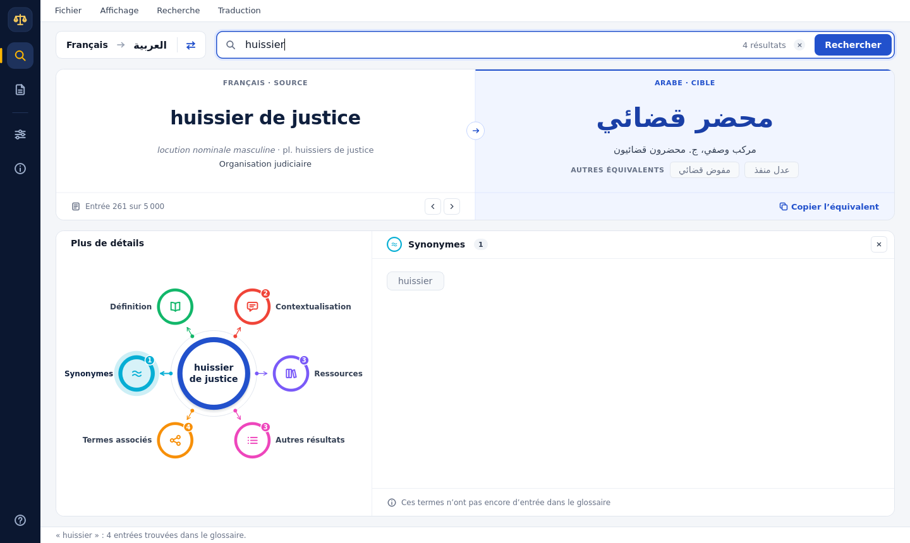

Le détail est dans [Les synonymes (version 0.15)](#les-synonymes-version-015).

La version 0.14 avait **donné leur phrase d'exemple aux 987 derniers termes seuls**. Ce sont
les noms de cinq groupes de domaines : fiscalité, finances publiques et douanes ; droit
international ; foncier, urbanisme et environnement ; propriété intellectuelle, consommation,
concurrence et numérique ; droit maritime, nationalité et condition des étrangers. Avant
elle, 887 de ces termes n'affichaient aucune phrase : leur cercle « Contextualisation » était
gris. Depuis, **les 5 000 entrées du glossaire ont une phrase d'exemple**, comme elles ont
une définition depuis la version 0.13.

- **987 phrases, en français et en arabe.** Une par terme, courte (111 caractères au plus en
  français), au présent. Par exemple, pour « diversité biologique » : « La forêt de cèdres
  abrite une riche diversité biologique. », « تؤوي غابة الأرز تنوعا بيولوجيا غنيا. ». Pour
  « pavillon du navire » : « Le pavillon du navire indique le pays dont il suit la loi. »,
  « تدل راية السفينة على البلد الذي تخضع لقانونه. ».
- **Ces phrases ont été écrites de mémoire par un assistant d'intelligence artificielle.
  Aucun juriste et aucun traducteur ne les a relues.** L'application les affiche sous la
  mention **À vérifier**. La plupart décrivent une scène (« La douane brûle la marchandise
  contrefaite. »). D'autres énoncent une règle de droit, et une vingtaine donnent un chiffre
  ou une date tirés d'un texte : une durée, un âge, l'année d'une loi. Ces règles et ces
  chiffres n'ont été comparés à aucun texte officiel.
- **Ce que l'application affiche depuis.** Le cercle « Contextualisation » est coloré pour
  chaque entrée. 3 294 entrées affichent une phrase, la leur. 1 706 affichent deux textes :
  pour 1 704, leur phrase, puis la phrase ou la définition d'une autre entrée qui emploie le
  terme ; « contrat » et « équité » ont deux phrases à eux.
- **La traduction d'un texte n'avait changé que pour ces phrases.** Une phrase d'un texte
  identique à un exemple du glossaire reçoit la traduction de cet exemple : c'est le cas des
  987 phrases, dans les deux langues. Un programme avait traduit 18 035 autres textes avec le
  glossaire de la version 0.13, puis avec celui de la version 0.14 : les traductions étaient
  identiques.
- Il restait alors à compléter les synonymes des 1 000 entrées complètes : la version 0.15
  l'a fait.

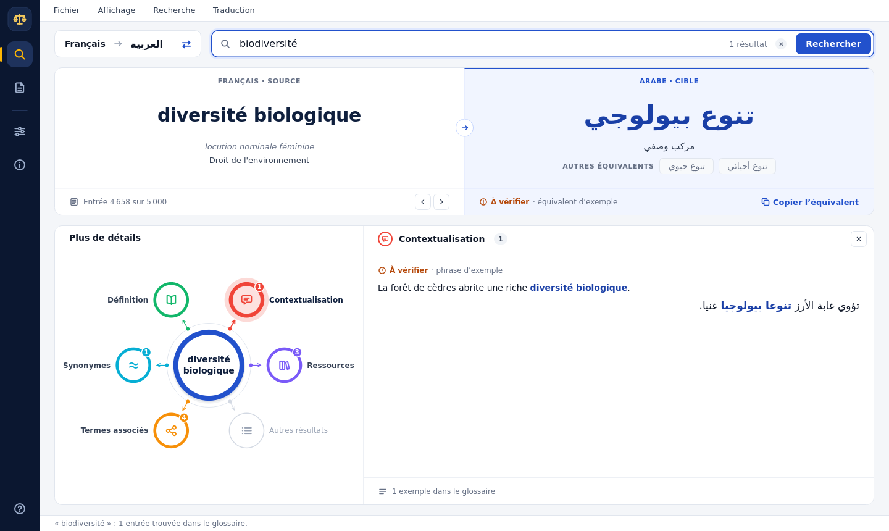

Le détail est dans [Les phrases d'exemple](#les-phrases-dexemple).

La version 0.13 avait **donné une définition à chacun des 4 000 termes seuls**, et des
synonymes à ceux qui en ont. Avant elle, aucun terme seul du glossaire fourni n'avait de
définition, et peu avaient des synonymes. C'était le cas de « protégé » : son cercle
« Définition » était gris. Depuis, les 5 000 entrées du glossaire ont une définition dans les
deux langues.

- **4 000 définitions, en français et en arabe.** 928 pour le vocabulaire juridique général
  (356 adjectifs, 246 verbes, 190 adverbes, prépositions et conjonctions, 136 noms), et 3 072
  pour les noms des treize domaines du droit. Par exemple, pour « protégé » : « Qui bénéficie
  d'une protection que la loi organise ou que le juge accorde. », « الذي يستفيد من حماية
  ينظمها القانون أو يمنحها القاضي. ». Pour « chèque barré » : « Chèque qui porte deux traits
  parallèles et ne peut être payé qu'à une banque. », « شيك عليه خطان متوازيان، لا يدفع إلا
  لبنك. ».
- **707 synonymes de plus**, pour 531 termes : 443 en français, 264 en arabe. « protégé »
  reçoit « préservé » et « sauvegardé » en français, « مصون » en arabe ; « diversité
  biologique » reçoit « biodiversité ». **3 338 termes seuls n'ont aucun synonyme** : un
  synonyme n'a été écrit que là où un autre mot dit la même chose. C'est rare pour les noms
  composés des domaines (« garantie décennale », « question écrite ») : 192 de ces 3 072
  noms en ont reçu.
- **Ces définitions et ces synonymes ont été écrits de mémoire par un assistant
  d'intelligence artificielle. Aucun juriste et aucun traducteur ne les a relus.**
  L'application affiche la définition sous la mention **À vérifier**. Une définition peut
  être incomplète ou fausse. Environ 70 définitions donnent un chiffre (un délai, un âge, une
  durée) : il a été écrit de mémoire, lui aussi. Les synonymes n'ont pas de mention à eux :
  celle de l'équivalent, dans la fiche, vaut pour toute l'entrée.
- Il restait alors 987 termes seuls sans phrase d'exemple : les noms des cinq derniers
  fichiers de termes. La version 0.14 la leur a donnée.
- La traduction d'un texte a peu changé. Elle ne remplace que les noms, et 267 des nouveaux
  synonymes sont ceux d'un nom : « prolongation » est maintenant rendu par « تمديد », comme
  « prorogation », et « biodiversité » par « تنوع بيولوجي », comme « diversité biologique ».

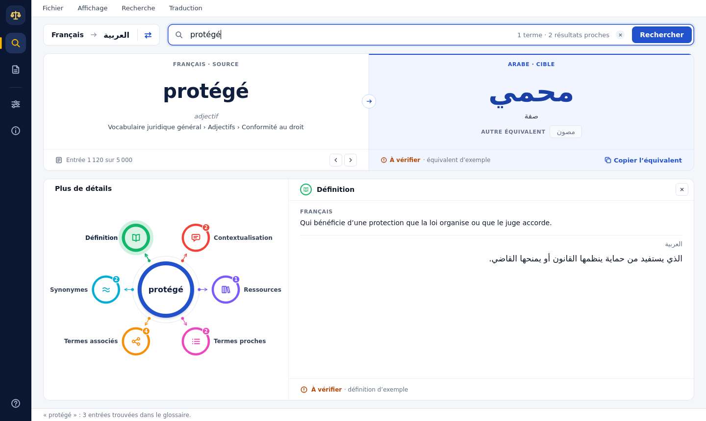

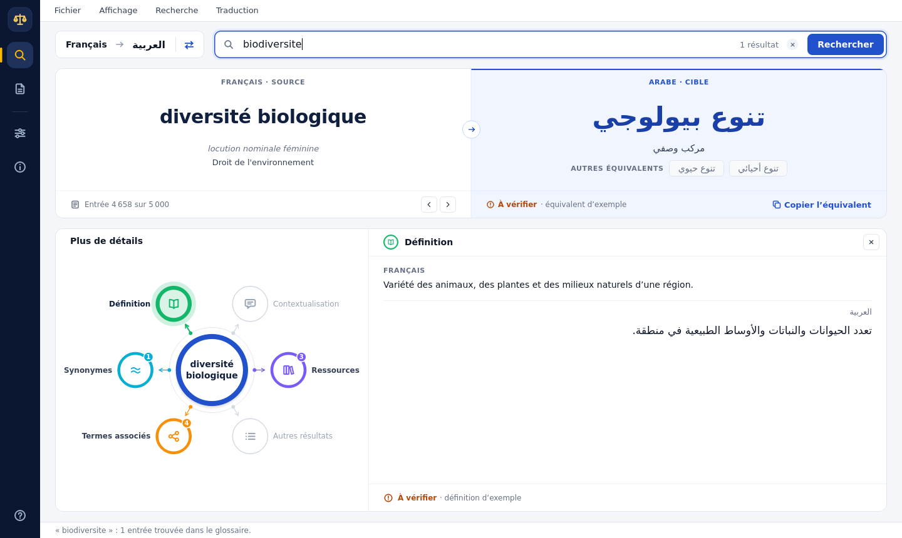

Le détail est dans [Les termes seuls](#les-termes-seuls).

La version 0.12 avait donné **une phrase d'exemple à 1 126 termes seuls de plus** : les noms
de cinq domaines (droit des affaires, droit constitutionnel, droit administratif, droit de la
famille, droit du travail). Par exemple, pour « chèque barré » : « Le chèque barré s'encaisse
par l'intermédiaire d'une banque. », « يحصل الشيك المسطر بواسطة بنك. ». Après elle, 3 013
termes seuls sur 4 000 avaient leur phrase. Il en restait 987 : ce sont ceux de la version
0.14. Ces phrases ont été écrites de mémoire par un assistant d'intelligence artificielle, et
personne ne les a relues : l'application les affiche sous la mention **À vérifier**.

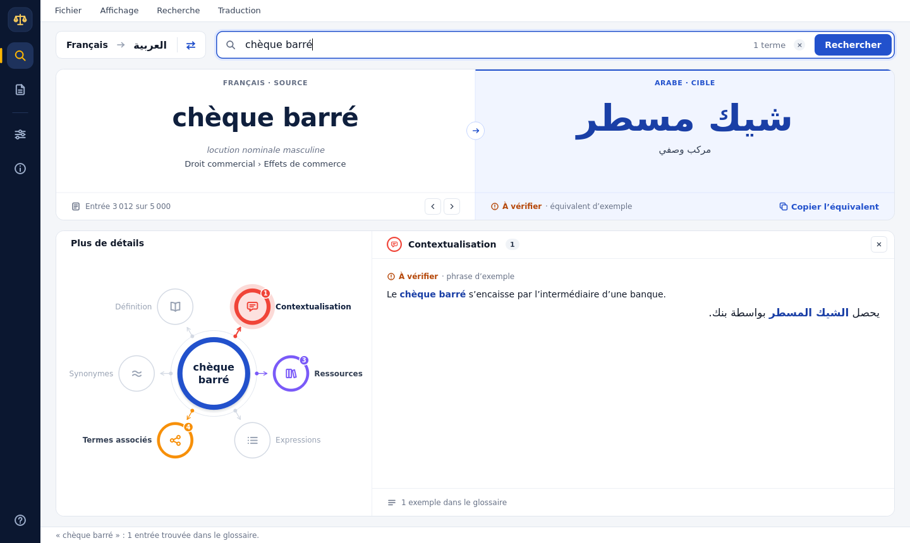

Le détail est dans [Les phrases d'exemple](#les-phrases-dexemple).

La version 0.11 avait donné leur phrase aux **1 887 premiers termes seuls** : tout le
vocabulaire juridique général (928 termes : 356 adjectifs, 246 verbes, 190 adverbes,
prépositions et conjonctions, 136 noms) et les noms de trois domaines (959 termes : droit
civil, justice et procédure, droit pénal). Avant elle, les termes seuls n'avaient pas de
phrase à eux : pour 3 690 d'entre eux, le cercle « Contextualisation » restait gris. Depuis
cette version, l'application met en évidence un adjectif accordé ou un verbe conjugué :
« protégées » pour « protégé », « a abrogé » pour « abroger », « ألغت » pour « ألغى ». Les
phrases montrent le verbe au passé dans les deux langues, parce que le glossaire écrit le
verbe arabe au passé.

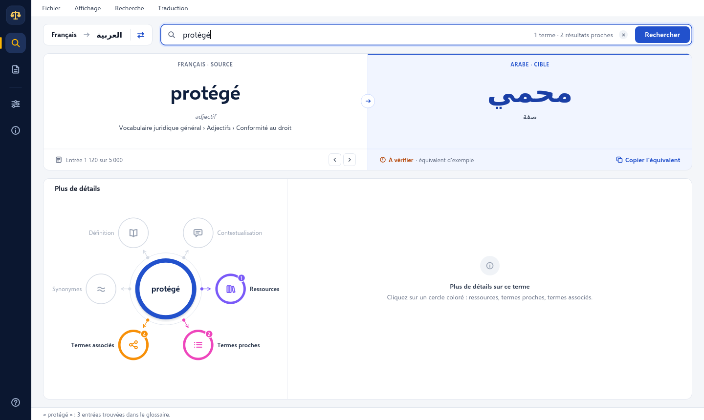

La version 0.10 avait **allégé les deux écrans de travail**. Ils affichaient trop de choses à la
fois : cinq colonnes sur l'écran « Terme » ; le texte, la bande des étapes, la traduction et
une carte par terme sur l'écran « Texte ».

- **Écran « Terme » : deux colonnes.** La fiche montre le terme à gauche et son équivalent à
  droite. Le reste est rangé dans le menu **Plus de détails**, sous la fiche : le terme au
  centre et, autour de lui, six cercles — Définition, Contextualisation, Ressources,
  Expressions, Termes associés, Synonymes. Un clic sur un cercle affiche son contenu à droite
  des cercles. Un cercle gris signale que le glossaire n'a rien pour ce terme.
- **Écran « Texte » : le texte, sa traduction, les termes.** Le texte est à gauche, sa
  traduction à droite. Dessous, la liste des termes juridiques du texte : une case par terme,
  avec son équivalent.
- **Un clic sur un terme ouvre sa fiche.** Sur l'écran « Texte », un clic sur une case de la
  liste, ou sur un terme écrit en bleu dans l'un des deux textes, affiche ce terme sur l'écran
  « Terme ». Le bouton **Retour au texte** ramène au texte, qui n'a pas changé.
- Les cinq étapes du traitement d'un texte ne sont plus affichées en permanence. Un clic sur
  l'état de la traduction (« Traduction partielle · 83 mots sur 84 trouvés ») les ouvre dans
  une petite fenêtre.
- La fenêtre ne descend plus en dessous de 900 × 600 points (900 × 560 auparavant).
- Le glossaire, la recherche d'un terme et la traduction d'un texte étaient ceux de la
  version 0.9 : seule la présentation changeait.

**Écran « Terme »** — ici, le cercle « Définition » a été cliqué :

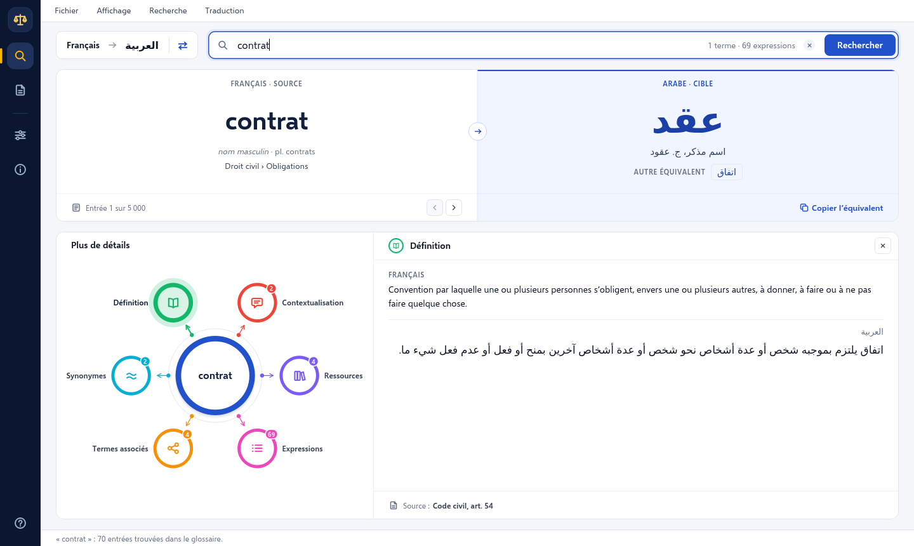

**Écran « Texte »** — le texte, sa traduction et les termes juridiques détectés :

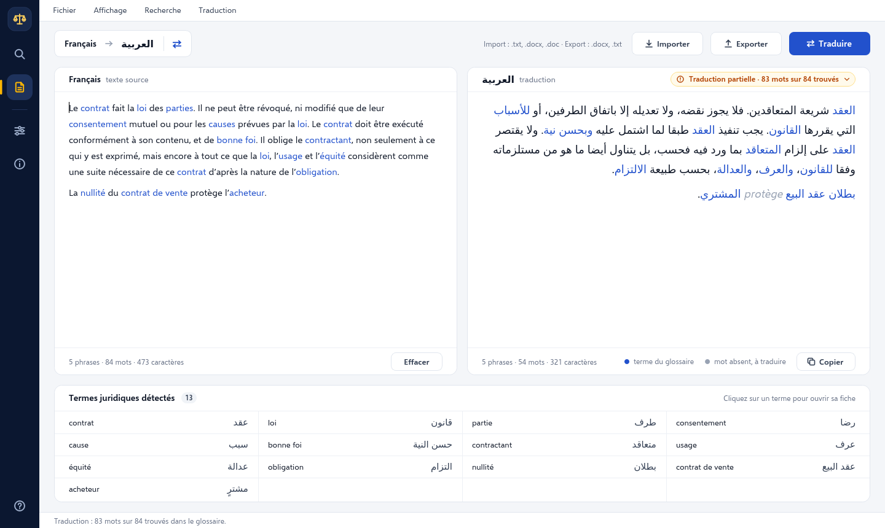

Le mode d'emploi des deux écrans est plus bas : « Utiliser l'écran « Terme » » et « Utiliser
l'écran « Texte » ». Ces écrans ont été vérifiés sur des captures faites sous Linux, sans
écran. **Ils restent à regarder sur un écran réel, sous Windows** : voir les
[limites connues](#limites-connues).

La version 0.9 avait **porté le glossaire fourni à 5 000 entrées** : l'objectif était atteint.

- Les 1 818 entrées ajoutées sont des **termes seuls**, comme celles de la version 0.8 : le
  terme, son équivalent, sa catégorie, son domaine. Elles n'avaient ni définition ni phrase
  d'exemple. Le glossaire compte donc 1 000 entrées complètes et 4 000 termes seuls.
- Elles couvrent les domaines qui n'avaient pas encore de termes seuls : droit constitutionnel,
  droit administratif, droit de la famille, droit du travail et sécurité sociale, droit fiscal,
  finances publiques, douanes, droit international, droits de l'homme, arbitrage, foncier,
  urbanisme, environnement, propriété intellectuelle, consommation, concurrence, numérique,
  droit maritime, nationalité.
- **Elles ont été écrites de mémoire par un assistant d'intelligence artificielle, sans
  dictionnaire, et personne ne les a relues.** L'application les signale par la mention
  **À vérifier**.
- La traduction d'un texte lit mieux deux expressions qui se suivent : « le délai d'exécution
  du contrat de vente » donne « أجل تنفيذ عقد البيع ». Voir
  [Comment le texte est traduit](#comment-le-texte-est-traduit).

La version 0.8 avait porté le glossaire de 1 000 à 3 182 entrées, avec les premiers termes
seuls :

- ils apportaient le vocabulaire juridique général qui manquait : des adjectifs (« protégé »,
  « exécutoire »), des verbes (« protéger », « résilier »), des locutions (« de plein droit »,
  « en vertu de »). Ils ajoutaient aussi des noms au vocabulaire général et à huit domaines :
  droit civil, organisation judiciaire, procédure civile, droit pénal, procédure pénale, droit
  commercial, banque, assurances ;
- dans la traduction d'un texte, seuls les noms sont remplacés. Les adjectifs, les verbes et
  les locutions ont une fiche sur l'écran « Terme », mais ils restent dans la langue du texte.

Le détail est dans [Les termes seuls](#les-termes-seuls).

La version 0.7 **retire la partie « Intelligence artificielle »** que la version 0.6 avait
ajoutée à l'écran « Paramètres » :

- cette partie reliait l'application à un service d'intelligence artificielle en ligne. Elle ne
  servait qu'à régler et à essayer la connexion : l'IA n'a jamais rien traduit ;
- l'essai n'a pas abouti : le service a répondu, mais le modèle n'a pas répondu à temps ;
- **l'application ne se connecte à rien**, comme avant la version 0.6. Elle traduit avec le
  glossaire, et avec lui seul ;
- à sa première ouverture, la version 0.7 **efface les réglages que la version 0.6 a pu laisser
  sur l'ordinateur, dont la clé d'accès**.

Le détail est dans
[L'essai d'un service d'IA (version 0.6)](#lessai-dun-service-dia-version-06).

La version 0.5 a rempli la **contextualisation** des 1 000 entrées que le glossaire fourni
comptait alors :

- **chacune de ces 1 000 entrées a sa phrase d'exemple**, en français et en arabe. Dans la
  version 0.4, 31 entrées seulement en avaient une ;
- 969 de ces phrases ont été **rédigées par un assistant d'intelligence artificielle**. Ce ne
  sont pas des citations de textes officiels, et aucun juriste ne les a relues. L'application
  les signale par la mention **À vérifier**. Les 31 autres entrées citent le Code civil, avec
  le numéro de l'article ;
- quand la contextualisation est complétée par une phrase d'une autre entrée, une phrase qui
  cite sa source passe avant une phrase à vérifier.

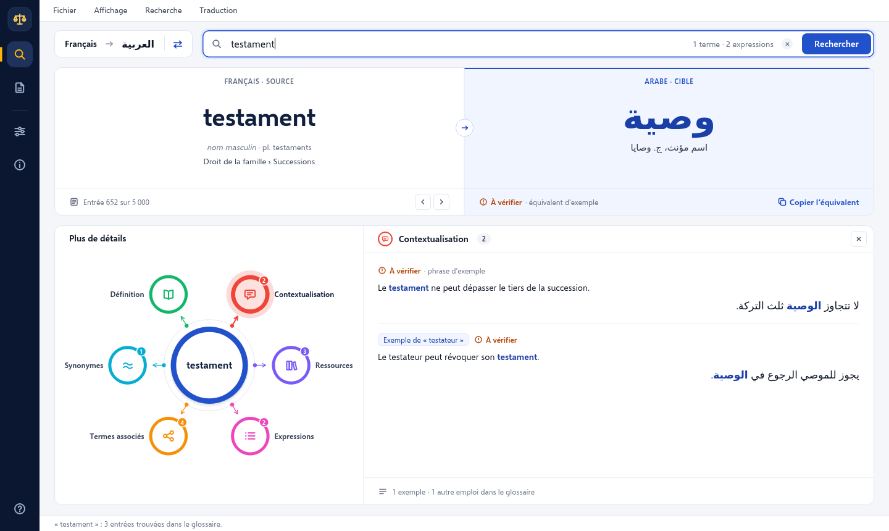

*Capture de la version 0.10 : la contextualisation s'ouvre par son cercle.*

Le détail est dans [Le glossaire d'exemple](#le-glossaire-dexemple).

Les versions 0.5.1 et 0.5.2 simplifient l'**écran de démarrage** : il ne montre plus que le
logo et les tirets, et son **fond est transparent**. Derrière eux, on voit le bureau ou la
fenêtre qui se trouve là. Le nom de l'application, la mention « Chargement… », le dégradé, la
lueur et la bordure sont retirés.

La version 0.5.3 ajoute un **installeur pour Windows** : un fichier `.msi` qui installe
l'application sur un ordinateur où Python n'est pas installé. Voir
[Installation](#installation).

La version 0.4 avait donné à l'application sa présentation d'ensemble. Elle comprenait la
version 0.3, qui n'a pas été publiée à part. Elle avait apporté ceci (la fiche du terme, les
étapes et l'écran « Texte » ont été refaits dans la version 0.10) :

- la **fiche d'un terme** suivait la [proposition d'interface](#la-proposition-dinterface) :
  les cinq champs côte à côte dans une seule fiche, l'équivalent au centre, les autres
  résultats listés sous la fiche ;
- un **écran de démarrage** animé s'affiche pendant l'ouverture ;
- une **barre latérale** sombre, à gauche, donne accès aux cinq écrans : « Terme », « Texte »,
  « Paramètres », « Description de la plateforme » et « Centre d'aide » ;
- les **étapes** de l'enchaînement s'allumaient en doré, l'une après l'autre, quand un
  résultat s'affichait ;
- le **glossaire est chargé automatiquement** à l'ouverture : il n'y a plus de bouton pour
  l'ouvrir. Le nom du fichier, son encodage et le numéro de version ne sont plus écrits dans la
  fenêtre. Seul un fichier choisi par l'utilisateur est nommé, dans « Paramètres » ;
- sur l'écran « Texte », le texte et sa traduction étaient **à gauche**, les informations sur
  les termes **à droite**, avec toutes les références écrites en entier ;
- la contextualisation cherche des phrases dans tout le glossaire, et plus seulement dans la
  ligne du terme ;
- le menu « Aide » est remplacé par le **Centre d'aide**, qui prépare un message pour le
  service informatique.

La lecture du glossaire, la recherche d'un terme et la traduction d'un texte sont celles de la
version 0.2.

**Écran de démarrage** — le logo, entre deux rangées de tirets qui ondulent et changent de
couleur. Le fond est transparent : sur cette capture, on voit le fond de la page ; à l'écran,
on voit le bureau ou la fenêtre qui se trouve derrière :

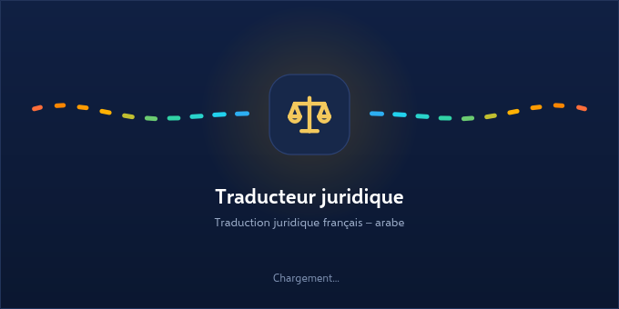

**Écran « Paramètres »** :

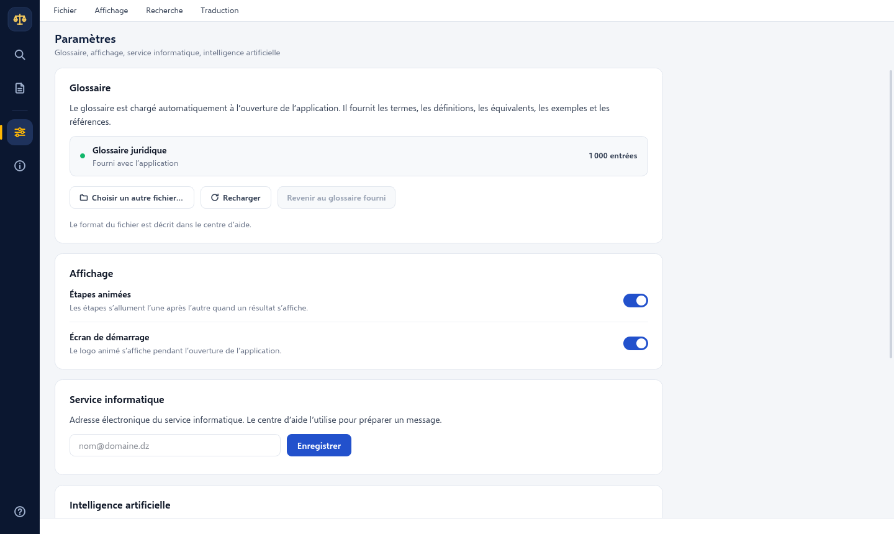

**Centre d'aide** :

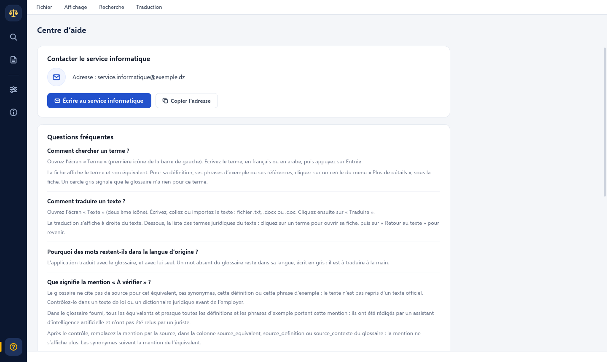

*Captures produites sous Linux, sans écran. L'aspect des caractères peut changer d'un système à
l'autre. Les captures des écrans « Terme », « Texte », « Paramètres » et du centre d'aide sont
celles de la version 0.10 ; celle du terme « protégé » avec sa phrase est de la version 0.11,
celle du terme « chèque barré » de la version 0.12, celles des termes « protégé » et
« diversité biologique » avec leur définition de la version 0.13, celle du terme « diversité
biologique » avec sa phrase de la version 0.14, celle du terme « huissier de justice » avec
ses synonymes de la version 0.15. Celle de l'écran de
démarrage date de la version 0.5.2 : cet écran n'a pas changé depuis. L'adresse affichée dans
le centre d'aide est un exemple. La capture de l'[installation](#installation) a été faite
sous Windows, avec la version 0.5.3 : elle montre l'ancienne fiche, à cinq colonnes.*

### Ce qui est fait, ce qui reste à faire

| Fonctionnalité | État |
| --- | --- |
| Lecture du glossaire CSV, chargé à l'ouverture de l'application | Fait |
| Écran « Terme » : barre de recherche, fiche à deux colonnes (le terme et son équivalent), menu « Plus de détails » pour la définition, la contextualisation, les ressources, les expressions, les termes associés et les synonymes | Fait, dans les deux sens (français → arabe et arabe → français). Présentation refaite dans la version 0.10. |
| Écran « Texte » : zones de texte, segmentation en phrases, découpage en mots, recherche de chaque mot dans le CSV, règles lexicales, grammaticales et sémantiques, reconstruction du paragraphe | Fait, dans les deux sens. La traduction se limite au contenu du glossaire : voir [Comment le texte est traduit](#comment-le-texte-est-traduit). Depuis la version 0.10 : le texte et sa traduction côte à côte, la liste des termes dessous, et un clic sur un terme ouvre sa fiche. |
| Import de fichiers `.txt`, `.docx`, `.doc` | Fait |
| Export de la traduction en `.docx` ou `.txt` | Fait. L'export au format `.doc` n'est pas proposé ; Word ouvre les fichiers `.docx`. |
| Écran de démarrage, barre latérale, écrans « Paramètres », « Description de la plateforme » et « Centre d'aide » | Fait (version 0.4). Sous Windows, personne ne les a encore regardés : voir les [limites connues](#limites-connues). |
| Écrans « Terme » et « Texte » allégés | Fait (version 0.10). Vérifiés sur des captures faites sans écran : **ils restent à regarder sur un écran réel**. Voir les [limites connues](#limites-connues). |
| Contextes cherchés dans tout le glossaire | Fait. |
| Une phrase d'exemple pour chacune des 1 000 premières entrées du glossaire fourni | Fait (version 0.5). 969 phrases sont rédigées par un assistant d'intelligence artificielle et **restent à vérifier par un juriste** : voir [Le glossaire d'exemple](#le-glossaire-dexemple). |
| Glossaire fourni porté à 5 000 entrées | Fait (version 0.9) : 1 000 entrées complètes et 4 000 termes seuls. Les termes seuls **restent à vérifier** : voir [Les termes seuls](#les-termes-seuls). |
| Une définition et des synonymes pour chaque terme seul | **Fait (version 0.13) : les 4 000 termes seuls ont une définition** dans les deux langues, et 662 ont au moins un synonyme. Les définitions et les synonymes sont rédigés par un assistant d'intelligence artificielle et **restent à vérifier par un juriste** : voir [Les termes seuls](#les-termes-seuls). |
| Une phrase d'exemple pour chaque terme seul | **Fait (version 0.14) : les 4 000 termes seuls ont leur phrase**, dans les deux langues : 1 887 depuis la version 0.11, 1 126 depuis la version 0.12, 987 depuis la version 0.14. Les phrases sont rédigées par un assistant d'intelligence artificielle et **restent à vérifier par un juriste** : voir [Les phrases d'exemple](#les-phrases-dexemple). |
| Des synonymes pour les 1 000 entrées complètes | **Fait (version 0.15) : 462 entrées complètes ont au moins un synonyme**, contre 132 avant : 223 en ont en français, 358 en arabe. Les 550 nouveaux synonymes sont rédigés par un assistant d'intelligence artificielle et **restent à vérifier par un juriste** : voir [Les synonymes (version 0.15)](#les-synonymes-version-015). |
| Message au service informatique | Fait : l'application prépare le message, le logiciel de messagerie de l'ordinateur l'envoie. L'adresse du service est à saisir dans « Paramètres ». |
| Liaison avec un service d'intelligence artificielle en ligne | Essayée dans la version 0.6, **retirée dans la version 0.7** : voir [L'essai d'un service d'IA (version 0.6)](#lessai-dun-service-dia-version-06). L'application ne se connecte à rien. |
| Installeur pour Windows (fichier `.msi`) | Fait (version 0.5.3) : voir [Installation](#installation). Il est fabriqué et essayé automatiquement sur une machine Windows. **Personne ne l'a encore installé à la main** : voir les [limites connues](#limites-connues). |

### Installation

Il y a deux façons d'installer l'application :

- **sous Windows, avec l'installeur** : c'est la plus simple, il n'y a rien d'autre à installer ;
- **avec Python, à partir du code** : sous Windows, macOS ou Linux, pour modifier l'application.

#### Sous Windows, avec l'installeur

1. Ouvrir la page
   [Releases](https://github.com/SAMOU2/La-traduction-juridique-assiste-par-l-ia-entre-gain-de-producutivite-et-risques-d-inexactitude/releases)
   du dépôt. Sous la version la plus récente, dans « Assets », télécharger le fichier dont le
   nom finit par `.msi`, par exemple `Traducteur-juridique-0.15.0.msi`.
2. Double-cliquer sur le fichier téléchargé.
3. Cliquer sur **Suivant**, puis sur **Installer**, puis sur **Terminer**. L'application s'ouvre.

Les fois suivantes, l'application s'ouvre avec l'icône « Traducteur juridique » du Bureau ou
du menu Démarrer.

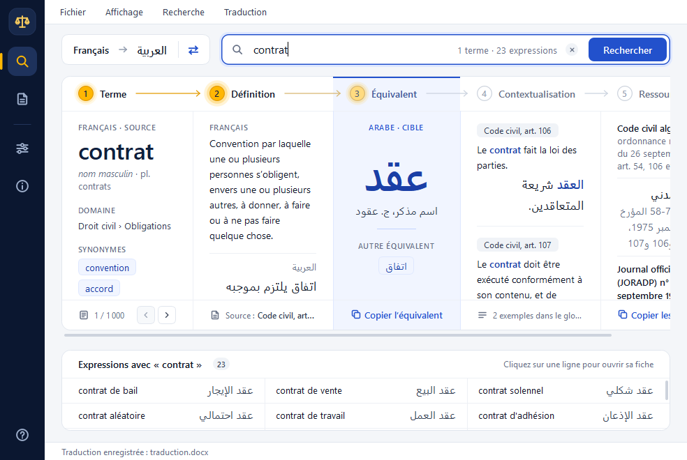

*Capture faite automatiquement sur une machine Windows, pendant l'essai de l'installeur de la
version 0.5.3. Elle montre l'ancienne fiche, à cinq colonnes : depuis la version 0.10, la fiche
a deux colonnes.*

- L'installeur convient à **Windows 10 et Windows 11, en 64 bits**. Il pèse environ 24 Mo et
  contient Python et Qt : l'application installée occupe environ 70 Mo.
- Il ne demande pas les droits d'administrateur. L'application s'installe dans le dossier de
  l'utilisateur (`AppData\Local\Programs\Traducteur juridique`), pour le seul compte Windows
  qui lance l'installeur.
- **L'installeur n'est pas signé : le navigateur, puis Windows, peuvent afficher un
  avertissement.** Si le navigateur demande une confirmation avant de garder le fichier,
  choisir « Conserver ». Si Windows affiche « Windows a protégé votre ordinateur », cliquer sur
  « Informations complémentaires », puis sur « Exécuter quand même ».
- Pour installer une nouvelle version, télécharger le nouvel installeur et le lancer : il
  remplace la version installée. Les réglages de l'application sont conservés.
- Pour désinstaller : Paramètres de Windows → Applications → Applications installées (sous
  Windows 10 : « Applications et fonctionnalités ») → Traducteur juridique → Désinstaller.

L'installeur a été essayé automatiquement, sans personne devant l'écran : voir
[Fabrication de l'installeur Windows](#fabrication-de-linstalleur-windows) et les
[limites connues](#limites-connues).

#### Avec Python, à partir du code

Il faut **Python 3.10 ou plus récent**.

Sous Windows, si la commande `python` répond « Python was not found », Python n'est pas encore
installé sur l'ordinateur :

1. Installer le **Python Install Manager** depuis le
   [Microsoft Store](https://apps.microsoft.com/detail/9NQ7512CXL7T) (bouton « Installer »). Il
   est aussi proposé sur [python.org](https://www.python.org/downloads/).
2. Ouvrir un nouveau terminal. À la première utilisation de la commande `python`, la dernière
   version de Python est téléchargée et installée automatiquement.

Dans VS Code, ouvrir le dossier du projet, puis un terminal (menu *Terminal → Nouveau terminal*) :

```
python -m pip install -r requirements.txt
```

Cette commande télécharge PySide6, soit environ 85 Mo sous Windows. Si la commande `python`
n'est toujours pas reconnue, écrire `py` à la place.

### Lancement

Application installée avec l'installeur : double-cliquer sur l'icône « Traducteur juridique »
du Bureau, ou la chercher dans le menu Démarrer.

Avec Python, depuis le dossier du projet :

```
python main.py
```

Ou, dans VS Code : ouvrir `main.py`, puis cliquer sur ▶ (« Exécuter le fichier Python »).

L'écran de démarrage s'affiche environ deux secondes, puis la fenêtre s'ouvre. Un clic sur
le logo le ferme dès que la fenêtre est prête. Il se désactive dans « Paramètres ».

Le glossaire fourni est chargé automatiquement. Si un autre glossaire a été choisi dans
« Paramètres », c'est lui qui est repris. Pour ouvrir l'application avec un glossaire précis :
`python main.py chemin/vers/mon_glossaire.csv`.

### Mise à jour

Application installée avec l'installeur : télécharger le nouvel installeur sur la page
[Releases](https://github.com/SAMOU2/La-traduction-juridique-assiste-par-l-ia-entre-gain-de-producutivite-et-risques-d-inexactitude/releases)
et le lancer.

Avec Python, pour récupérer la dernière version du dépôt, dans le terminal de VS Code :

```
git pull origin main
python -m pip install -r requirements.txt
python main.py
```

### La barre latérale

La barre sombre, à gauche de la fenêtre, contient une icône par écran. L'icône de l'écran
affiché est dorée. Laisser le pointeur sur une icône affiche le nom de l'écran.

| Icône | Écran | Raccourci |
| --- | --- | --- |
| Loupe | **Terme** : chercher un terme dans le glossaire | Ctrl+1 |
| Feuille | **Texte** : traduire un texte | Ctrl+2 |
| Curseurs | **Paramètres** : glossaire, affichage, adresse du service informatique | Ctrl+3 |
| « i » | **Description de la plateforme** : ce que fait l'application, et comment | Ctrl+4 |
| « ? », en bas | **Centre d'aide** : contact du service informatique, questions fréquentes | F1 |

Les mêmes écrans sont dans le menu *Affichage*.

### Utiliser l'écran « Terme »

L'écran a deux parties : en haut, la **fiche** du terme ; dessous, le menu **Plus de détails**.

- Saisir un terme, en français ou en arabe, puis appuyer sur Entrée ou cliquer sur
  **Rechercher**. Pendant la saisie, une liste propose les termes du glossaire qui contiennent
  les lettres tapées. Si le terme est écrit dans l'autre langue, le sens de traduction
  s'inverse tout seul. Le bouton ⇄ l'inverse à la main.
- La **fiche** a deux colonnes :
  - à gauche, le **terme**, avec sa catégorie grammaticale, son pluriel et son domaine ;
  - à droite, sur fond bleu, son **équivalent**, avec sa catégorie, son pluriel et ses autres
    équivalents. **Copier l'équivalent** le place dans le presse-papiers.
- Un terme qui a plusieurs sens (« action » : « دعوى » ou « سهم ») a un onglet par sens, en
  haut de la fiche.
- Les deux flèches placées en bas de la colonne du terme ouvrent l'entrée précédente et
  l'entrée suivante du glossaire.
- La barre de recherche indique ce qui a été trouvé (« 1 terme · 69 expressions »).
- Si rien n'est trouvé, l'application propose les termes dont l'écriture est proche.

**Le menu « Plus de détails ».** Le terme est au centre ; six cercles l'entourent.

| Cercle | Ce qu'il affiche |
| --- | --- |
| **Définition** | La définition du terme, en français et en arabe, puis sa source. |
| **Contextualisation** | Des phrases qui emploient le terme, dans les deux langues. |
| **Ressources** | Les textes de loi, les ouvrages et les sites à consulter. **Copier les références** les place dans le presse-papiers. Un clic sur l'adresse d'un site l'ouvre dans le navigateur. |
| **Expressions** | Les autres entrées du glossaire trouvées par la recherche (« contrat de vente » pour « contrat »). Un clic sur une ligne ouvre sa fiche. |
| **Termes associés** | Les termes qu'on rencontre avec celui-ci. |
| **Synonymes** | Les synonymes du terme, dans la même langue. |

- Un cercle **coloré** a quelque chose à montrer. Une pastille donne le nombre d'éléments :
  « 2 » phrases, « 69 » expressions.
- Un cercle **gris** signale que le glossaire n'a rien pour ce terme. Il s'ouvre quand même,
  et dit ce qui manque (« Aucune définition pour ce terme »).
- Un clic sur un cercle affiche son contenu à droite des cercles. Pour le refermer : un second
  clic sur le même cercle, un clic sur le terme du centre, ou la croix.
- L'information choisie reste ouverte d'un terme au suivant. Avec « Définition » ouverte,
  chaque recherche affiche la définition du nouveau terme.
- Rien ne s'ouvre d'office, sauf dans un cas : quand le terme affiché n'est pas celui qui a été
  saisi. Le glossaire n'a pas d'entrée « magistrat », mais il a « magistrature » : la fiche de
  « magistrature » s'affiche, et la liste des autres résultats s'ouvre.
- Le quatrième cercle change de nom selon ce que la recherche a trouvé : « Expressions »,
  « Termes proches » ou « Autres résultats ».
- Un terme écrit en bleu (synonyme, terme associé, autre équivalent) est une autre entrée du
  glossaire : un clic l'ouvre.
- Dans une fenêtre étroite, le nom des cercles peut être abrégé (« Contexte », « Associés »).
  Quand le terme ne tient pas en entier dans le cercle du centre, celui-ci affiche le mot
  « TERME » ; le terme reste écrit en grand dans la fiche.
- Au clavier : la touche Tab passe d'un cercle au suivant, la barre d'espace ouvre ou referme
  son information.
- Quand les animations sont actives, les cercles s'allument l'un après l'autre à l'affichage
  d'une fiche.

**La contextualisation.** Elle affiche d'abord les exemples écrits dans la ligne du terme
(colonnes `contexte_fr` et `contexte_ar`). S'il y en a moins de deux, l'application cherche dans
tout le glossaire d'autres phrases qui emploient le terme : les exemples et les définitions des
autres entrées. Une phrase n'est retenue que si elle contient le terme en français **et** son
équivalent en arabe. Parmi les exemples des autres entrées, ceux qui ne sont pas « à vérifier »
passent d'abord. Une étiquette dit d'où vient la phrase, par exemple *Exemple de « testateur »*
ou *Définition de « acheteur »* ; un clic sur cette étiquette ouvre l'entrée en question.

Au-dessus de chaque phrase, la contextualisation écrit sa source (« Code civil, art. 106 »), ou
la mention **À vérifier** quand le glossaire ne la reprend d'aucun texte.

Dans chaque phrase, le terme est écrit en bleu, dans les deux langues. Depuis la version 0.11,
l'application le repère aussi quand il change de forme :

- un adjectif accordé : « protégées » pour « protégé », « المحمية » pour « محمي » ;
- un verbe à l'infinitif ou au participe passé en français (« a abrogé » pour « abroger »),
  au passé en arabe (« ألغى », « ألغت »). Un verbe au présent n'est pas repéré ;
- une locution verbale dont le verbe est séparé de la suite : « a **mis** le débiteur **en
  demeure** », « **رفع** المدعي **دعوى** » ;
- une locution qui se contracte avec le mot suivant : « conformément **au** », « en vertu
  **du** », « طبقا **للقانون** ».

**La fiche et le menu sont remplis avec le contenu du glossaire, et rien d'autre.** Un terme
qui n'est pas dans le glossaire n'a pas de fiche. Quand le glossaire n'a ni définition, ni
phrase, ni ressource pour un terme, le cercle correspondant est gris. Pour compléter le
glossaire : voir [Corriger le glossaire](#corriger-le-glossaire).

**La mention « À vérifier ».** Elle est écrite en orange, à côté d'un point d'exclamation.

- Sous la définition, elle signale une définition sans source : la colonne
  `source_definition` est vide, ou commence par « à vérifier ». C'est le cas de 4 993 des
  5 000 définitions du glossaire fourni : 993 des 1 000 entrées complètes, et les 4 000
  définitions des termes seuls.
- Dans la fiche, au pied de l'équivalent, elle signale un équivalent à vérifier. C'est le cas
  d'un terme sans définition dont la colonne `source_definition` commence par « à vérifier »,
  et d'un terme dont cette colonne dit « à vérifier (équivalent et définition d'exemple) ».
  Les 4 000 termes seuls du glossaire fourni sont dans le second cas : « À vérifier ·
  équivalent d'exemple » au pied de l'équivalent, et « À vérifier · définition d'exemple »
  sous la définition. Un terme sans définition dont la colonne `source_definition` est vide
  s'affiche sans mention.
- Dans la contextualisation, elle signale une phrase d'exemple dont la colonne `source_contexte`
  commence par « à vérifier » : c'est le cas de 4 969 des 5 002 phrases d'exemple du glossaire
  fourni. Elle signale aussi une définition sans source, quand cette définition sert de
  contexte à un autre terme. Une phrase d'exemple dont la colonne `source_contexte` est vide
  s'affiche sans source et sans mention.
- Après le contrôle d'une définition ou d'une phrase, écrire sa source dans le glossaire
  (« Code de la famille, art. 4 ») : la source s'affiche à la place de la mention.

La recherche ne tient pas compte des majuscules, des accents, d'un article placé devant le terme
(« le contrat », « العقد »), des signes diacritiques arabes ni des variantes d'écriture de la
hamza, du ta marbuta et de l'alif maqsura. Le pluriel est reconnu s'il figure dans le glossaire.

### Utiliser l'écran « Texte »

En haut, deux colonnes : le texte à gauche, sa traduction à droite. Dessous : la liste des
termes juridiques du texte.

1. Cliquer sur l'icône **Texte** de la barre latérale (ou Ctrl+2). Les boutons **Importer**,
   **Exporter** et **Traduire** s'affichent en haut à droite.
2. Écrire ou coller le texte dans la zone de gauche. **Importer** ouvre un fichier `.txt`,
   `.docx` ou `.doc`. Le lien *Insérer un exemple* place un texte d'essai.
3. Cliquer sur **Traduire** (ou Ctrl+Entrée). Un fichier importé est traduit tout de suite. Si
   le texte est écrit dans l'autre langue, le sens de traduction s'inverse tout seul.
4. La traduction s'affiche dans la zone de droite :
   - en bleu, les termes du glossaire (dans les deux zones) ;
   - en gris italique, les mots absents du glossaire : ils restent dans la langue source et
     sont à traduire à la main.
5. L'étiquette placée au-dessus de la traduction indique le résultat :
   - « Traduction terminée » (tous les mots ont été trouvés) ou « Traduction partielle », avec
     le nombre de mots trouvés (« 83 mots sur 84 trouvés ») ;
   - « Aucun mot trouvé dans le glossaire » ;
   - « Texte modifié » quand le texte source a changé depuis la dernière traduction.
6. Sous les deux zones, le panneau « Termes juridiques détectés » contient **une case par
   terme** du glossaire relevé dans le texte : le terme français à gauche, le terme arabe à
   droite.
   - Laisser le pointeur sur une case affiche le nombre d'occurrences du terme dans le texte.
   - Un signe orange précède un terme **ambigu** : le contexte n'a pas permis de choisir entre
     deux sens. L'infobulle donne l'autre sens.
   - L'infobulle signale aussi un **équivalent à vérifier** (un terme seul du glossaire).
   - Quand les termes sont nombreux, la liste défile : elle n'occupe jamais plus du tiers de
     l'écran, environ.
7. **Un clic sur un terme ouvre sa fiche** sur l'écran « Terme » : un clic sur une case de la
   liste, ou sur un terme écrit en bleu dans le texte ou dans la traduction. Sa définition,
   ses phrases d'exemple et ses références sont dans le menu « Plus de détails » : voir
   « Utiliser l'écran « Terme » ».
   - Le bouton **Retour au texte** s'affiche alors à gauche de la barre d'outils. Il ramène à
     l'écran « Texte » : le texte, sa traduction et la liste des termes n'ont pas changé.
   - Ctrl+2 ramène aussi au texte.
8. **Les cinq étapes du traitement** ne sont pas affichées en permanence. Un clic sur
   l'étiquette de résultat, ou la commande *Traduction → Étapes du traitement…*, les ouvre
   dans une petite fenêtre, avec le résultat de chacune (« 83 mots sur 84 » pour la
   recherche). Laisser le pointeur sur une étape affiche le détail : règles appliquées, mots
   non trouvés, phrases reprises d'un exemple du glossaire. Un clic ailleurs referme la
   petite fenêtre.
9. **Copier** place la traduction dans le presse-papiers. **Exporter** l'enregistre dans un
   fichier `.docx` ou `.txt`. **Effacer** vide les deux zones.

Chaque écran garde son propre sens de traduction.

### Paramètres, description de la plateforme, centre d'aide

**Paramètres**

- *Glossaire* : le glossaire chargé (« Glossaire juridique » pour le glossaire fourni, le nom
  du fichier pour un autre) et son nombre d'entrées.
  - **Choisir un autre fichier…** charge un autre fichier CSV. L'application le rouvrira au
    prochain lancement.
  - **Recharger** relit le fichier après une modification.
  - **Revenir au glossaire fourni** reprend `donnees/glossaire_juridique.csv`.
- *Affichage* : deux interrupteurs, l'un pour les animations (les cercles du menu « Plus de
  détails » s'allument l'un après l'autre), l'autre pour l'écran de démarrage.
- *Service informatique* : l'adresse électronique du service informatique. **Elle est vide à
  l'installation.** Il faut la saisir une fois, puis cliquer sur **Enregistrer**.

**Description de la plateforme** — ce que fait l'application, la fiche d'un terme (ses deux
colonnes et les six informations du menu « Plus de détails »), les deux écrans de travail, la
façon dont un texte est traduit, et ce qu'il faut savoir avant de se fier à une traduction.

**Centre d'aide**

- **Écrire au service informatique** ouvre le logiciel de messagerie de l'ordinateur sur un
  message déjà adressé. Le message indique la version de l'application, le système et le
  glossaire utilisés : il reste à décrire le problème. L'application n'envoie rien elle-même.
- Si aucun logiciel de messagerie ne répond, l'adresse est copiée dans le presse-papiers, pour
  écrire depuis une autre messagerie. **Copier l'adresse** la copie directement.
- Tant que l'adresse n'est pas saisie, le bouton renvoie à « Paramètres ».
- Six questions fréquentes, puis la liste des raccourcis du clavier.

### Comment le texte est traduit

La traduction utilise **le glossaire CSV et lui seul** : ni dictionnaire général, ni service en
ligne, ni modèle d'intelligence artificielle. Elle suit cinq étapes :

1. **Segmentation** : le texte est découpé en phrases.
2. **Découpage** : chaque phrase est découpée en mots.
3. **Recherche dans le glossaire** : la phrase entière est cherchée parmi les exemples du glossaire,
   puis les expressions les plus longues (« contrat de vente »), puis les mots un par un.
4. **Règles linguistiques** :
   - lexique : expression de plusieurs mots, synonyme ramené au terme du glossaire ;
   - grammaire : pluriel, article défini ou indéfini, complément du nom (« la nullité du
     contrat » ↔ « بطلان العقد »), possessif et particules collées au mot arabe (و، ب، ل…) ;
     après « le », « la », « au », « du », « un », « son »…, un mot n'est pas lu comme un
     pluriel (« cours », dans « au cours de », n'est pas le pluriel de « cour ») ;
   - sémantique : quand une forme correspond à plusieurs entrées (« droit » : « حق » ou
     « قانون »), le choix se fait d'après les autres termes de la phrase et du texte.
5. **Reconstruction** : chaque phrase est récrite dans la langue cible, avec sa ponctuation.

Ce que cela donne :

- Une phrase identique à un exemple du glossaire (colonnes `contexte_fr` et `contexte_ar`) reçoit
  la traduction de cet exemple. Quand cet exemple porte la mention « à vérifier », la
  traduction n'est pas plus sûre que lui. L'étiquette de résultat l'indique quand on y laisse
  le pointeur ; l'étape 5 aussi, dans la petite fenêtre des étapes (« dont 1 d'un exemple à
  vérifier »).
- Les autres phrases sont traduites mot à mot. Les termes du glossaire sont traduits ; les
  autres mots (verbes, mots grammaticaux, mots absents du CSV) restent dans la langue source, en
  gris italique. Exemple avec le glossaire fourni : « La nullité du contrat de vente protège
  l'acheteur. » donne « بطلان عقد البيع protège المشتري. ».
- L'ordre des mots n'est pas modifié. Les verbes ne sont pas conjugués et les adjectifs ne sont
  pas accordés.
- **Seuls les noms du glossaire sont remplacés.** Une entrée dont la catégorie est un adjectif,
  un verbe, un adverbe, une préposition ou une conjonction a sa fiche sur l'écran « Terme »,
  mais elle reste dans la langue du texte : pour la remplacer, il faudrait accorder l'adjectif
  et conjuguer le verbe, ce que l'application ne fait pas. Exemple : « Le juge doit protéger le
  mineur protégé. » donne « القاضي doit protéger القاصر protégé. ».
- Une locution adverbiale, prépositive ou conjonctive du glossaire reste entière : ses mots ne
  sont pas traduits un par un. Dans « de plein droit », le mot « droit » n'est pas traduit ;
  dans « sous peine de nullité », le mot « peine » non plus, et « nullité » devient « بطلان ».
- **Deux expressions qui se suivent** (depuis la version 0.9). Dans « le délai d'exécution du
  contrat de vente », le glossaire reconnaît « délai d'exécution », « exécution du contrat » et
  « contrat de vente » : chacune commence par le dernier mot de la précédente. Garder la
  première couperait les suivantes. L'application lit donc « délai », puis « exécution », puis
  « contrat de vente », et les relie : « أجل تنفيذ عقد البيع ». Elle ne le fait que si le
  premier nom (« délai ») est lui-même un terme du glossaire et garde le même sens : sinon,
  voir les [limites connues](#limites-connues).
- Dans un texte français écrit avec ses accents, les accents comptent : « cause » n'est pas
  « causé », ni « condamne » « condamné ». Une majuscule peut ne pas porter le sien (« Etat »).
  Un texte sans aucun accent est comparé sans les accents.
- Un mot courant qui s'écrit comme un terme du glossaire est traduit comme ce terme, même
  quand il a un autre sens : voir les [limites connues](#limites-connues).
- Une phrase où aucun terme n'est trouvé est recopiée telle quelle.
- Pour traduire davantage, il faut enrichir le CSV : termes, pluriels, synonymes, exemples.

Le résultat est une aide à la traduction. Il doit être complété et vérifié par le traducteur.

### L'essai d'un service d'IA (version 0.6)

*Retiré dans la version 0.7.*

La version 0.6 avait ajouté, en bas de l'écran « Paramètres », une partie « Intelligence
artificielle » : un interrupteur, l'adresse d'un service d'IA en ligne (celle de
[NVIDIA Build](https://build.nvidia.com) était proposée), une clé d'accès, le nom d'un modèle
et un bouton « Tester la connexion ». L'IA était éteinte à l'installation et ne traduisait
rien : ces réglages préparaient une suite, qui n'a pas été faite.

Ce que l'essai a montré, en novembre 2026 :

- pendant la fabrication de l'installeur, sous Windows, le programme a reçu du service la liste
  de ses 83 modèles, sans clé ;
- avec une clé saisie dans l'application, l'essai de connexion a reçu cette liste, mais le
  modèle proposé (`google/gemma-4-31b-it`) **n'a pas répondu à temps** : l'application attend
  sa réponse 40 secondes. La cause n'a pas été établie. Peu après, la file d'attente de ce
  modèle, lue sur le site de NVIDIA, comptait environ 900 demandes ;
- aucun texte n'a été traduit par une IA.

Un service gratuit en ligne peut être lent, saturé ou modifié sans prévenir. La version 0.7
retire donc cette partie :

- l'écran « Paramètres » retrouve ses trois parties, et le centre d'aide ses six questions ;
- le code qui parlait au service est retiré, avec ses tests. L'application ne se connecte à
  rien : un test le vérifie (voir [Tests](#tests)) ;
- la fabrication de l'installeur n'essaie plus de connexion ;
- **à sa première ouverture, l'application efface les réglages de cette partie**, s'il y en a :
  l'interrupteur, l'adresse, le modèle et **la clé d'accès**, que la version 0.6 enregistrait
  sans chiffrement. Les autres réglages sont gardés. La clé reste valable chez le service qui
  l'a créée : pour qu'elle ne serve plus à personne, il faut aussi la supprimer sur son site.

Le code de cet essai n'est pas perdu : il reste dans l'historique du dépôt
([le dépôt tel qu'il était à la version 0.6](https://github.com/SAMOU2/La-traduction-juridique-assiste-par-l-ia-entre-gain-de-producutivite-et-risques-d-inexactitude/tree/b599f3ac598e93e12a1c14a6b1239abc6888a53a)).

### Import et export

| Format | Import | Export |
| --- | --- | --- |
| `.txt` | Oui. L'encodage est reconnu (UTF-8, UTF-16, Windows-1256, Windows-1252). | Oui, en UTF-8. |
| `.docx` (Word) | Oui | Oui. Les paragraphes arabes sont écrits de droite à gauche. |
| `.doc` (Word 97 à 2003) | Oui | Non |

- Seul le texte du corps du document est lu : un paragraphe par ligne, les cellules d'un
  tableau séparées par des tabulations. La mise en forme, les images, les en-têtes, les pieds de
  page et les notes ne sont pas repris. Dans un fichier `.doc`, le texte des zones de texte
  (cadres flottants) est placé à la fin.
- Le format est reconnu d'après le contenu du fichier, pas d'après son nom. Certains sites et
  logiciels produisent des fichiers nommés `.doc` qui sont en réalité une page web (HTML) ou un
  fichier XML de Word 2003 : leur texte est lu, sans les balises. Un fichier `.txt` est
  toujours lu tel quel.
- Un fichier Word protégé par un mot de passe, créé avant Word 97 ou endommagé est refusé, avec
  un message qui en donne la raison.
- Les fichiers PDF et RTF ne sont pas lus : le message d'erreur indique comment les convertir.
- Le nom proposé pour l'export est celui du fichier importé suivi de `_traduction`. Le fichier
  exporté contient le texte de la traduction, y compris les mots non traduits.

### Raccourcis

| Raccourci | Action |
| --- | --- |
| Ctrl+1, Ctrl+2 | Afficher l'écran « Terme », l'écran « Texte » |
| Ctrl+3, Ctrl+4 | Afficher « Paramètres », « Description de la plateforme » |
| F1 | Afficher le centre d'aide |
| Ctrl+I | Inverser le sens de traduction |
| Ctrl+F | Aller à la barre de recherche |
| Ctrl+Entrée | Traduire le texte |
| Ctrl+Maj+C | Copier la traduction |
| Ctrl+Maj+O | Importer un texte |
| Ctrl+E | Exporter la traduction |
| Ctrl+O | Choisir un autre glossaire |
| F5 | Recharger le glossaire |
| Ctrl+Q | Quitter |
| Alt+F, Alt+I, Alt+R, Alt+T | Ouvrir le menu Fichier, Affichage, Recherche, Traduction |

### Le glossaire CSV

Une ligne par terme ; la première ligne donne le nom des colonnes. Seules les deux premières
colonnes du tableau sont obligatoires.

| Colonne | Écran « Terme » | Écran « Texte » |
| --- | --- | --- |
| `terme_fr`, `terme_ar` | Le terme et son équivalent, selon le sens de traduction | Mots et expressions cherchés dans le texte, et leur traduction |
| `categorie_fr`, `categorie_ar` | Catégorie grammaticale, sous le terme et sous l'équivalent | Si `categorie_fr` contient « masculin » ou « féminin », l'article français est écrit (« le », « la », « un », « une »). Si elle contient « pluriel » (« biens », « droits de l'homme »), le terme est traité comme un pluriel (« les », « des », « ses »). |
| `pluriel_fr`, `pluriel_ar` | Pluriel, sous le terme et sous l'équivalent ; il sert aussi à la recherche | Reconnaissance et écriture du pluriel |
| `domaine` | Domaine, sous le terme | — |
| `synonymes_fr`, `synonymes_ar` | Ceux de la langue source : cercle « Synonymes ». Ceux de la langue cible : « Autres équivalents », sous l'équivalent. Ils servent aussi à la recherche. | Un synonyme trouvé dans le texte est traduit comme le terme |
| `termes_associes` | Cercle « Termes associés » | Choix entre deux entrées de même forme |
| `definition_fr`, `definition_ar`, `source_definition` | Cercle « Définition ». Si `source_definition` est vide ou commence par « à vérifier », la définition porte la mention « À vérifier ». Sans définition, la mention ne s'affiche que si `source_definition` commence par « à vérifier » : elle porte alors sur l'équivalent, et s'affiche dans la fiche. Avec une définition, « à vérifier (équivalent et définition d'exemple) » porte sur les deux : la mention s'affiche dans la fiche et sous la définition (version 0.13). | Quand la mention porte sur l'équivalent : l'infobulle de la case du terme signale un équivalent à vérifier |
| `contexte_fr`, `contexte_ar`, `source_contexte` | Cercle « Contextualisation ». Ces phrases servent aussi de contexte aux autres termes qu'elles emploient. Si `source_contexte` commence par « à vérifier », la phrase porte la mention « À vérifier ». | Une phrase du texte identique à un exemple reçoit la traduction de cet exemple |
| `ressources` | Cercle « Ressources » | — |

- Dans une cellule, plusieurs valeurs se séparent par une barre verticale : `convention | accord`.
  Pour les exemples, le premier exemple français va avec le premier exemple arabe et la première
  source, et ainsi de suite.
- Depuis Excel : *Enregistrer sous → CSV UTF-8 (délimité par des virgules)*. Un classeur
  `.xlsx` n'est pas lu directement.
- Le séparateur (point-virgule, virgule ou tabulation) et l'encodage (UTF-8, UTF-16,
  Windows-1256, Windows-1252) sont reconnus automatiquement.
- D'autres noms de colonnes sont acceptés (« Français », « Arabe », « Définition »…). Un fichier
  sans ligne d'en-tête fonctionne aussi : la colonne arabe et la colonne française sont
  repérées d'après leur écriture.
- Les lignes sans terme français ou sans terme arabe sont ignorées. Leur nombre est indiqué
  quand on choisit le fichier dans « Paramètres ».
- La liste du cercle « Expressions » ne vient pas d'une colonne : ce sont les autres entrées
  du glossaire qui contiennent le terme (« contrat de vente » pour « contrat »).

Le rappel du format se trouve aussi dans l'application : centre d'aide, question « Comment
utiliser un autre glossaire ? ».

### Le glossaire d'exemple

`donnees/glossaire_juridique.csv` contient **5 000 entrées**, dans le vocabulaire du droit
algérien. Il sert à essayer l'application. **Son contenu n'a été relu ni par un juriste ni par
un traducteur** : il doit être vérifié avant tout usage, ou remplacé par le glossaire du projet.

Il est fait de trois parties :

| Entrées | Contenu | Nombre |
| --- | --- | --- |
| n° 1 à 40 | Entrées complètes des premières versions | 40 |
| n° 41 à 1 000 | Entrées complètes : définition dans les deux langues, phrase d'exemple | 960 |
| n° 1 001 à 5 000 | Termes seuls : une définition (version 0.13) et une phrase d'exemple (version 0.14) pour chacun | 4 000 |

L'objectif de 5 000 entrées est atteint. Quatre entrées sur cinq sont des termes seuls.

Nombre d'entrées par domaine (premier domaine indiqué dans la colonne `domaine`) :

| Domaine | Entrées complètes | Termes seuls | Total |
| --- | --- | --- | --- |
| Vocabulaire juridique général (adjectifs, verbes, locutions, noms communs à tout le droit) | 0 | 923 | 923 |
| Droit civil (personnes, obligations, responsabilité, preuve, contrats, biens, sûretés) | 257 | 356 | 613 |
| Droit international public et privé, droits de l'homme, arbitrage et médiation | 40 | 324 | 364 |
| Droit pénal (droit pénal général, infractions, exécution des peines) | 71 | 253 | 324 |
| Droit administratif | 59 | 247 | 306 |
| Procédure civile et voies d'exécution | 99 | 203 | 302 |
| Droit commercial (sociétés, effets de commerce, entreprises en difficulté) | 49 | 233 | 282 |
| Droit fiscal, finances publiques, douanes | 26 | 242 | 268 |
| Droit constitutionnel | 54 | 183 | 237 |
| Droit du travail et sécurité sociale | 37 | 188 | 225 |
| Droit de la famille et successions | 54 | 153 | 207 |
| Propriété intellectuelle, consommation, concurrence, numérique | 28 | 177 | 205 |
| Droit foncier, urbanisme, environnement | 21 | 163 | 184 |
| Droit bancaire et droit des assurances | 21 | 123 | 144 |
| Organisation judiciaire | 49 | 76 | 125 |
| Procédure pénale | 47 | 74 | 121 |
| Droit maritime, nationalité et condition des étrangers | 14 | 82 | 96 |
| Sources du droit et notions générales | 74 | 0 | 74 |
| **Total** | **1 000** | **4 000** | **5 000** |

Les « sources du droit et notions générales » n'ont pas de terme seul : les mots de ce genre
ajoutés depuis sont rangés dans le « vocabulaire juridique général ».

#### Les 40 premières entrées

Ce sont les entrées de droit civil des premières versions. La version 0.5 a ajouté une phrase
d'exemple à neuf d'entre elles ; le reste n'a pas été modifié.

- **Extraits du Code civil algérien** (ordonnance n° 75-58 du 26 septembre 1975), en français
  et en arabe :
  - les définitions de « contrat » (art. 54), « vente » et « contrat de vente » (art. 351),
    « bail » et « contrat de bail » (art. 467) et « propriété » (art. 674) ;
  - les exemples de 31 entrées : articles 1er, 40, 55, 59, 102, 106, 107, 124, 188, 351 et
    467, et l'intitulé de l'ordonnance.

  Ces textes ont été relevés sur des sites web juridiques et n'ont pas été comparés au Journal
  officiel : ils sont à vérifier avant d'être cités. Les articles longs sont découpés en
  phrases, et le début des définitions est retiré (« Le contrat est une… »). Le texte arabe a
  reçu trois retouches : une hamza ajoutée à l'article 59 (« الإخلال »), le choix d'une des
  deux versions trouvées pour le début de l'article 124, et une virgule ajoutée dans
  l'intitulé de l'ordonnance.
- **Définitions d'exemple.** Les 34 autres définitions, en français et en arabe, ont été
  rédigées pour la démonstration. Elles ne viennent d'aucun dictionnaire juridique. La source
  affichée pour 33 d'entre elles est « à vérifier (définition d'exemple) » ; celle de
  « conclusion du contrat » est « D'après le Code civil, art. 59 ».
- **Autre contenu d'illustration.** Les couples de termes, les catégories grammaticales, les
  pluriels, les domaines, les synonymes, les termes associés et les ressources ont été rédigés
  pour la démonstration. Dans la version 0.15, 13 de ces entrées ont reçu 17 synonymes de
  plus (« acquéreur » pour « acheteur », « كراء » pour « إيجار ») : voir
  [Les synonymes (version 0.15)](#les-synonymes-version-015).
- Neuf de ces entrées n'avaient pas d'exemple à elles : « contrat de vente », « contrat de
  bail », « contrat de travail », « conclusion du contrat », « droit », « mauvaise foi »,
  « responsabilité », « article » et « Journal officiel ». Elles ont reçu une phrase rédigée
  par l'assistant, comme les 960 entrées suivantes. Ces neuf phrases sont écrites directement
  dans le fichier CSV.

#### Les 960 entrées suivantes

Les entrées n° 41 à 1 000 ont été **rédigées de mémoire par un assistant d'intelligence
artificielle**, sans dictionnaire juridique et sans relecture par un spécialiste. Tout leur
contenu est à vérifier.

- **Termes et équivalents.** Ce sont des noms et des groupes nominaux. Les équivalents suivent
  autant que possible le vocabulaire des textes algériens (« cour » : « مجلس قضائي »,
  « lettre de change » : « سفتجة », « wilaya » : « ولاية »). Un autre équivalent en usage est
  parfois donné comme synonyme (« كمبيالة »).
- **Définitions.** Elles sont courtes, dans les deux langues, et toutes portent la source
  « à vérifier (définition d'exemple) ». Quelques-unes suivent de près la formulation d'un
  code, écrite de mémoire (« droit de propriété », « mariage », « garde », « commerçant »…) :
  elles n'ont pas été comparées au texte officiel et ne doivent pas être citées comme telles.
- **Phrases d'exemple (version 0.5).** Chaque entrée a une phrase, en français et en arabe.
  Voir [Les phrases d'exemple](#les-phrases-dexemple).
- **Ressources.** Chaque entrée renvoie au texte principal de son domaine (code, loi,
  ordonnance ou convention internationale), sans numéro d'article, et le plus souvent au
  Journal officiel ([www.joradp.dz](https://www.joradp.dz)). Les références de six codes
  (civil, pénal, de commerce, de la famille, de procédure civile et administrative, de
  procédure pénale) correspondent à celles que donne le site du ministère de la Justice
  (droit.mjustice.gov.dz), d'après les extraits affichés par un moteur de recherche. Les
  autres références (numéros et dates des lois, des ordonnances et des numéros du Journal
  officiel) ont été écrites de mémoire. Aucune n'a été comparée au Journal officiel, et un
  texte a pu être modifié ou remplacé depuis.
- **Catégories, pluriels, synonymes, termes associés.** Rédigés de la même façon. Les termes
  associés d'une entrée sont ses voisins dans le glossaire. Les synonymes ont été complétés
  dans la version 0.15 : voir la section suivante.

#### Les synonymes (version 0.15)

Jusqu'à la version 0.14, 132 des 1 000 entrées complètes avaient un synonyme : 85 synonymes
en français, 63 en arabe. La version 0.15 en ajoute **550, pour 381 entrées** : 186 en
français, 364 en arabe. Maintenant, 462 entrées complètes ont au moins un synonyme : 223 en
ont en français, 358 en arabe, 119 dans les deux langues. Comme le reste de ces entrées, les
nouveaux synonymes ont été **écrits de mémoire par un assistant d'intelligence
artificielle**, sans dictionnaire juridique, et **personne ne les a relus**.

- **Ce qu'ils sont.**
  - D'autres noms de la même chose : « acquéreur » pour « acheteur », « municipalité » pour
    « commune », « charia » pour « droit musulman », « détention préventive » pour
    « détention provisoire », « mise en examen » pour « inculpation », « préjudice moral »
    pour « dommage moral ».
  - Des formes plus courtes : « huissier » pour « huissier de justice », « pourvoi » pour
    « pourvoi en cassation », « blanchiment » pour « blanchiment d'argent ». Et des formes
    plus longues : « demande en justice » pour « demande », « traité international » pour
    « traité », « cotisation sociale » pour « cotisation ».
  - 14 sigles : « ANIE », « APC », « APN », « APW », « CAC », « CIJ », « CSM », « DIH »,
    « ISTN », « JAP », « JORADP », « OPJ », « PV », « TIG ».
  - Des mots latins (« pacta sunt servanda », « exceptio non adimpleti contractus ») et des
    mots arabes écrits en lettres latines (« sadaq », « mahr », « aceb », « chariâa »).
  - En arabe, souvent le mot en usage dans d'autres pays arabes, ou une autre tournure :
    « عقد الشغل » pour « عقد العمل », « كراء » pour « إيجار », « كاتب عدل » pour « موثق »,
    « مفوض قضائي » et « عدل منفذ » pour « محضر قضائي », « الادعاء العام » pour « النيابة
    العامة », « الحراسة النظرية » pour « التوقيف للنظر », « مذكرة توقيف » pour « الأمر
    بالقبض », « رئيس الوزراء » pour « الوزير الأول ». Le terme de l'entrée reste celui que
    l'assistant a retenu pour les textes algériens.
- **Ce ne sont pas toujours des synonymes exacts.** Beaucoup sont des mots de sens voisin,
  que le droit distingue parfois. Un « extrait de naissance » est tiré de l'« acte de
  naissance » : ce n'est pas le même document. « saisie-vente » est donné pour
  « saisie-exécution », « redressement judiciaire » pour « règlement judiciaire », « حكم
  تمهيدي » pour « jugement avant dire droit » : ces noms désignent des choses proches, pas
  toujours identiques. Un mot arabe d'un autre pays peut y désigner une institution un peu
  différente : le pays où chaque mot est en usage n'a pas été vérifié.
- **Aucune mention ne les signale dans la fiche.** Pour une entrée complète, la mention
  « À vérifier » s'affiche sous la définition et sous la phrase d'exemple. Elle ne s'affiche
  ni dans le cercle « Synonymes », ni sous l'équivalent, où sont écrits les synonymes de
  l'autre langue. C'était déjà le cas des 148 synonymes plus anciens de ces entrées. Voir
  la capture du début de cette page.
- **Tous les termes n'ont pas de synonyme.** 538 entrées complètes n'en ont aucun : « contrat
  de vente », « nullité », « juge », « créancier », « décret exécutif »… Un synonyme n'a été
  écrit que là où un autre nom existe.
- **Comment ils ont été triés.** 646 synonymes avaient été écrits, pour 425 entrées. 97 ont
  été retirés, et un a été ajouté à la place d'un autre : le nom arabe du Journal officiel,
  plus bas. Il en reste 550, pour 381 entrées.
  - **48 ont été retirés par un programme**, parce qu'ils étaient déjà le terme, le pluriel
    ou le synonyme d'une autre entrée : la recherche de ce mot, et la traduction d'un texte,
    auraient hésité entre deux fiches. « formation du contrat », « effet rétroactif »,
    « traducteur assermenté » et « chèque sans provision » ont déjà leur entrée parmi les
    termes seuls.
  - **49 ont été retirés après les essais décrits plus bas, et après une relecture.**
    - Deux lettres : « JO » et « AG ». Beaucoup de termes commencent par ces lettres : la
      recherche de « AG » trouvait déjà 26 entrées.
    - Un mot plus large que son terme, ou une autre notion : « الجمارك » pour « إدارة
      الجمارك » (« قانون الجمارك » devenait « La loi de l'administration des douanes »),
      « سلعة » pour « بضاعة », « المؤمن عليه » pour « المؤمن له », « contrat de mariage »
      pour « acte de mariage », « إساءة استعمال السلطة » pour « الانحراف بالسلطة »,
      « autorité judiciaire » pour « pouvoir judiciaire » (dans « les autorités judiciaires
      de différents États », « les autorités judiciaires » devenait « السلطة القضائية »).
    - Un synonyme qui coupait une autre expression : « رأس مال الشركة » prenait « شركة »
      dans « رأس مال شركة أخرى » ; avec « droit applicable », « règles de droit
      applicables » n'était plus lu « règles de droit ».
    - Un nom et son complément que la version 0.14 traduisait déjà un par un : « résolution
      du contrat », « garde des enfants », « droit de préemption », « capitaine du navire »,
      « فسخ العقد », « حق الشفعة ». Avec le synonyme, le complément n'était plus écrit :
      « résolution du contrat » donnait « فسخ » au lieu de « فسخ العقد ».
  - **Le nom du Journal officiel.** Son nom arabe complet, « الجريدة الرسمية للجمهورية
    الجزائرية الديمقراطية الشعبية », est donné comme synonyme : il compte six mots. Le nom
    français complet avait été écrit lui aussi. Il compte neuf mots, et une expression du
    glossaire n'est lue dans un texte que jusqu'à huit mots : il a été retiré. Des noms plus
    courts ont été essayés dans les deux langues (« Journal officiel de la République
    algérienne », « الجريدة الرسمية للجمهورية الجزائرية ») : dans un texte, ils laissaient la
    fin du nom (« démocratique et populaire ») seule après l'équivalent. Ils ont été
    retirés, et le nom arabe complet a remplacé le nom arabe court.
- **Effet sur la recherche d'un terme.** Chacun des 550 synonymes a été cherché avec le
  glossaire de la version 0.14, puis avec celui de la version 0.15. 523 ne trouvaient rien.
  27 trouvaient déjà quelque chose : 10 ouvraient déjà la bonne fiche, parce que le terme
  les contient (« huissier », « pourvoi », « blanchiment ») ; 17 ouvraient une autre fiche
  (« stipulation » ouvrait « stipulation pour autrui », « flagrance » ouvrait « enquête de
  flagrance »). Maintenant, les 550 ouvrent d'abord la fiche de leur terme. Les 12 455
  recherches d'un terme, d'un pluriel ou d'un synonyme plus ancien ouvrent la même fiche
  qu'avant.
- **Effet sur la traduction d'un texte.** Les 1 000 entrées complètes sont des noms : dans un
  texte, un de leurs synonymes est remplacé comme le terme. Un programme a traduit 20 004
  textes avec le glossaire de la version 0.14, puis avec celui de la version 0.15 : les
  10 000 définitions et les 10 004 phrases d'exemple, dans les deux langues. Dans
  l'application, une phrase d'exemple reçoit la traduction écrite dans le glossaire ; pour
  cet essai, chaque phrase a été traduite mot à mot, comme un texte quelconque. **87
  traductions changent** (66 quand les phrases d'exemple gardent leur traduction écrite),
  chaque fois parce qu'un nouveau synonyme est reconnu.
  - Ce qui est mieux traduit : « huissier » est rendu par « محضر قضائي » dans 10 textes, et
    « la charia » par « الشريعة الإسلامية » dans 4 ; la version 0.14 laissait ces mots en
    français. « الأمم المتحدة » est rendu par « l'Organisation des Nations Unies » dans 8
    textes (avant : « les nations المتحدة »), « محل إقامته » par « sa résidence » (avant :
    « l'objet de sa résidence »), « Le pourvoi est rejeté » par « الطعن بالنقض est rejeté »,
    « Le droit humanitaire » par « القانون الدولي الإنساني » (avant : « الحق humanitaire »).
  - Ce qui est moins précis : un nom long donne l'équivalent court de son entrée, et le mot
    qui le précisait n'est plus écrit. « demande en justice » donne « الطلب » (avant :
    « الطلب en عدل »), « cotisations sociales » donne « الاشتراكات » (avant : « الاشتراكات
    sociales »), « l'âge de la majorité » donne « الرشد » (avant : « l'âge de الرشد »).
- **Les synonymes traduits un par un.** Chacun des 550 synonymes a aussi été traduit seul.
  Tous sont reconnus en entier et donnent l'équivalent de leur entrée. Avec la version 0.14,
  223 n'étaient pas traduits du tout, et 325 l'étaient en partie ou mot à mot : « نقابة
  المحامين » donnait « Le syndicat des avocats » (maintenant « Le barreau »), « principe de
  la contradiction » donnait « مبدأ التناقض » (maintenant « مبدأ الوجاهية »). 2 donnent la
  même traduction qu'avant.
- **Ce qui n'a pas changé.** Dans le fichier CSV, seules les colonnes `synonymes_fr` et
  `synonymes_ar` de 381 lignes ont changé : les synonymes déjà écrits sont gardés, les
  nouveaux les suivent. Les termes seuls gardent leurs synonymes (662 en ont). Le contrôle
  des phrases (`construire.py --coherence`) donne la même liste qu'avec la version 0.14 : 639
  phrases à relire.
- **Où ils sont écrits.** Pour les entrées n° 41 à 1 000 : dans les fichiers de
  `outils/glossaire/lots/`, à la fin de la ligne de l'entrée (`sf=` pour le français, `sa=`
  pour l'arabe). Pour 13 des 40 premières entrées : directement dans le fichier CSV.
- **Une correction faite au passage.** De l'arabe vers le français, l'application écrivait
  « le huissier de justice » et « du huissier de justice » : elle prenait le « h » de
  « huissier » pour celui de « huis clos ». Elle écrit maintenant « l'huissier de justice »
  et « de l'huissier de justice ». Parmi les 10 002 textes arabes du glossaire, 26
  traductions changent ainsi.

#### Les termes seuls

Les entrées n° 1 001 à 3 182 ont été ajoutées dans la version 0.8, les entrées n° 3 183 à
5 000 dans la version 0.9. Comme les précédentes, elles ont été **écrites de mémoire par un
assistant d'intelligence artificielle**, sans dictionnaire juridique et sans relecture par un
spécialiste. **Chaque équivalent est à vérifier**, et chaque définition aussi.

- **Ce qu'une entrée contient.** Le terme français, le terme arabe, la catégorie dans les deux
  langues, le domaine, les termes associés, les ouvrages et les textes à consulter ; pour 244
  noms, le pluriel ; pour 662 entrées, des synonymes. Depuis la version 0.13, chaque entrée a
  une **définition** dans les deux langues : dans le menu « Plus de détails », le cercle
  « Définition » est coloré pour tous les termes.
- **Définitions (version 0.13).** Les 4 000 termes seuls ont la leur. Elles ont été écrites
  en deux étapes :
  1. le vocabulaire juridique général : 928 définitions, pour 356 adjectifs, 246 verbes, 190
     adverbes, prépositions et conjonctions, et 136 noms ;
  2. les noms des treize domaines : 3 072 définitions.

  | Fichier de termes | Définitions |
  | --- | --- |
  | n° 41 à 44, 58 et 59 : vocabulaire général | 928 |
  | n° 45 : droit civil | 355 |
  | n° 46 : justice et procédure | 277 |
  | n° 47 : droit pénal | 327 |
  | n° 48 : droit des affaires | 355 |
  | n° 49 : droit constitutionnel | 183 |
  | n° 50 : droit administratif | 247 |
  | n° 51 : droit de la famille | 153 |
  | n° 52 : droit du travail | 188 |
  | n° 53 : fiscalité, finances, douanes | 241 |
  | n° 54 : droit international | 324 |
  | n° 55 : foncier, urbanisme, environnement | 163 |
  | n° 56 : propriété intellectuelle, consommation, concurrence, numérique | 177 |
  | n° 57 : droit maritime, nationalité, condition des étrangers | 82 |

  - **Forme.** Une phrase courte, en mots simples : de 18 à 146 caractères en français, de 9 à
    110 en arabe. Un adjectif est défini par « Qui … » ou « Relatif à … » (« ما … », « متعلق
    ب… » en arabe), un verbe par un verbe à l'infinitif (au passé en arabe, comme le terme),
    un nom par un groupe nominal (« Contrat qui … », « Droit de … », « Personne qui … »). Un
    mot de liaison est décrit par son rôle : « toutefois », « Mot qui introduit une réserve
    ou une exception à ce qui précède. ».

    | Terme | Définition |
    | --- | --- |
    | protégé = محمي | « Qui bénéficie d'une protection que la loi organise ou que le juge accorde. » — « الذي يستفيد من حماية ينظمها القانون أو يمنحها القاضي. » |
    | abroger = ألغى | « Mettre fin pour l'avenir à l'application d'une loi ou d'un règlement. » — « أنهى تطبيق قانون أو تنظيم بالنسبة إلى المستقبل. » |
    | de plein droit = بقوة القانون | « Par le seul effet de la loi, sans qu'une décision ou une formalité soit nécessaire. » — « بأثر القانون وحده، دون أن يلزم قرار أو شكلية. » |
    | protection = حماية | « Ensemble des mesures et des règles qui mettent une personne, un bien ou un droit à l'abri d'une atteinte. » — « مجموع التدابير والقواعد التي تجعل شخصا أو مالا أو حقا في مأمن من المساس. » |
    | chèque barré = شيك مسطر | « Chèque qui porte deux traits parallèles et ne peut être payé qu'à une banque. » — « شيك عليه خطان متوازيان، لا يدفع إلا لبنك. » |
    | question écrite = سؤال كتابي | « Question qu'un parlementaire adresse par écrit à un ministre, qui doit répondre dans un délai. » — « سؤال يوجهه برلماني كتابة إلى وزير، ويجب أن يجيب عنه في أجل. » |
    | taxe foncière = رسم عقاري | « Taxe annuelle que paie le propriétaire d'une construction ou d'un terrain. » — « رسم سنوي يدفعه مالك بناء أو أرض. » |
    | diversité biologique = تنوع بيولوجي | « Variété des animaux, des plantes et des milieux naturels d'une région. » — « تعدد الحيوانات والنباتات والأوساط الطبيعية في منطقة. » |

  - **Ce qui a été contrôlé par programme** (script `construire.py`, tests). Chaque
    définition existe dans les deux langues, finit par un point et ne dépasse pas 200
    caractères. Elle ne contient pas le terme qu'elle définit. Deux exceptions, en arabe,
    sont des mots de même écriture : « البلدية » (la commune) dans la définition de « بلدي »
    (communal), « الجمهورية » (la République) dans celle de « جمهوري » (républicain). Aucune
    de ces définitions n'est celle d'une autre entrée. Quand la définition française emploie
    un autre terme du glossaire, la définition arabe emploie son équivalent ou un de ses
    synonymes. Environ 400 lignes ont été récrites après ces contrôles : 84 à la première
    étape, environ 320 à la seconde.
  - **Des chiffres écrits de mémoire.** Environ 70 définitions des domaines donnent un
    chiffre : un délai, un âge, une durée, un seuil, une année. Par exemple, « garantie
    décennale » : dix ans ; « congé de maternité » : quatorze semaines ; « âge légal de la
    retraite » : en principe soixante ans ; « mer territoriale » : douze milles. **Aucun de
    ces chiffres n'a été comparé à un texte officiel**, et un texte a pu être modifié depuis.
  - **Ce qui n'a pas été fait.** **Aucun juriste et aucun traducteur n'a relu ces
    définitions.** Elles ont été écrites de mémoire, sans dictionnaire juridique et sans les
    textes de loi. Une définition donne le sens général du terme : elle peut être incomplète,
    trop large, ou inexacte en droit algérien. Quelques notions viennent du droit français
    (« référé-liberté », « composition pénale ») : leur définition décrit la notion, sans
    dire si le droit algérien la connaît. La tournure arabe peut être maladroite. Les
    contrôles ci-dessus portent sur la forme. **Ils ne disent pas si une définition est
    juste.**
- **Synonymes (version 0.13).** 662 termes seuls ont au moins un synonyme : 546 en ont en
  français, 296 en arabe. Ils étaient 196 dans la version 0.12 (161 en français, 39 en arabe).
  La version 0.13 ajoute 707 synonymes à 531 termes, en deux étapes.
  - **Première étape : le vocabulaire général.** 456 synonymes pour 339 termes : 269 pour des
    adjectifs, 93 pour des verbes, 78 pour des adverbes, des prépositions et des
    conjonctions, 16 pour des noms. Par exemple : « protégé » — « préservé », « sauvegardé »,
    « مصون » ; « protéger » — « préserver », « sauvegarder », « صان » ; « illicite » —
    « prohibé », « illégal », « interdit », « محظور ».
  - **Seconde étape : les noms des domaines.** 251 synonymes pour 192 noms : 222 en français,
    29 en arabe. Ce sont d'autres noms de la même chose (« biodiversité » pour « diversité
    biologique », « fiche de paie » pour « bulletin de paie », « leasing » pour
    « crédit-bail », « سجين » pour « شخص محبوس »), des sigles (« COSOB », « ANEM », « GES »)
    et des variantes d'écriture (« congé maternité » pour « congé de maternité »).
  - **Tous les termes n'ont pas de synonyme.** 3 338 termes seuls n'en ont aucun : 485 des 928
    termes du vocabulaire général, et 2 853 des 3 072 noms des domaines. Un synonyme n'a été
    écrit que là où un autre mot dit la même chose : « exécutoire » n'en a pas en français,
    « lu et approuvé » n'en a dans aucune langue. Un nom composé du droit a rarement un autre
    nom : « garantie décennale », « question écrite » et « permis de travail » n'en ont pas.
  - **Ces synonymes ont été écrits de mémoire, et personne ne les a relus.** Beaucoup sont
    des mots de sens voisin, que le droit distingue parfois : « illégal » et « illicite » ne
    se recouvrent pas tout à fait. Les synonymes écrits avant la version 0.13 n'ont pas été
    revus à la lumière des définitions. Certains sont discutables : « résoudre » pour
    « résilier », « authentique » pour « officiel ».
  - **À quoi sert un synonyme.** Sur l'écran « Terme », il s'affiche dans le cercle
    « Synonymes » (langue du terme) ou sous l'équivalent, comme « autre équivalent » (autre
    langue), et sa recherche ouvre la fiche du terme. Dans la traduction d'un texte, le
    synonyme d'un nom est remplacé comme ce nom : voir plus bas.
  - **Les 1 000 entrées complètes** gardaient alors leurs synonymes : 132 en avaient. La
    version 0.15 les a complétés : voir
    [Les synonymes (version 0.15)](#les-synonymes-version-015).
  - **Effet sur la traduction d'un texte.** Un programme a traduit 17 994 textes avec la
    version 0.12 puis avec la version 0.13 : toutes les définitions et toutes les phrases
    d'exemple des deux versions, dans les deux langues. 31 traductions changent : chaque
    fois, un nom est maintenant remplacé parce qu'il est le synonyme d'une entrée. 14
    viennent de la première étape : « précaution » est rendu par « حيطة », « correction »
    par « تصحيح », « estimation » par « تقييم ». 17 viennent de la seconde : « juridiction
    du second degré » est rendu par « جهة الاستئناف », « partie perdante » par « الخصم
    الخاسر », « actes de terrorisme » par « أعمال إرهابية », « monnaie étrangère » par
    « العملة الأجنبية », « drogue » par « مخدرات », « gendarmerie » par « الدرك الوطني »,
    « dernière maladie » par « مرض الموت ». Les 707 synonymes ont aussi été traduits un par
    un. Les 267 synonymes de noms donnent maintenant l'équivalent du nom : « prolongation »
    donne « تمديد », « mise en garde » donne « إنذار » (la version 0.12 écrivait « mise en
    حضانة »), « arrêt maladie » donne « عطلة مرضية » (la version 0.12 écrivait « قرار
    maladie »). 7 synonymes de locutions
    sont maintenant reconnus en entier et, comme toute locution, restent dans la langue du
    texte : « à juste titre », « sous peine de nullité », « sauf texte contraire », « من حيث
    المبدأ », « على وجه التضامن », « انتهاكا ل », « بناء على طلب ». Le nom qu'ils contiennent
    n'est plus traduit à part : « sous peine de nullité » ne devient plus « sous peine de
    بطلان », et « à juste titre » ne devient plus « à سند صحيح ».
  - **Effet sur la recherche d'un terme.** Chacun des 456 synonymes de la première étape a été
    cherché avec la
    version 0.12 puis avec la version 0.13. 304 ne trouvaient rien. Maintenant, 377 ouvrent
    la fiche de leur terme. Les 79 autres ouvrent d'abord une autre entrée, qui porte ce mot
    comme terme ou comme synonyme : « illicite », donné comme synonyme de « illégal », ouvre
    sa propre fiche, et « illégal » vient ensuite. (Un cas à part : « d'ordre public »,
    synonyme de « impératif », ouvre « ordre public ».) **29 synonymes ont été retirés après cet
    essai**, parce qu'ils détournaient la recherche d'un mot courant. « garanti » ouvrait
    « protégé » avant « garantie » et « garantir ». « volontaire » ouvrait « spontané »
    avant « intentionnel ». En arabe, « بين » (manifeste) s'écrit comme « بين » (entre), et
    « دون » (codifier) comme « دون » (sans).
    Les 251 synonymes de la seconde étape ont été cherchés de la même façon. 232 ne
    trouvaient rien, et 7 ouvraient une autre entrée : « GES » ouvrait « gestion », « SAV »
    ouvrait « savoir-faire ». Maintenant, tous ouvrent la fiche de leur terme. **6 synonymes
    ont été retirés après la comparaison des traductions**, parce qu'ils disaient plus que
    leur terme, ou autre chose : « budget de l'État » (pour « budget général de l'État »),
    « géomètre », « piratage », « aide publique », « sursis à exécution », « marché de gré à
    gré ».
- **Phrase d'exemple (versions 0.11, 0.12 et 0.14).** Les 4 000 termes seuls ont une phrase
  d'exemple : tous les adjectifs, les verbes et les locutions, les 136 noms du vocabulaire
  général, et les 3 072 noms des domaines du droit. Les 987 derniers l'ont reçue dans la
  version 0.14 : fiscalité, finances publiques et douanes, droit international, foncier,
  urbanisme et environnement, propriété intellectuelle, consommation et numérique, droit
  maritime et nationalité. Le cercle « Contextualisation » est coloré pour tous les termes.
  Voir [Les phrases d'exemple](#les-phrases-dexemple). Les captures du terme « protégé » sont au
  [début de cette page](#lapplication-version-015).
- **La mention « À vérifier ».** Elle est écrite dans la colonne `source_definition`.
  - Les 4 000 termes seuls ont une définition : la colonne dit « à vérifier (équivalent et
    définition d'exemple) ». L'application affiche « À vérifier · équivalent d'exemple » au
    pied de l'équivalent, et « À vérifier · définition d'exemple » sous la définition. Après
    le contrôle des deux, écrire la source dans cette colonne : les deux mentions
    disparaissent. Si seul l'équivalent a été contrôlé, écrire « à vérifier (définition
    d'exemple) » : il ne reste que la mention de la définition.
  - Un terme sans définition (le glossaire fourni n'en a plus) porte « à vérifier
    (équivalent d'exemple) ». L'application affiche « À vérifier · équivalent d'exemple » au
    pied de l'équivalent, et son cercle « Définition » est gris.
  - Sur l'écran « Texte », l'infobulle de la case du terme rappelle la mention.
- **Ce qu'elles couvrent.**

  | Catégorie | Entrées | Exemples |
  | --- | --- | --- |
  | Noms et groupes nominaux | 3 208 | « protection », « garantie décennale », « question écrite », « permis de travail » |
  | Adjectifs et locutions adjectivales | 356 | « protégé », « exécutoire », « de bonne foi » |
  | Verbes et locutions verbales | 246 | « protéger », « résilier », « faire appel » |
  | Adverbes et locutions adverbiales | 110 | « de plein droit », « à titre gratuit » |
  | Prépositions et locutions prépositives | 62 | « en vertu de », « sous peine de » |
  | Conjonctions et locutions conjonctives | 18 | « à condition que », « à moins que » |

  Les entrées de la version 0.9 sont presque toutes des noms et des groupes nominaux, dans les
  domaines qui n'avaient pas encore de termes seuls : voir le tableau des domaines, plus haut.
  Dix noms courants manquaient seuls et n'existaient que dans des expressions : « exécution »,
  « désignation », « acquisition », « gestion », « enregistrement », « évaluation »,
  « négociation », « immunité », « bureau », « libertés ».

- **Forme des termes.** Un adjectif arabe est écrit au masculin singulier, sans article. Un
  verbe français est à l'infinitif. Un verbe arabe est au passé, à la troisième personne du
  masculin singulier (« حمى » pour « protéger »), comme dans un dictionnaire arabe.
- **Dans la traduction d'un texte**, seuls les noms sont remplacés : voir
  [Comment le texte est traduit](#comment-le-texte-est-traduit).
- **Un nom seul ne s'écrit jamais comme un autre nom du glossaire**, ni en français ni en
  arabe. La règle date des versions où un terme seul n'avait ni définition ni exemple : la
  traduction d'un texte n'avait rien pour choisir entre les deux. Le script `construire.py`
  l'applique toujours. Un adjectif, un verbe ou une locution peut s'écrire comme un nom
  (« حكم » : les noms « disposition » et « jugement », le verbe « juger »). L'écran « Terme »
  affiche alors un onglet pour chaque entrée ; la traduction d'un texte ne retient que les
  noms.
- **Ce qui a été écarté.** Plus de cent termes prévus n'ont pas été gardés.
  - Les uns sont déjà le synonyme français d'une entrée : « préjudice » (« dommage »),
    « prévenu » et « accusé » (« inculpé »), « meurtre » (« homicide volontaire »).
  - D'autres auraient eu le même mot arabe qu'une entrée existante : « magistrat » et
    « juge » (« قاض »), « dommages-intérêts » et « réparation » (« تعويض »), « complicité » et
    « cotisation » (« اشتراك »). **Ces termes n'ont donc pas de fiche à eux** : la recherche
    de « magistrat » ouvre « magistrature » et propose « magistrat du siège ».
  - D'autres étaient des mots trop courants, qu'un texte aurait fait traduire à tort :
    « titre » (dans « à titre de »), « registre » (« سجل » est aussi le verbe « il a
    enregistré »).
  - Dans la version 0.9, d'autres ont été écartés parce que leur mot arabe a un second sens
    courant : « coup d'État » (« انقلاب » est aussi le renversement d'un véhicule), « religion
    de l'État » (« دين الدولة » : au pluriel, « ديون الدولة » désigne les dettes de l'État). Le
    singulier « liberté » n'a pas de fiche à lui : « بحرية » se lit « librement » ou
    « maritime ». Le glossaire a le pluriel « libertés » et les expressions (« liberté
    d'expression », « liberté de réunion »…).
  - D'autres ont été remplacés par une expression plus précise : « transit » par « transit
    douanier », « piratage » par « piratage informatique ». « nomination » est donné comme
    synonyme de « désignation » (« تعيين ») : sa recherche ouvre cette fiche.
- **Ce qui a été contrôlé dans la version 0.9.** L'effet des nouvelles entrées sur la traduction
  d'un texte a été essayé sur les 1 000 définitions et les 1 002 phrases d'exemple du glossaire,
  dans les deux langues, et sur environ 170 phrases d'essai : un programme a comparé chaque
  traduction à celle de la version 0.8. Sur 4 176 phrases, 396 traductions ont changé. Dans 11
  d'entre elles, un terme que la version 0.8 reconnaissait ne l'est plus, et c'est voulu :
  « من أجل » (pour) n'est plus lu « délai », deux expressions qui se suivent sont lues en
  entier. Plusieurs dizaines d'entrées qui donnaient un faux équivalent ou coupaient une autre
  expression ont été retirées ou récrites. Ce contrôle porte sur ce que les entrées font dans un
  texte. **Il ne dit pas si un équivalent est le bon terme juridique.**
- **Recherche d'un synonyme.** Depuis la version 0.8, un mot qui est le synonyme d'une entrée
  ouvre cette entrée, avant les expressions qui commencent par lui : « préjudice » ouvre la
  fiche « dommage », puis la liste propose « préjudice futur », « préjudice direct »…
- **Limites de ce contenu.** Certains équivalents décrivent la notion plutôt qu'ils ne la
  nomment, faute de terme arabe établi (« saisie-gagerie », « folle enchère », « témoin
  assisté »). Quelques notions viennent du droit français et n'ont pas de place certaine en
  droit algérien. Aucun équivalent n'a été comparé au texte arabe d'un code.

#### Les phrases d'exemple

Le glossaire contient 5 002 phrases d'exemple :

- 1 002 pour les 1 000 entrées complètes : une par entrée, deux pour « contrat » et « équité » ;
- 4 000 pour les termes seuls, une par terme : 1 887 depuis la version 0.11, 1 126 de plus
  dans la version 0.12, et les 987 dernières dans la version 0.14.

Chaque entrée du glossaire a donc sa phrase d'exemple.

- **33 phrases citent le Code civil**, dans 31 des 40 premières entrées. Leur source est le
  numéro de l'article, ou l'intitulé du code. Elles sont décrites plus haut.
- **4 969 phrases ont été rédigées par un assistant d'intelligence artificielle**, de mémoire,
  pour montrer l'emploi du terme : 969 pour les entrées complètes, 4 000 pour les termes seuls.
  Leur source dans le glossaire est « à vérifier (phrase d'exemple) », et l'application affiche
  la mention **À vérifier**.
  - Chaque phrase est courte (136 caractères au plus en français) et emploie le terme en
    français et son équivalent en arabe. La phrase arabe traduit la phrase française avec les
    équivalents du glossaire. Les phrases des entrées complètes sont au présent.
  - Beaucoup de phrases énoncent une règle du droit algérien, parfois avec un chiffre : un
    délai, un âge, un montant, une durée (« La garde à vue ne peut dépasser quarante-huit
    heures. »). **Ces règles et ces chiffres ont été écrits de mémoire. Ils n'ont été comparés
    à aucun texte officiel**, et un texte a pu être modifié depuis. Une phrase peut aussi
    simplifier une règle qui a des exceptions.
  - Ce qui a été contrôlé par programme (script `construire.py`, tests) : le terme figure dans la phrase
    française et son équivalent dans la phrase arabe ; aucune phrase ne sert deux fois ; quand
    la phrase française emploie un autre terme du glossaire, la phrase arabe emploie son
    équivalent ou un de ses synonymes.
  - Ce qui n'a pas été fait : **aucun juriste et aucun traducteur n'a relu ces phrases.**
    L'assistant les a relues lui-même une fois. Cette relecture ne remplace pas celle d'un
    spécialiste.
- **Les 4 000 phrases des termes seuls (versions 0.11, 0.12 et 0.14).** Elles ont été écrites
  en quatre étapes :
  1. le vocabulaire juridique général (fichiers de termes n° 41 à 44, 58 et 59 : 928 phrases,
     version 0.11) ;
  2. les noms de trois domaines (fichiers n° 45 à 47 : 959 phrases, version 0.11) ;
  3. les noms de cinq autres domaines (fichiers n° 48 à 52 : 1 126 phrases, version 0.12) ;
  4. les noms des derniers domaines (fichiers n° 53 à 57 : 987 phrases, version 0.14).

  | Catégorie | Termes | Avec une phrase | Exemple de phrase |
  | --- | --- | --- | --- |
  | Adjectifs et locutions adjectivales | 356 | 356 | « Le logiciel est **protégé** par le droit d'auteur. » |
  | Verbes et locutions verbales | 246 | 246 | « La loi nouvelle **a abrogé** toutes les dispositions contraires. » |
  | Adverbes, prépositions, conjonctions et leurs locutions | 190 | 190 | « Le contrat est exécuté **conformément à** ses clauses. » |
  | Noms et groupes nominaux | 3 208 | 3 208 | « La loi assure la **protection** des données personnelles. » |

  Les noms, par fichier de termes :

  | Fichier de termes | Noms | Avec une phrase | Exemple de phrase |
  | --- | --- | --- | --- |
  | n° 41 et 59 : vocabulaire général | 136 | 136 | « La loi assure la **protection** des données personnelles. » |
  | n° 45 : droit civil | 355 | 355 | « Le vendeur est tenu de la **garantie des vices cachés**. » |
  | n° 46 : justice et procédure | 277 | 277 | « Le tribunal désigne un **expert** pour évaluer le dommage. » |
  | n° 47 : droit pénal | 327 | 327 | « Le juge relaxe le prévenu au bénéfice du **doute**. » |
  | n° 48 : droit des affaires | 355 | 355 | « Le **chèque barré** s'encaisse par l'intermédiaire d'une banque. » |
  | n° 49 : droit constitutionnel | 183 | 183 | « Le **scrutin secret** protège la liberté de choix de l'électeur. » |
  | n° 50 : droit administratif | 247 | 247 | « Le retard de l'ambulance est une **faute de service**. » |
  | n° 51 : droit de la famille | 153 | 153 | « Le **gardien de l'enfant** veille à sa scolarité et à sa santé. » |
  | n° 52 : droit du travail | 188 | 188 | « Le **bulletin de paie** détaille le salaire de base, les indemnités et les retenues. » |
  | n° 53 : fiscalité, finances, douanes | 241 | 241 | « Le propriétaire d'une maison paie la **taxe foncière** chaque année. » |
  | n° 54 : droit international | 324 | 324 | « Les agents de l'aéroport n'ouvrent pas la **valise diplomatique**. » |
  | n° 55 : foncier, urbanisme, environnement | 163 | 163 | « La forêt de cèdres abrite une riche **diversité biologique**. » |
  | n° 56 : propriété intellectuelle, consommation, numérique | 177 | 177 | « La **numérisation** de l'état civil raccourcit les files d'attente. » |
  | n° 57 : droit maritime, nationalité | 82 | 82 | « Le **pavillon du navire** indique le pays dont il suit la loi. » |

  - **Un adjectif s'accorde** avec le nom que la phrase lui donne, dans les deux langues :
    « une clause **abusive** », « الشروط **التعسفية** ».
  - **Un verbe est au passé dans les deux langues** : « Le tribunal **a désigné** un expert. »,
    « **عينت** المحكمة خبيرا. ». Le glossaire écrit le verbe français à l'infinitif et le verbe
    arabe au passé. Une phrase au présent n'aurait montré ni l'un ni l'autre : l'application
    n'aurait pas reconnu le verbe arabe. Ces phrases racontent donc un fait, alors qu'un texte
    de loi est écrit au présent.
  - **Les autres termes du glossaire.** Le script a listé les phrases où un autre terme du
    glossaire figure en français sans que son équivalent figure en arabe : 301 phrases sur 928
    à la première étape, 217 sur 959 à la seconde. L'assistant les a relues, et il en a récrit
    environ 130, puis environ 100 : pour reprendre l'équivalent du glossaire (« cour » :
    « مجلس قضائي », « clause » : « بند »), ou pour éviter un mot à double sens (« mandat »,
    « succession », « titulaire »). Il en reste 338 dans la liste (200 et 138) : le plus
    souvent, la phrase arabe emploie le même verbe à un autre temps, ou le mot français a un
    autre sens dans la phrase (« le prix du lait », « faute de preuves », « les objets
    saisis »). À la troisième étape, la liste comptait 79 phrases sur 1 126 au premier jet :
    toutes ont été récrites, et il n'en reste aucune pour ces cinq fichiers. Ces phrases sont
    au présent et ne contiennent presque que des noms : les équivalents du glossaire y ont
    été repris dès le premier jet.
  - **Dix-huit phrases étaient identiques, en français ou en arabe, à une phrase déjà présente**
    (« Le pouvoir judiciaire est indépendant. »…) : neuf à la première étape, quatre à la
    seconde, cinq à la troisième. Elles ont été remplacées : une phrase ne sert qu'une fois.
  - **Première étape : neuf phrases énonçaient une règle fausse, douteuse ou trop générale en
    droit algérien, ou employaient un équivalent inexact.** L'assistant les a récrites en se
    relisant. Par exemple, « Le bail verbal se prouve par tous moyens » : en Algérie, le bail
    doit être écrit.
  - **Seconde étape : 247 phrases sur 959 ont été récrites après le premier jet.**
    - Environ 100 l'ont été pour reprendre les équivalents du glossaire (voir plus haut).
    - Environ 130 contenaient, au premier jet, un délai, un montant, une règle sans nuance ou
      une tournure arabe maladroite : la nouvelle phrase n'a plus de chiffre, ou dit « en
      principe », « peut ». Quelques-unes étaient fausses. Par exemple, « L'injure constitue
      une atteinte à la considération » : le Code pénal emploie ces mots pour la diffamation.
      Ou « Le décès d'un plaideur compte parmi les incidents d'instance » : le décès
      interrompt l'instance, il n'est pas lui-même un incident.
    - Dix-neuf ressemblaient trop à la phrase d'une autre entrée, que la même fiche affiche
      juste dessous : « Le doute profite à l'accusé. » et « Le doute raisonnable profite à
      l'accusé. ». Elles ont été changées.
  - Les phrases de ces trois domaines (droit civil, justice et procédure, droit pénal)
    décrivent le plus souvent une scène (« Le greffier tient le
    registre d'audience. ») plutôt qu'une règle. Elles n'énoncent ni délai légal, ni montant,
    ni numéro d'article. Certaines énoncent tout de même une règle (« Le jugement réputé
    contradictoire n'est pas susceptible d'opposition. »).
  - Quelques termes de ces domaines nomment une notion du droit français qui n'a pas de place
    certaine en droit algérien (« jour-amende », « composition pénale », « témoin assisté »,
    « sursis avec mise à l'épreuve »). Leur phrase décrit la notion, sans dire où elle
    s'applique.
  - Quelques équivalents de termes semblent eux-mêmes discutables. Par exemple, « mort civile »
    est rendu par « موت حكمي » : le terme arabe désigne le décès déclaré par un jugement, alors
    que la mort civile était, dans l'ancien droit français, la perte des droits civils d'un
    condamné. Les termes n'ont pas été changés à cette étape : la phrase suit le sens du terme
    arabe.
  - **Troisième étape (version 0.12) : 124 phrases sur 1 126 ont été récrites après le premier
    jet.**
    - 87 l'ont été à la suite des deux contrôles du script : les cinq phrases identiques à une
      phrase déjà présente, les 79 phrases de la liste décrite plus haut, et quelques phrases
      voisines, corrigées en même temps.
    - L'assistant a ensuite relu les 1 126 phrases, une fois, et il en a récrit 42 (cinq
      l'avaient déjà été) :
      - 20 ressemblaient trop à la phrase d'une autre entrée. Un programme a comparé chaque
        nouvelle phrase à toutes les autres. Par exemple, « L'achat de marchandises pour les
        revendre est un acte de commerce par nature. » répétait presque la phrase de « acte de
        commerce ». Il reste 54 paires de phrases proches : le plus souvent, deux termes
        voisins sont décrits par la même tournure (« L'assurance incendie est une assurance de
        dommages. », « L'assurance sur la vie est une assurance de personnes. ») ;
      - les 22 autres contenaient une règle ou un exemple faux, douteux, incomplet ou trop
        général, ou bien une tournure maladroite, en arabe ou en français. Par exemple,
        « Après le vol de son sac, le client forme une opposition au paiement du chèque » : de
        mémoire, le Code de commerce algérien n'admet cette opposition que si le chèque est
        perdu ou si le porteur est en faillite ; la phrase parle maintenant d'un chéquier
        perdu. Ou « Le faible d'esprit n'a qu'une capacité limitée » : l'assistant n'est pas
        sûr de la règle ; la phrase dit maintenant qu'un tuteur le représente.
    - Comme à la seconde étape, les phrases décrivent le plus souvent une scène ou donnent un
      exemple (« Le retard de l'ambulance est une faute de service. »). Elles n'énoncent ni
      délai, ni montant, ni numéro d'article.
    - **Beaucoup de phrases énoncent tout de même une règle du droit algérien, ou disent ce
      que fait une institution**, surtout en droit constitutionnel, en droit administratif, en
      droit de la famille et en droit du travail : « Le mandat présidentiel est renouvelable
      une seule fois. », « La dissolution de l'assemblée populaire communale intervient par
      décret présidentiel. », « Le repos hebdomadaire tombe en principe le vendredi. ». Ces
      règles ont été écrites de mémoire. **Elles n'ont été comparées à aucun texte** : ni à
      la Constitution, ni aux codes, ni aux lois. Un texte a pu changer. Par exemple, la
      phrase de « Conseil de la monnaie et du crédit » est à l'imparfait (« … autorisait
      l'ouverture des banques. ») : de mémoire, une loi de 2023 a remplacé ce conseil. C'est
      à vérifier.
    - Quelques termes nomment une notion du droit français ou du droit musulman classique.
      Quand l'assistant le savait, la phrase le dit : « Le droit français admet le testament
      olographe… », « Selon le droit musulman, la différence de religion est un obstacle à
      l'héritage. ». D'autres phrases décrivent la notion sans dire où elle s'applique
      (« concordat préventif », « faillite personnelle », « sauvegarde de l'entreprise »).
    - Quelques phrases arabes sont moins naturelles qu'elles ne pourraient l'être, parce que
      l'application ne reconnaît pas toutes les formes d'un terme. Elle ne reconnaît
      « وقاية صحية وأمن » (« hygiène et sécurité ») que sans article : la phrase écrit
      « قواعد وقاية صحية وأمن », là où l'on écrirait plutôt « قواعد الوقاية الصحية والأمن ».
      De même, plusieurs phrases emploient un singulier là où un pluriel serait plus naturel.
    - Les équivalents des termes n'ont pas été changés. Certains sont des périphrases
      (« franchise d'assurance » : « إعفاء من جزء من التعويض »). Ils restent à vérifier, comme
      ceux de tous les termes seuls.
  - **Quatrième étape (version 0.14) : une centaine de phrases sur 987 ont été récrites après
    le premier jet**, certaines deux fois.
    - 52 l'ont été à la suite des contrôles du script, au fil de l'écriture : le terme n'était
      pas reconnu dans une des deux phrases, la phrase existait déjà, ou un autre terme du
      glossaire figurait en français sans son équivalent en arabe. Il ne reste aucune phrase
      de ces cinq fichiers dans cette dernière liste.
    - L'assistant a ensuite relu les 987 phrases, une fois, et il en a récrit une soixantaine.
      - 13 ressemblaient trop à la phrase d'une autre entrée. Un programme a comparé chaque
        nouvelle phrase française à toutes les autres phrases du glossaire. Par exemple, « Le
        pacte international garantit la liberté d'expression. » répétait presque la phrase
        du verbe « garantir » : « La Constitution a garanti la liberté d'expression. ».
        Toutes les paires proches n'ont pas été récrites : le plus souvent, les deux phrases
        commencent seulement par le même sujet (« Le président de la République signe
        l'instrument de ratification. », « Le président de la République incarne l'unité de
        la nation. »).
      - Les autres contenaient une règle fausse, douteuse ou trop générale, un chiffre peu
        sûr, un exemple douteux ou une tournure maladroite. Par exemple, « L'amendement du
        traité exige l'accord de tous les États parties. » est devenu « L'amendement du
        traité ne lie que les États qui l'approuvent. ». « Seuls les pêcheurs de l'État
        riverain travaillent dans la zone économique exclusive. » est devenu « L'État
        riverain décide qui peut pêcher dans la zone économique exclusive. ». La phrase de
        « appellation d'origine » citait la datte Deglet Nour de Tolga : l'assistant n'est
        pas sûr du signe officiel de cette datte, et la phrase cite maintenant le fromage de
        Roquefort.
      - Neuf phrases ont perdu un chiffre dont l'assistant n'était pas sûr : un délai, une
        durée, un montant. La phrase de « arrêté d'expulsion » donnait un délai de quinze
        jours ; elle dit maintenant : « L'arrêté d'expulsion fixe le délai pour quitter le
        pays. ».
      - **Cette relecture n'a pas tout trouvé.** Deux des phrases corrigées ci-dessus ne l'ont
        été qu'à un second passage sur une partie des fichiers. D'autres erreurs du même
        genre restent sûrement.
    - Comme aux étapes précédentes, les phrases décrivent le plus souvent une scène ou donnent
      un exemple (« Le capitaine jette des conteneurs à la mer pour sauver le navire : c'est
      une avarie commune. »). Beaucoup de scènes se passent en Algérie (« La cargaison de blé
      arrive au port d'Oran. »).
    - **Une vingtaine de phrases donnent tout de même un chiffre ou une date tirés d'un
      texte**, de mémoire : « La concession agricole dure quarante ans. », « La carte de
      résident vaut deux ans. », « L'enregistrement de la marque vaut pour dix ans. », « La
      durée de protection continue cinquante ans après le décès de l'auteur. »,
      « L'instruction de la demande dure vingt jours. », « La loi de 2010 remplace le droit de
      jouissance perpétuelle par la concession. », « L'exercice fiscal se termine le 31
      décembre. ». **Aucun de ces chiffres n'a été comparé à un texte officiel.** Les autres
      chiffres ne font que raconter un fait (« L'équipage compte vingt marins. »).
    - **Beaucoup de phrases énoncent une règle sans chiffre**, surtout en droit international
      privé, en fiscalité, en droit douanier et en droit de la nationalité : « La loi du for
      gouverne la procédure. », « La valeur en douane comprend le prix du transport et de
      l'assurance. », « Le ministère public est toujours partie au contentieux de la
      nationalité. ». Elles ont été écrites de mémoire, elles aussi, et **n'ont été comparées
      à aucun texte**. Ces domaines changent souvent : une loi de finances paraît chaque
      année.
    - Une phrase est à l'imparfait, parce que l'assistant croit que la règle a changé : « La
      taxe sur l'activité professionnelle alimentait le budget des communes. » De mémoire,
      une loi de finances récente a supprimé cette taxe. C'est à vérifier.
    - Quelques termes nomment une notion du droit international ou d'un droit étranger. Leur
      phrase prend alors son exemple hors d'Algérie : « Le fromage de Roquefort porte une
      appellation d'origine. », « Les peuples autochtones d'Amazonie défendent leur forêt. ».
    - Les équivalents des termes n'ont pas été changés. Certains sont des périphrases
      (« drawback » : « استرداد الرسوم الجمركية »), et la phrase arabe doit les reprendre tels
      quels pour que l'application y reconnaisse le terme. Ils restent à vérifier, comme ceux
      de tous les termes seuls.
  - **Ces relectures ont été faites de mémoire, sans les textes. D'autres erreurs restent
    possibles.**
- **Ce qu'affiche la contextualisation.**
  - Entrées complètes : 278 affichent une phrase et 722 en affichent deux (709 dans la version
    0.13, 667 dans la version 0.12, 607 dans la version 0.11 : les nouvelles phrases, puis les
    nouvelles définitions, servent aussi aux autres entrées). Pour 720 entrées, la seconde
    phrase vient d'une autre entrée qui emploie le terme : 673 fois son exemple (17 citent le
    Code civil, 656 sont à vérifier) et 47 fois sa définition (toutes à vérifier).
  - Termes seuls : les 4 000 affichent leur phrase, et 984 d'entre eux affichent en plus un
    texte d'une autre entrée : 767 fois sa phrase d'exemple, 217 fois sa définition. Dans la
    version 0.13, 3 013 termes affichaient leur phrase (819 avec un second texte), 100
    n'affichaient que le texte d'une autre entrée, et 887 n'affichaient rien. **Plus aucun
    terme n'a son cercle « Contextualisation » gris.**
  - Depuis la version 0.13, la définition d'un terme seul peut servir de contexte à un autre
    terme qu'elle emploie. Elle s'affiche alors sous la mention « À vérifier · définition
    d'exemple ». La phrase d'exemple passe avant elle : c'est pourquoi les définitions servent
    moins souvent de second texte dans la version 0.14.
- **Traduction d'un texte.** Une phrase du texte identique à un exemple reçoit la traduction de
  cet exemple. Les 4 969 phrases rédigées servent donc aussi de traductions toutes faites :
  l'application le signale (étape 5 et étiquette de résultat, au survol). Les versions 0.11 et
  0.12 ne changent rien d'autre : un programme a traduit les 1 000 définitions et les 1 002
  phrases des entrées complètes, dans les deux langues, et cinq phrases d'essai, avec la
  version 0.10 puis avec la version 0.11. Le texte des 4 009 traductions est le même. Dans
  quatre d'entre elles, un équivalent est mieux mis en évidence : « سؤالا كتابيا » (« question
  écrite ») est maintenant en bleu en entier. Le même contrôle a été refait entre la version
  0.11 et la version 0.12, avec cinq autres phrases d'essai : les 4 009 traductions sont
  identiques, mise en évidence comprise. Entre la version 0.13 et la version 0.14, le contrôle
  porte sur plus de textes : les 10 000 définitions (5 000 entrées, dans les deux langues), les
  8 030 phrases d'exemple déjà présentes (4 015, dans les deux langues) et cinq phrases
  d'essai. Les 18 035 traductions sont identiques, mise en évidence comprise. Les 987
  nouvelles phrases, elles, sont maintenant reconnues comme des exemples dans les deux
  langues : chacune reçoit la traduction écrite dans le glossaire.
- Dans quatre citations du Code civil, le terme de l'entrée n'est pas mis en évidence dans une
  des deux langues, parce que l'article emploie un autre mot ou une autre forme : « exécution
  du contrat », « réparation » et « capacité » en français, « consentement » en arabe.

#### Dans tout le glossaire

- Le *Vocabulaire juridique* de G. Cornu est cité comme ouvrage à consulter (988 entrées, dont
  les 923 du vocabulaire juridique général) : aucune définition et aucun équivalent n'en sont
  tirés.
- Parmi les noms, quatre termes français et dix termes arabes désignent chacun deux entrées,
  par exemple
  « action » (« دعوى » ou « سهم »), « auteur » (« فاعل » ou « مؤلف »), « قرار » (« décision » ou
  « arrêt ») et « ولاية » (« wilaya » ou « tutelle »). L'écran « Terme » affiche un onglet pour
  chaque entrée. L'écran « Texte » choisit d'après le contexte et signale le terme quand il
  hésite.

#### Corriger le glossaire

Le plus simple est de modifier `donnees/glossaire_juridique.csv` dans un tableur ou un éditeur
de texte, puis de le recharger dans l'application : « Paramètres », bouton **Recharger** (ou
F5).

Pour corriger la définition d'un terme, modifier les colonnes `definition_fr` et
`definition_ar` de sa ligne ; pour ses synonymes, les colonnes `synonymes_fr` et
`synonymes_ar` (plusieurs synonymes sont séparés par ` | `). Une fois la définition vérifiée,
remplacer la mention de la colonne `source_definition` par sa source : voir
[Les termes seuls](#les-termes-seuls).

Pour corriger la phrase d'un terme, modifier les colonnes `contexte_fr` et `contexte_ar` de sa
ligne. La phrase française doit contenir le terme, et la phrase arabe son équivalent. Une fois
la phrase vérifiée, remplacer « à vérifier (phrase d'exemple) » par sa source dans la colonne
`source_contexte` (par exemple « Code de la famille, art. 4 ») : la mention « À vérifier »
disparaît de l'application.

Le dossier `outils/glossaire/` garde ce qui a servi à écrire les entrées n° 41 à 5 000 :

- `lots/` : les entrées n° 41 à 1 000, une par ligne (19 fichiers texte, un par domaine) ;
- `exemples/` : les phrases d'exemple, une par ligne, dans un fichier du même nom que le lot
  ou que le fichier de termes seuls (38 fichiers texte) :
  `terme français | phrase française | phrase arabe` ;
- `termes/` : les termes seuls, un par ligne (19 fichiers texte) :
  `terme français | terme arabe | codes | pluriel arabe | options` ;
- `definitions/` : les définitions et les synonymes des termes seuls, une ligne par terme,
  dans un fichier du même nom que le fichier de termes (19 fichiers texte, version 0.13) :
  `terme français | définition française | définition arabe | sf=synonymes français | sa=synonymes arabes` ;
- `construire.py` : le script qui vérifie ces fichiers et les assemble.

```
python outils/glossaire/construire.py               vérifie les lots, les exemples, les termes seuls
                                                    et les définitions, sans rien écrire ;
                                                    dit si le fichier CSV leur correspond
python outils/glossaire/construire.py --ecrire      récrit le fichier CSV
python outils/glossaire/construire.py --manquants   liste les termes qui n'ont pas de phrase d'exemple,
                                                    puis ceux qui n'ont pas de définition
python outils/glossaire/construire.py --coherence   liste les phrases à relire (voir ci-dessous)
python outils/glossaire/construire.py --coherence-definitions
                                                    liste les définitions à relire (même contrôle)
```

Le script refuse une phrase d'exemple qui ne contient pas le terme dans les deux langues, qui
sert déjà à une autre entrée, qui dépasse 170 caractères ou qui ne finit pas par un point.
Il applique la règle de l'application : un nom figure tel quel ou au pluriel, un adjectif peut
être accordé, un verbe est à l'infinitif ou au participe passé en français et au passé en
arabe. Le script accepte un terme seul sans phrase, et l'option `--manquants` les compte par
fichier. Dans le glossaire fourni, il n'en reste aucun depuis la version 0.14 : les tests le
demandent.
L'option `--coherence` liste les phrases où un autre terme du glossaire figure en français
sans que son équivalent figure en arabe : ce n'est pas toujours une erreur, chaque phrase
listée est à relire.

Pour la définition d'un terme seul, le script refuse une définition qui manque dans une des
deux langues, qui ne finit pas par un point, qui dépasse 200 caractères, qui contient le
terme défini ou qui sert déjà à une autre entrée. Il refuse aussi un synonyme répété, ou
identique au terme. Un terme seul peut ne pas avoir de définition. L'option
`--coherence-definitions` fait pour les définitions ce que `--coherence` fait pour les
phrases. Une erreur dans un fichier de définitions est signalée avec son dossier et sa ligne :
`definitions/42_adjectifs.txt:57`.

Le script refuse aussi un nom seul dont une forme (terme, pluriel ou synonyme) désigne déjà un
autre nom, en français ou en arabe, et un nom d'un seul mot qui est aussi un mot courant.

**Attention :** ce script garde les 40 premières entrées du CSV et récrit toutes les
suivantes à partir des lots, des exemples, des termes seuls et des définitions. Une correction faite à la main dans le CSV après
la 40e entrée est donc perdue si on le relance. Il faut choisir : corriger le CSV et ne plus
utiliser le script, ou corriger les fichiers de `lots/`, `exemples/`, `termes/` et `definitions/` et relancer le script. Le format des
fichiers est décrit au début de `construire.py`.

### Organisation du code

```
main.py                      lance l'application
requirements.txt             bibliothèques nécessaires
donnees/
  glossaire_juridique.csv    glossaire d'exemple (5 000 entrées)
traducteur/
  langues.py                 comparaison des mots : accents, variantes d'écriture de l'arabe
  glossaire.py               lecture du CSV et recherche des termes
  contextes.py               phrases du glossaire qui emploient un terme (contextualisation)
  surlignage.py              repérage du terme dans une phrase : nom, adjectif accordé, verbe au passé
  segmentation.py            découpage d'un texte en phrases, puis en mots
  traduction.py              traduction d'un texte : recherche, règles, reconstruction
  documents.py               import et export des fichiers .txt, .docx et .doc
  application.py             démarrage de l'application
  controle.py                contrôle de l'installation : l'application s'essaie elle-même (option --controle)
  interface/
    demarrage.py             écran de démarrage animé
    fenetre.py               fenêtre : barre latérale, menus, barre d'outils, chargement du glossaire
    navigation.py            barre latérale
    recherche.py             écran « Terme » : barre de recherche, accueil, terme introuvable
    fiche.py                 fiche d'un terme, contenu de chaque information, listes d'entrées
    details.py               menu « Plus de détails » : les six cercles et l'information choisie
    texte.py                 écran « Texte » : zones de texte, petite fenêtre des étapes
    termes.py                écran « Texte » : liste des termes détectés
    pages.py                 écrans « Paramètres », « Description de la plateforme », « Centre d'aide »
    animation.py             allumage progressif des cercles et des étapes
    boites.py                fenêtres de message (glossaire chargé, erreurs)
    composants.py            éléments communs : étiquettes, puces, panneaux, dispositions
    dessin.py                écriture des textes dessinés (listes, en-têtes) : abréger, couper
    theme.py                 couleurs et feuille de style
    icones.py                icônes
outils/
  aide_installation/         script qui dessine les images de docs/aide-installation
  glossaire/                 construction du glossaire d'exemple : script, lots de termes, phrases d'exemple,
                             définitions des termes seuls
  installeur/                fabrication de l'installeur Windows
    construire.py            enchaîne toutes les étapes, puis essaie l'installeur
    icone.py                 icône de l'application au format de Windows
    traducteur.spec          recette de PyInstaller : l'application, Python et Qt dans un dossier
    superflu.py              fichiers de Qt écartés de ce dossier
    crochet_controle.py      début du programme installé, quand il est lancé avec --controle
    fichiers.py              liste des fichiers à installer
    traducteur.wxs           description de l'installeur pour WiX Toolset : nom, écrans, raccourcis
    publier.py               publication de l'installeur sur la page « Releases »
    requirements.txt         outils de fabrication, avec leurs versions
  maquette/                  script qui dessine la proposition d'interface
.github/workflows/
  installeur.yml             fabrication automatique de l'installeur sur une machine Windows de GitHub
tests/                       tests automatiques
  donnees/                   petit glossaire de 40 entrées réservé aux tests
docs/                        captures d'écran
  aide-installation/         images d'aide (dessins) : que faire si Windows 10 refuse d'ouvrir l'installeur
maquette/                    première maquette SVG des deux écrans (version 0.1)
  proposition/               proposition d'interface (version 0.3)
```

Les modules placés directement dans `traducteur/` n'utilisent pas l'interface graphique, sauf
`application.py` et `controle.py`. La lecture et l'écriture des fichiers Word n'utilisent aucune bibliothèque
supplémentaire.

### Tests

```
python -m pip install -r requirements-dev.txt
python -m pytest
```

Les 739 tests s'exécutent sans ouvrir de fenêtre. La plupart utilisent un petit glossaire de
40 entrées (`tests/donnees/glossaire_essai.csv`), pour que leurs résultats ne dépendent pas du
contenu du glossaire fourni. Les tests de `tests/test_glossaire_fourni.py` portent sur ce
dernier : ils contiennent des nombres (5 000 entrées, 70 résultats pour « contrat ») à mettre
à jour quand il est enrichi.

Ces tests demandent que chacune des 1 000 premières entrées du glossaire fourni ait une
phrase d'exemple, et que chaque phrase ait une source ou la mention « à vérifier ». Pour les
termes seuls, ils demandent une mention « à vérifier » qui porte sur l'équivalent,
et qu'aucun nom seul ne s'écrive comme un autre nom. Depuis la version 0.14, ils demandent aussi
que chacun des 4 000 termes seuls ait une phrase d'exemple, et une seule : ce nombre est écrit
dans `tests/conftest.py`. Depuis la version 0.15, ils comptent les entrées complètes qui ont
un synonyme (462), et ils demandent qu'aucun de ces synonymes ne soit le terme, le pluriel ou
le synonyme d'une autre entrée ; douze cas plus anciens sont admis (« convention » pour
« contrat », « coutume » pour « usage »…). Ils ne comptent pas les phrases « à
vérifier » : écrire la source d'une phrase dans le fichier CSV ne les fait pas échouer. Une
phrase qui garde la mention doit contenir le terme en français et son équivalent en arabe.

Depuis la version 0.13, ils demandent aussi que les 4 000 termes seuls aient une définition
dans les deux langues (nombre écrit dans `tests/conftest.py`), qu'aucune de ces définitions ne
contienne son terme ni ne serve à une autre entrée, et qu'un synonyme ne répète ni le terme ni
un autre synonyme. Un terme seul qui a une définition doit porter la mention « à vérifier
(équivalent et définition d'exemple) » : ce test est à adapter quand une source remplace la
mention.

Les tests de `tests/test_outil_glossaire.py` lancent le script
`outils/glossaire/construire.py` sur des copies des fichiers : il doit accepter les lots, les
phrases d'exemple et les définitions fournis, et refuser une phrase d'exemple ou une
définition mal écrite.

Les tests de l'interface vérifient ce que chaque écran affiche et ce que fait chaque commande.
Ils ne vérifient pas l'aspect : celui-ci a été contrôlé à l'œil, sur des captures (voir les
[limites connues](#limites-connues)).

Les tests de `tests/test_controle.py` portent sur le contrôle de l'installation (option
`--controle`) ; l'un d'eux lance l'application entière, comme le fait l'installeur. Ceux de
`tests/test_installeur.py` portent sur les outils de l'installeur : liste des fichiers, icône,
tri des fichiers de Qt, page de téléchargement. L'installeur lui-même ne se fabrique que sous
Windows : il n'est pas essayé par ces tests, mais par sa fabrication.

Le premier test de `tests/test_aucune_connexion.py` coupe le réseau, puis ouvre l'application,
cherche des termes, traduit des textes et visite chaque écran : l'application ne doit tenter
aucune connexion. Le second vérifie que ce garde-fou voit bien une connexion. Le garde-fou ne
voit que les connexions demandées par Python ; celles de Qt passeraient par son module de
réseau, que l'application ne charge pas et que l'installeur n'emporte pas.

Trois tests de `tests/test_application.py` vérifient qu'à son ouverture, l'application efface
les réglages laissés par la version 0.6 et garde les autres.

Un test de `tests/test_documents.py` relit un fichier Word avec la bibliothèque `python-docx` :
si elle n'est pas installée, il est ignoré.

### Fabrication de l'installeur Windows

L'installeur est fabriqué par GitHub, sur une machine Windows (GitHub Actions, fichier
`.github/workflows/installeur.yml`). La fabrication dure environ trois minutes. Elle démarre
toute seule quand l'application ou l'installeur change :

- sur la branche `main`, l'installeur est publié sur la page
  [Releases](https://github.com/SAMOU2/La-traduction-juridique-assiste-par-l-ia-entre-gain-de-producutivite-et-risques-d-inexactitude/releases)
  comme version `v0.15.0`, puis `v0.15.1`… ;
- sur une branche de travail (`arena/…`), il est publié comme **version d'essai**, remplacée à
  chaque fabrication. Elle sert à essayer un travail avant de le fusionner dans `main` ; elle
  est retirée quand ce travail est fusionné.

Elle se lance aussi à la main, une fois ce fichier présent sur la branche `main` : onglet
« Actions » du dépôt, « Installeur Windows », bouton « Run workflow ».

Le script `outils/installeur/construire.py` fait tout le travail, en sept étapes :

| Étape | Outil | Ce qu'elle produit |
| --- | --- | --- |
| 1 | `icone.py` | L'icône de l'application, au format de Windows. |
| 2 | PyInstaller, recette `traducteur.spec` | Un dossier qui contient le programme `TraducteurJuridique.exe`, Python 3.13, Qt, le code de l'application et le glossaire fourni. `superflu.py` en écarte les fichiers de Qt dont l'application ne se sert pas (dessin en trois dimensions, réseau, textes dans d'autres langues que le français) : le dossier passe de 110 Mo à 70 Mo. |
| 3 | Le programme lui-même, option `--controle` | Le programme est lancé et se contrôle. Le script vérifie aussi que chaque bibliothèque (`.dll`) demandée par un fichier du dossier est dans ce dossier ou fait partie de Windows. |
| 4 | `fichiers.py` | La liste des fichiers à installer. |
| 5 | WiX Toolset 3, description `traducteur.wxs` | Le fichier `.msi`, avec ses écrans en français. Windows Installer vérifie sa cohérence. |
| 6 | Microsoft Defender, l'antivirus de Windows | L'analyse du dossier de l'application et de l'installeur. Un antivirus prend parfois un programme fabriqué par PyInstaller pour un logiciel malveillant : une alerte arrête la fabrication. |
| 7 | Windows Installer | L'essai de l'installeur sur la machine de fabrication. |

**Le contrôle (étape 3).** Lancée avec `--controle=dossier`, l'application démarre comme
d'habitude, avec son écran de démarrage et le glossaire fourni. Puis elle cherche un terme,
clique sur un cercle du menu « Plus de détails », traduit le texte d'exemple, ouvre la fiche
d'un terme du texte et revient au texte, enregistre la traduction dans un document Word, le
relit, affiche ses cinq écrans et vérifie que les menus de Qt sont en français. Elle écrit ce
qu'elle a constaté dans `dossier/rapport.json`, avec une image de sa fenêtre et une image de
l'écran de démarrage, puis elle se ferme. Si une étape échoue, la fabrication s'arrête. Ce
contrôle ne regarde pas l'aspect des écrans. Il fonctionne aussi sans l'installeur :
`python main.py --controle=dossier`.

**L'essai de l'installeur (étape 7).** Il se fait sans afficher les écrans de l'installeur :

1. installation : les fichiers, l'icône du Bureau et celle du menu Démarrer sont en place, les
   deux icônes ouvrent le programme installé, et Windows connaît l'application ;
2. contrôle de l'application installée, comme à l'étape 3 ;
3. désinstallation : il ne reste ni dossier, ni icône, ni inscription ; les réglages de
   l'application sont conservés ;
4. mise à jour : l'installeur est lancé par-dessus une version plus ancienne, fabriquée pour
   l'essai. Il la remplace, les réglages sont conservés et l'application passe encore son
   contrôle ;
5. réglages laissés par la version 0.6 : le script en écrit dans le registre de Windows, avec
   une clé d'accès inventée. Puis il lance, avec Python, le code de l'application qui les
   efface à chaque ouverture : ils doivent avoir disparu, et les autres réglages être restés.

Le résultat de ces vérifications est écrit sur la page de téléchargement de l'installeur. Les
journaux, les rapports et les images sont gardés 90 jours avec la fabrication (onglet
« Actions », fichier « journaux »).

**Fabriquer l'installeur sur un ordinateur Windows.** Il faut Python 3.13 et WiX Toolset 3.14
(fichier `wix314.exe` de la page <https://github.com/wixtoolset/wix3/releases>). Puis, depuis
le dossier du projet :

```
python -m pip install -r outils/installeur/requirements.txt
python outils/installeur/construire.py
```

Le fichier `.msi` est écrit dans `build/installeur`. Le dossier du projet doit avoir un chemin
court, par exemple `C:\tj` : Windows limite la longueur des chemins, et le nom de ce dépôt est
long. Cette fabrication n'a été faite que sur la machine de GitHub.

### Limites connues

- **Systèmes essayés.** Les tests ont été exécutés sous Linux, sans écran, avec Python 3.11
  (PySide6 6.7 et 6.11) et Python 3.15 (PySide6 6.12). Aucun test n'a été exécuté sous Windows ni
  sous macOS. Depuis la version 0.5, ils n'ont été exécutés qu'avec Python 3.11 et PySide6 6.11.
  Les captures de cette page ont été produites sans écran, sauf celle de l'application
  installée. Sous Windows, l'application n'a été lancée que par le contrôle automatique de
  l'installeur (Windows Server 2025, Python 3.13, PySide6 6.11). **L'application n'a pas été
  regardée sur un écran réel pendant sa mise au point** : l'animation de l'écran de démarrage,
  la barre latérale et les écrans de la version 0.10 sont à regarder sous Windows.
- **Écrans de la version 0.10.** La fiche à deux colonnes, le menu « Plus de détails » et la
  liste des termes de l'écran « Texte » ont été vérifiés de deux façons : par les tests, qui
  mesurent la place des éléments, et sur des captures faites sous Linux, sans écran, à
  plusieurs tailles de fenêtre (de 900 × 600 à 1440 × 860).
  - Ils n'ont pas été regardés sous Windows. La capture de l'application installée date de la
    version 0.5.3.
  - L'allumage des cercles, l'un après l'autre, n'a pas été regardé : les captures sont des
    images fixes.
  - La petite fenêtre des étapes n'a été capturée que seule. Sa place à l'écran, sous
    l'étiquette de résultat, est vérifiée par les tests ; elle n'a pas été regardée.
- **Installeur Windows.**
  - Il est essayé automatiquement à chaque fabrication, sur une machine Windows de GitHub :
    voir [Fabrication de l'installeur Windows](#fabrication-de-linstalleur-windows). Cette
    machine fonctionne sous Windows Server 2025, de la même famille que Windows 11.
    L'installeur n'a pas été essayé sous Windows 10.
  - **Personne ne l'a encore installé à la main.** L'essai automatique installe sans afficher
    les écrans de l'installeur (« Bienvenue », « Prêt à installer », « Terminé ») : ces écrans,
    et la case « Ouvrir Traducteur juridique maintenant » du dernier, n'ont jamais été
    affichés.
  - Il n'est pas signé. Le navigateur peut demander une confirmation avant de garder le
    fichier, et Windows peut afficher « Windows a protégé votre ordinateur » : voir
    [Installation](#installation). Ces avertissements n'ont pas été observés : ils ne
    s'affichent que pour un fichier téléchargé, puis lancé à la main.
  - Pendant la fabrication, Microsoft Defender analyse l'installeur et ne signale rien. Un
    autre antivirus, ou une mise à jour de Defender, peut réagir autrement.
  - Il installe l'application pour le seul compte Windows qui le lance, et seulement sous
    Windows 64 bits.
  - Dans l'application installée, le glossaire fourni est rangé dans
    `AppData\Local\Programs\Traducteur juridique\_internal\donnees`, un dossier que Windows
    ne montre pas d'habitude. Pour le compléter, il est plus simple de télécharger le fichier
    [`donnees/glossaire_juridique.csv`](donnees/glossaire_juridique.csv) de ce dépôt, puis de
    le choisir dans « Paramètres ».
- **Réglages laissés par la version 0.6.** La version 0.7 les efface à sa première ouverture,
  clé d'accès comprise : voir
  [L'essai d'un service d'IA (version 0.6)](#lessai-dun-service-dia-version-06).
  - Les tests le vérifient sous Linux, où les réglages sont dans un fichier.
  - Sous Windows, ils sont dans le registre de l'utilisateur
    (`HKEY_CURRENT_USER\Software\TraducteurJuridique`). La fabrication de l'installeur y
    essaie l'effacement, avec le code de l'application lancé par Python, et ne publie
    l'installeur que si cet essai réussit : voir
    [Fabrication de l'installeur Windows](#fabrication-de-linstalleur-windows). À la première
    fabrication de la version 0.7.0, il a réussi (Windows Server 2025).
  - L'effacement n'a pas été essayé avec le programme installé, ni sur un ordinateur où la
    version 0.6 a servi.
  - La clé effacée de l'ordinateur reste valable chez le service qui l'a créée, tant qu'elle
    n'y est pas supprimée.
- **Fond transparent de l'écran de démarrage.** C'est le système qui affiche la transparence.
  Les tests vérifient que l'application ne peint aucun fond et qu'elle demande une fenêtre
  transparente. Sous Windows, l'affichage a été contrôlé une fois, sur une image de l'écran
  prise automatiquement pendant l'essai de l'installeur (Windows Server 2025) : on y voit,
  derrière le logo et les tirets, la fenêtre qui se trouvait là. Il n'a pas été essayé sous
  Windows 10 ni sous macOS. Là où le système ne
  permet pas la transparence (par exemple sous Linux, sans gestionnaire de composition), le
  fond devrait apparaître noir. Devant une fenêtre chargée, par exemple une page de texte, les
  tirets se distinguent moins bien. Selon le système, un clic à côté du logo et des tirets
  ferme l'écran de démarrage ou atteint la fenêtre située derrière.
- **PySide6 6.12 avec Python 3.11.** Avec ces deux versions, l'application se ferme brutalement
  après quelques milliers d'opérations (« Fatal Python error: none_dealloc »). `requirements.txt`
  installe donc une version antérieure de PySide6 avec Python 3.10 et 3.11 (Python 3.10 n'a pas
  été essayé : c'est une précaution). Si l'application détecte ce défaut au lancement, elle
  affiche un avertissement. Le défaut ne s'est pas produit avec Python 3.15.
- **Traduction d'un texte.** Elle se limite au glossaire : voir
  [Comment le texte est traduit](#comment-le-texte-est-traduit). En particulier :
  - un mot conjugué ou décliné n'est reconnu que si cette forme figure dans le glossaire, ou si
    elle s'en déduit par une règle simple (pluriel français en « s », « x » ou « aux » ;
    article, particule et terminaisons courantes en arabe) ;
  - quand le pluriel arabe d'un terme n'est pas connu, le terme reste au singulier ;
  - sans genre dans la colonne `categorie_fr`, l'article français n'est pas écrit devant une
    consonne ;
  - quand le contexte ne permet pas de choisir entre deux entrées de même forme, la première
    entrée du glossaire est retenue. Dans la liste des termes, un signe orange précède alors
    le terme. Un choix fait d'après le contexte peut aussi être faux : l'infobulle de la case
    donne l'autre sens.
- **Un mot courant peut être pris pour un terme.** L'application ne connaît que l'écriture des
  mots. Elle ne distingue pas un terme juridique d'un verbe ou d'un mot ordinaire qui s'écrit
  de la même façon. Exemples avec le glossaire fourni :
  - « celui qui cause un dommage » : le verbe « cause » est traduit par « سبب » ;
  - « la mise en œuvre » : « œuvre » est traduit par « مصنف » ;
  - « en cours d'examen » : « cours » est lu comme le pluriel de « cour » ;
  - « عدة أشخاص » (plusieurs personnes) : « عدة » est traduit par « retraite légale » ;
  - « دفع المشتري الثمن » (l'acheteur a payé le prix) : le verbe « دفع » est lu comme le nom
    « paiement » ;
  - « تدخل المعاهدة حيز التنفيذ » (le traité entre en vigueur) : le verbe « تدخل » est lu
    comme le nom « intervention ».

  Des locutions du glossaire gardent entières quelques tournures de ce genre, qui ne sont donc
  pas traduites mot à mot : « en tout état de cause », « من أجل » (pour), « من طرف » (par),
  « حيز التنفيذ » (en vigueur).

  Plus le glossaire est riche, plus ces confusions sont fréquentes. L'étiquette « Traduction
  terminée » signifie seulement que tous les mots ont été trouvés dans le glossaire : elle
  s'affiche aussi pour les deux derniers exemples. Chaque terme traduit est écrit en bleu et a
  sa case dans la liste des termes : ils sont à vérifier un par un.
- **Texte long.** Avec le glossaire fourni, sur la machine d'essai (Linux, sans écran), un
  texte de 2 000 mots est traduit et affiché en moins d'une demi-seconde, un texte de
  13 000 mots en une seconde environ. La liste des termes ne ralentit plus l'affichage : un
  texte de 4 000 mots où 840 termes différents sont relevés s'affiche aussi en une seconde
  environ. La fenêtre ne répond pas pendant ce temps ; le pointeur d'attente s'affiche. Avec
  840 termes, chaque changement de taille de la fenêtre prend un tiers de seconde. Ces durées
  n'ont pas été mesurées sous Windows.
- **Fichiers `.doc`.** Le lecteur a été essayé sur 471 fichiers d'exemple des projets Apache POI
  et LibreOffice : 362 sont lus (dont 47 sans texte dans le corps du document) et 109 sont
  refusés avec un message (fichiers d'avant Word 97, protégés, endommagés ou d'un autre type).
  Il a aussi été essayé sur 12 000 copies abîmées de fichiers `.doc` et `.docx`. Aucun de ces
  essais n'a arrêté la lecture brutalement. Pour les 11 documents fournis aussi au format
  `.docx`, le texte lu est le même dans les deux formats. Des documents en russe, en chinois et
  en hébreu sont lus correctement.
- **Fichiers `.doc` en arabe.** Cinq fichiers réels ont été essayés. Ce sont des pages web ou des
  fichiers XML de Word 2003 enregistrés sous le nom `.doc` : le texte de leur corps est lu en
  entier. Aucun fichier arabe au format binaire de Word 97 à 2003 n'a pu être essayé : ce cas
  n'est vérifié que par un fichier construit pour les tests.
- **Recherche d'un terme.** Les suggestions affichées pendant la saisie tiennent compte des
  accents ; la recherche lancée avec Entrée, non.
- **Phrases d'exemple du glossaire fourni.** 4 969 phrases sur 5 002 ont été rédigées par un
  assistant d'intelligence artificielle et n'ont été relues par aucun juriste. Elles peuvent
  contenir une erreur de droit, un chiffre faux ou périmé, ou une tournure arabe maladroite.
  L'application les marque « À vérifier » ; elle ne les vérifie pas. Voir
  [Les phrases d'exemple](#les-phrases-dexemple).
- **Les 987 phrases de la version 0.14 n'ont été relues par personne.** Elles portent sur des
  domaines où les textes changent souvent : fiscalité, douanes, urbanisme, séjour des
  étrangers. Une vingtaine donnent un chiffre ou une date tirés d'un texte, et beaucoup
  énoncent une règle : tout a été écrit de mémoire. Une phrase reconnue telle quelle dans un
  texte à traduire reçoit sa traduction du glossaire : une erreur dans la phrase arabe passe
  alors dans la traduction. L'application le signale à l'étape 5 et au survol de l'étiquette
  de résultat : elle dit que la phrase est reprise d'un exemple « à vérifier ».
- **Les versions 0.14 et 0.15 n'ont été regardées sur aucun écran.** Les captures du début
  de cette page ont été faites sans écran, sous Linux. Personne n'a regardé les nouvelles
  phrases ni les nouveaux synonymes dans l'application sous Windows.
- **Les 550 synonymes de la version 0.15 n'ont été relus par personne.** Un assistant
  d'intelligence artificielle les a écrits de mémoire, pour 381 des 1 000 entrées complètes.
  Beaucoup sont des mots de sens voisin, que le droit distingue parfois (« extrait de
  naissance » et « acte de naissance », « saisie-vente » et « saisie-exécution »). Les mots
  arabes donnés comme en usage dans d'autres pays arabes n'ont été comparés à aucun texte de
  ces pays. Dans la fiche d'une entrée complète, rien ne signale qu'un synonyme est à
  vérifier : la mention « À vérifier » ne s'affiche que sous la définition et sous la phrase
  d'exemple. Dans un texte à traduire, un synonyme est remplacé comme le terme : un synonyme
  faux donne une traduction fausse, sans mention particulière. Un nom long donne
  l'équivalent court de son entrée : « demande en justice » donne « الطلب », « cotisations
  sociales » donne « الاشتراكات ». Les essais de traduction ont porté sur les définitions et
  les phrases du glossaire : un synonyme peut encore couper une expression qu'aucun de ces
  textes ne contient. Voir [Les synonymes (version 0.15)](#les-synonymes-version-015).
- **Les 4 000 définitions de la version 0.13 n'ont été relues par personne.** Un assistant
  d'intelligence artificielle les a écrites de mémoire, sans dictionnaire juridique et sans
  les textes de loi. Une définition peut être incomplète, trop large ou inexacte en droit
  algérien, et sa tournure arabe peut être maladroite. Environ 70 définitions donnent un
  chiffre (un délai, un âge, une durée, un seuil, une année) : il n'a été comparé à aucun
  texte officiel. L'application marque ces définitions « À vérifier » ; elle ne les vérifie
  pas.
- **Synonymes.** Ceux de la version 0.13 (707, pour 531 termes) ont été écrits de la même
  façon. Beaucoup sont des mots de sens voisin plutôt que des synonymes exacts, et le droit
  distingue parfois les deux mots. 3 338 termes seuls n'ont aucun synonyme : c'est le cas de
  2 853 des 3 072 noms des domaines. 538 entrées complètes n'en ont pas non plus. Les
  synonymes écrits avant la version 0.13 n'ont pas été revus. L'application n'affiche pas de
  mention propre aux synonymes. Pour un terme seul, celle de l'équivalent vaut pour toute
  l'entrée. Pour une entrée complète, l'équivalent n'a pas de mention : rien ne signale que
  ses synonymes sont à vérifier.
- **Termes seuls du glossaire fourni.** Les 4 000 entrées ajoutées dans les versions 0.8 et 0.9
  ont été écrites de mémoire par un assistant d'intelligence artificielle, et aucun juriste
  ne les a relues. Un
  équivalent peut être faux, vieilli, ou étranger à l'usage algérien. L'application les marque
  « À vérifier » ; elle ne les vérifie pas. Voir [Les termes seuls](#les-termes-seuls).
- **5 000 entrées, dont 1 000 complètes.** L'objectif de 5 000 entrées est atteint avec des
  termes seuls. Depuis la version 0.14, chaque entrée a une définition et une phrase d'exemple,
  mais 4 993 définitions sur 5 000 et 4 969 phrases sur 5 002 sont à vérifier.
- **Adjectifs, verbes et locutions.** Ils ont une fiche, mais la traduction d'un texte ne les
  remplace pas. Un adjectif n'est écrit qu'au masculin singulier, un verbe qu'à l'infinitif :
  pour « protégés » ou « exécutoires », l'écran « Terme » ne trouve pas la fiche et propose
  le terme le plus proche (« protégé », « exécutoire »).
- **Le terme mis en évidence dans une phrase.** Les accords d'un adjectif français et le
  participe passé d'un verbe français sont calculés par des règles courtes, qui ne connaissent
  pas toutes les exceptions (« dissoute », « absoute »). Un verbe n'est repéré ni au présent ni
  au futur. En arabe, un verbe n'est repéré qu'au passé, à la troisième personne du singulier,
  et un adjectif n'est pas repéré au pluriel irrégulier. Quand la forme n'est pas repérée, la
  phrase s'affiche sans mot en bleu.
- **Deux expressions qui se suivent.** Quand le dernier mot d'une expression commence la
  suivante, celle-ci n'est lue en entier que si le premier nom de la première est un terme du
  glossaire, avec le même sens. Sinon la fin de la seconde reste dans la langue du texte :
  « le président du tribunal administratif » donne « رئيس المحكمة administratif », parce que
  « président » n'a pas de fiche à lui.
- **Davantage de noms, davantage de faux équivalents.** Plus le glossaire a de noms d'un seul
  mot, plus un mot courant risque d'être traduit comme un terme. Avec le glossaire fourni,
  « مظهر العقد » (« l'apparence du contrat ») donne « L'endosseur du contrat », et « سحب
  المدعي دعواه » (« le demandeur a retiré son action ») commence par « Le retrait du
  demandeur ».
- **Contextes cherchés dans le glossaire.** Une phrase d'une autre entrée est retenue quand
  elle contient le terme en français et son équivalent en arabe. Cela écarte les autres sens
  d'un mot, mais ne prouve pas que la phrase illustre bien le terme : elle a été écrite pour
  un autre terme, ou c'est la définition d'un autre terme.
- **Mention « À vérifier » dans une colonne étroite.** Sur la fiche, quand la place manque à
  côté de l'étiquette *Exemple de « … »*, la mention se réduit à son point d'exclamation
  orange ; le texte s'affiche quand on y laisse le pointeur.
- **Message au service informatique.** L'application demande au système d'ouvrir le logiciel
  de messagerie de l'ordinateur ; elle n'envoie rien elle-même. Cela n'a été essayé avec aucun
  logiciel de messagerie. Si le système répond qu'il ne peut pas ouvrir le message, l'adresse
  est copiée dans le presse-papiers. L'adresse du service n'est pas connue de l'application :
  elle est vide tant qu'elle n'a pas été saisie dans « Paramètres ».
- **Contenu.** Les équivalents, les définitions et les exemples affichés sont ceux du glossaire
  chargé. L'application ne les vérifie pas. Ceux du glossaire fourni sont à vérifier : voir
  [Le glossaire d'exemple](#le-glossaire-dexemple).
- **Petite fenêtre.** La taille minimale est de 900 × 600 points. À cette taille :
  - la fiche s'affiche en entier, mais l'information ouverte dans le menu « Plus de détails »
    ne montre que trois lignes à la fois : il faut la faire défiler ;
  - le cercle du centre affiche le mot « TERME » pour un terme français sur deux, environ, et
    pour trois termes arabes sur dix : le terme n'y tient pas en entier. Dans une fenêtre de
    1280 × 720 ou plus, 98 termes sur 100 y sont écrits en entier. Ces parts ont été mesurées
    sous Linux, avec la police des captures ; sous Windows, elles peuvent différer ;
  - sur l'écran « Texte », chaque zone de texte affiche six lignes et la liste des termes
    trois rangées. L'étiquette de résultat est abrégée (« Traduction partielle ») ; la barre
    d'état donne le nombre de mots trouvés.

  Un écran plus petit que la taille minimale ne montre pas la fenêtre en entier. C'est le cas,
  par exemple, d'un écran de 1366 × 768 dont Windows agrandit l'affichage à 125 % ou plus. Ce
  cas n'a pas été essayé.

## La proposition d'interface

Ce sont cinq dessins au format SVG, faits avant la version 0.3 pour corriger les défauts de la
version 0.2. **Ce ne sont pas des captures de l'application.** La version 0.3 les a suivis. La
version 0.4 s'en écarte sur les points suivants :

- le choix de l'écran passe de la barre du haut à la barre latérale ;
- le nom du glossaire n'est plus affiché en haut à droite : le glossaire se choisit dans
  « Paramètres » ;
- sur l'écran « Texte », la traduction est sous le texte, et le tableau du bas est remplacé
  par des cartes, à droite ;
- les étapes renseignées sont dorées ;
- la barre d'état n'affiche plus le sens de traduction ;
- un champ vide ne nomme plus les colonnes du CSV à remplir : le centre d'aide les donne.

La version 0.10 s'en écarte davantage, pour alléger les écrans :

- la fiche n'a plus cinq colonnes, mais deux : le terme et son équivalent ;
- la définition, la contextualisation, les ressources et la liste des autres entrées ne sont
  plus affichées en permanence : elles s'ouvrent par les cercles du menu « Plus de détails » ;
- les synonymes et les termes associés quittent la colonne du terme : ils ont chacun leur
  cercle ;
- l'en-tête des cinq étapes, en haut de la fiche, est retiré ;
- sur l'écran « Texte », le texte et sa traduction sont de nouveau côte à côte, comme sur le
  dessin. La bande des cinq étapes du traitement s'ouvre à la demande. Le tableau du bas est
  remplacé par une liste : une case par terme, sans définition ni référence. Un clic sur une
  case ouvre la fiche du terme.

L'application actuelle est celle des captures du début de cette page.

Les fichiers sont dans `maquette/proposition/`.

### Écran « Terme »

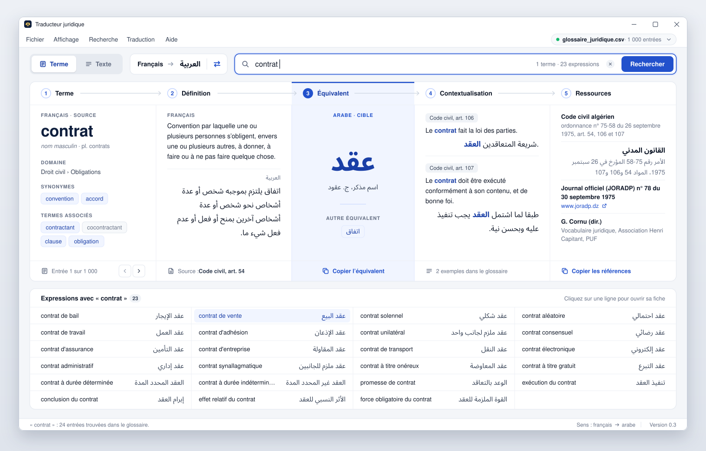

Les cinq champs de l'enchaînement sont réunis dans une seule fiche. L'équivalent est au centre.
Les autres entrées du glossaire qui contiennent le terme sont listées sous la fiche.

### Écran « Texte »

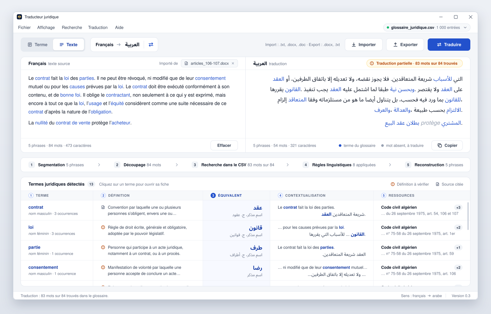

Dans les deux zones, les termes du glossaire sont en bleu. Le mot absent du glossaire reste en
français, en gris italique. Le tableau du bas reprend les cinq champs pour chaque terme trouvé.

### Trois autres cas de l'écran « Terme »

| Fichier | Ce qu'il montre |
| --- | --- |
| [`03-terme-deux-sens.svg`](maquette/proposition/03-terme-deux-sens.svg) | Le cas le plus courant : la définition porte la mention « À vérifier » et le glossaire ne donne pas d'exemple. Ici, le terme (« action ») a en plus deux sens. |
| [`04-terme-accueil.svg`](maquette/proposition/04-terme-accueil.svg) | L'écran à l'ouverture de l'application, avant toute recherche. |
| [`05-terme-introuvable.svg`](maquette/proposition/05-terme-introuvable.svg) | Le terme cherché n'est pas dans le glossaire. |

### Défauts relevés dans la version 0.2 et correction proposée

Les défauts ont été relevés sur des captures de l'application faites sous Linux, à trois tailles de
fenêtre (1440 × 860, 1080 × 620 et 900 × 560). Sous Windows, l'aspect des caractères peut différer.

| Défaut relevé | Proposition |
| --- | --- |
| À l'ouverture, cinq grandes boîtes presque vides. | Un seul panneau : rappel de l'enchaînement, invitation à chercher, cinq exemples. |
| Trois barres empilées en haut de la fenêtre. Le sens de traduction est loin de la barre de recherche. | Les menus, puis une seule barre : choix de l'écran, sens de traduction, recherche. |
| Le bouton en haut à droite change d'un écran à l'autre (« Ouvrir un glossaire… », ou « Importer » et « Exporter »). | Le glossaire chargé est toujours indiqué en haut à droite. « Importer », « Exporter » et « Traduire » sont dans la barre de l'écran « Texte ». |
| Les puces de résultats occupent une à trois lignes et repoussent les champs vers le bas. Au-delà de huit résultats, il faut préciser la recherche. | Toutes les autres entrées trouvées sont listées sous la fiche, sur des lignes régulières. |
| Les mêmes expressions figurent deux fois : en puces sous la recherche et dans le champ ③. | Une seule liste, sous la fiche. |
| Champ ③ : la liste des expressions est coupée par le pied du champ ; il faut la faire défiler. | Le champ ③ ne contient plus que l'équivalent, sa catégorie, son pluriel et ses autres équivalents. |
| Cinq cartes séparées, de même hauteur : certaines sont à moitié vides, une autre déborde. | Une seule fiche à cinq colonnes. La colonne ③, au centre, est mise en avant. |
| La source de la définition est coupée : « à vérifier (définition d'exem… ». | La mention « À vérifier » s'affiche en entier, en orange, avec un signe. |
| Champ ④ sans exemple (969 entrées sur 1 000) : une phrase grise en haut d'une grande boîte vide. | Un message centré, qui dit quelles colonnes du CSV remplir. |
| Les lignes arabes sont plus espacées que les lignes françaises. Dans les expressions, l'arabe est écrit plus bas que le français. | Interlignes réguliers. Le français et l'arabe d'une même ligne sont alignés. |
| Ressources : icône à gauche pour une référence française, à droite pour une référence arabe. | Une liste simple, sans icône ; les références arabes sont alignées à droite. |
| Terme à deux sens : deux puces (« action (دعوى) », « action (سهم) ») mêlées aux autres résultats. | Un onglet par sens en haut de la fiche, et un avertissement. |
| Terme introuvable : le message est une ligne grise sous la recherche ; les cinq boîtes vides restent affichées. | Un panneau avec le message et les termes proches. |
| Écran « Texte » : dans un texte juridique, la plupart des mots sont écrits en orange. | Les termes sont en bleu. L'orange est réservé aux avertissements. |
| L'étiquette d'état de la traduction passe à gauche ou à droite selon la langue. | Elle reste à droite et donne le nombre de mots trouvés. |
| Tableau des termes : une ou deux rangées visibles ; les termes longs sont coupés. | Rangées de deux lignes : quatre rangées visibles. Un signe indique si la définition est à vérifier. |
| Barre d'état : nom du fichier, nombre d'entrées, encodage, « Prototype ». | Un message court et le sens de traduction. |
| Petite fenêtre (1080 × 620 et moins) : champs illisibles, une barre de défilement par champ. | **Non dessiné.** À traiter au moment de programmer. |

### Ce que la proposition change dans l'usage

Par rapport à la version 0.2 :

- Les puces de résultats disparaissent. Le nombre de résultats s'affiche dans la barre de
  recherche ; les autres entrées trouvées sont sous la fiche.
- Les expressions quittent le champ ③. À leur place, le champ affiche les autres équivalents
  (colonne des synonymes de la langue cible), que la version 0.2 ne montre pas dans ce champ.
- Un terme à plusieurs sens s'ouvre avec un onglet par sens.
- Deux boutons, dans le pied du champ ①, ouvrent l'entrée précédente et l'entrée suivante du
  glossaire.
- Le bouton « Traduire » passe de la zone du texte source à la barre d'outils.
- L'étiquette « Traduction terminée » ou « partielle » donne aussi le nombre de mots trouvés.
- Dans le tableau, la colonne ④ choisit, quand c'est possible, un passage du texte dont la
  traduction contient l'équivalent.
- Un clic sur le nom du glossaire, en haut à droite, sert à ouvrir un autre glossaire ou à le
  recharger.

### Ce qui n'est pas dessiné

- le sens arabe → français ;
- l'écran « Texte » avant la traduction ;
- les petites fenêtres ;
- les boîtes de dialogue (aide, format du glossaire, à propos).

### Contenu des dessins

Le contenu vient du glossaire fourni et de l'application : entrées « contrat » et « action », texte
d'exemple de l'écran « Texte », sa traduction et les termes relevés. Trois éléments sont donnés à
titre d'illustration : le nom du fichier importé, le numéro de version, et les passages de la
colonne ④ du tableau, choisis à la main.

Les dessins sont prévus pour la police Segoe UI de Windows. Ils ont été vérifiés dans Chromium avec
la police Selawik, de mêmes dimensions ; ils n'ont pas été vérifiés sous Windows.

Les cinq fichiers sont écrits par le script `outils/maquette/generer.py`. Ce script ne fait pas
partie de l'application.

## Maquette de l'application de bureau

Maquette SVG des deux écrans du prototype (version 0.1). Les deux écrans sont programmés (voir
[L'application](#lapplication-version-015)). L'application actuelle ne ressemble plus à cette
maquette : elle est gardée pour mémoire.

### Écran 1 — Recherche d'un terme

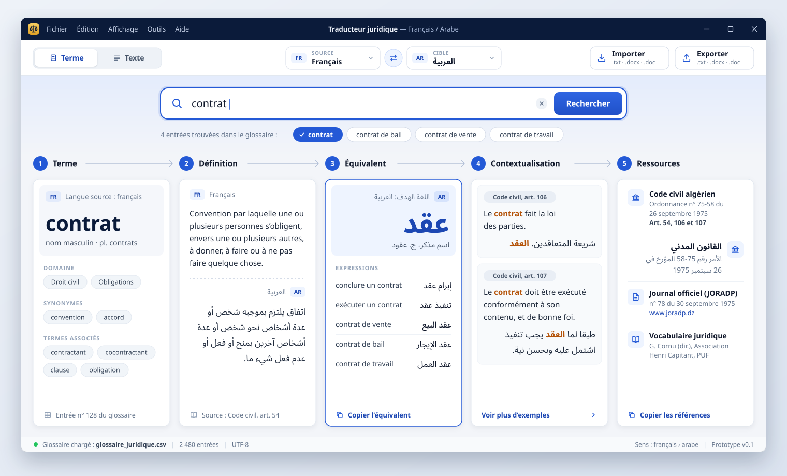

Le terme saisi dans la barre de recherche est cherché dans le glossaire CSV. Le résultat
s'affiche dans cinq champs placés côte à côte, un par élément de l'enchaînement.

### Écran 2 — Traduction d'un texte

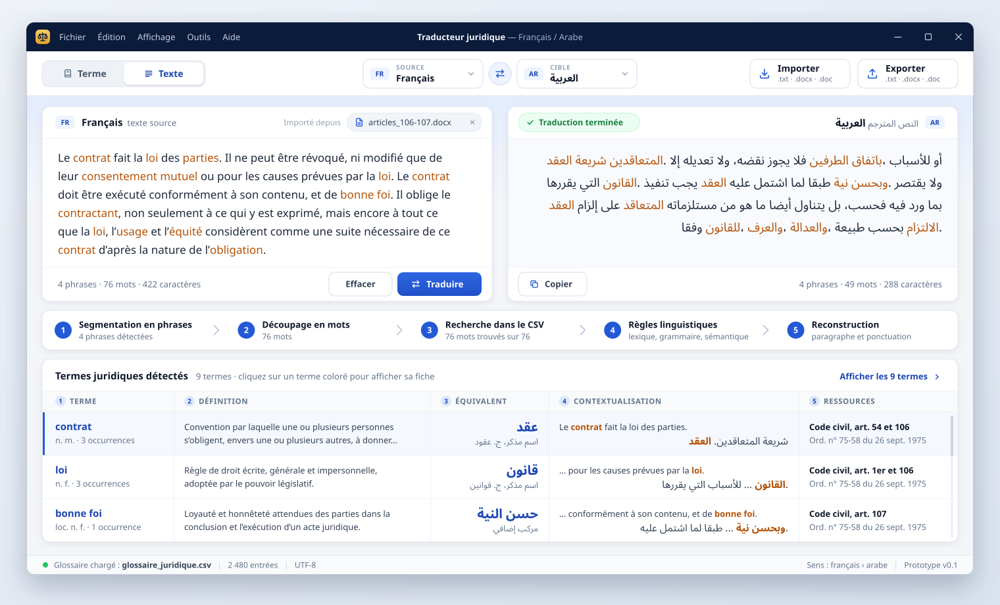

Le paragraphe source est saisi, collé ou importé dans la zone de texte de gauche ; sa
traduction apparaît dans la zone de droite (écriture de droite à gauche pour l'arabe).
La bande centrale reprend les étapes de l'algorithme : segmentation en phrases, découpage
en mots, recherche de chaque mot dans le CSV, application des règles lexicales,
grammaticales et sémantiques, puis reconstruction du paragraphe. Le tableau du bas
applique l'enchaînement de l'écran 1 aux termes juridiques repérés dans le texte.

### Fonctionnalités demandées et emplacement dans la maquette

| Fonctionnalité | Emplacement |
| --- | --- |
| Champs horizontaux pour chaque élément de l'enchaînement | Écran 1 : les cinq cartes numérotées. Écran 2 : les cinq colonnes du tableau. |
| Import et export de fichiers `.txt`, `.docx`, `.doc` | Boutons **Importer** et **Exporter** de la barre d'outils (les deux écrans). Le fichier importé est rappelé dans l'en-tête de la zone source (écran 2). |
| Barre de recherche des mots | Écran 1, en haut, avec les entrées correspondantes du glossaire. |
| Zones de texte pour un paragraphe | Écran 2 : zone source et zone cible. |

Éléments communs aux deux écrans : le sélecteur **Terme / Texte**, le choix du sens de
traduction (le bouton ⇄ inverse français et arabe) et la barre d'état qui indique le
fichier CSV chargé.

### Points à valider

- **Structure du CSV.** L'application lit les colonnes décrites dans la section
  [Le glossaire CSV](#le-glossaire-csv). Il reste à confirmer que le glossaire du projet
  contient une définition, des exemples et des ressources pour chaque terme, et pas seulement
  le mot et sa traduction. Un fichier limité aux deux colonnes de termes est accepté : les
  champs ②, ④ et ⑤ restent alors vides.
- **Nom de l'application.** « Traducteur juridique » est un nom provisoire.
- **Cas non dessinés.** Le sens arabe → français et le cas d'un mot absent du CSV ne figurent
  pas dans la maquette. Ils sont programmés dans l'application : mêmes écrans avec les langues
  inversées, et proposition des termes proches quand rien n'est trouvé.

### Contenu d'exemple de la maquette

Les textes juridiques sont des extraits du Code civil algérien (ordonnance n° 75-58 du
26 septembre 1975), articles 54, 106 et 107, dans leurs versions française et arabe. Dans
le paragraphe arabe de l'écran 2, une virgule de l'article 106 est remplacée par un point
pour obtenir quatre phrases, comme en français.

Le reste est donné à titre d'illustration : nom et taille du glossaire, numéro d'entrée,
nom du document importé, définitions de « loi » et de « bonne foi », expressions,
synonymes et termes associés.

### Modifier la maquette

Les deux fichiers du dossier `maquette/` sont des SVG autonomes : ni image ni police
externe, et les textes restent des textes. Ils s'affichent dans un navigateur et se
modifient dans un éditeur de code ou un éditeur vectoriel (rendu non vérifié dans Inkscape
et Figma). Ils utilisent les polices du système (Segoe UI sous Windows), le rendu peut
donc varier légèrement d'un appareil à l'autre.
